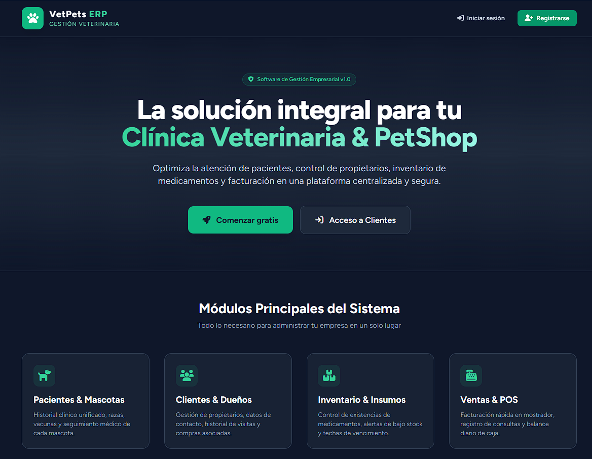
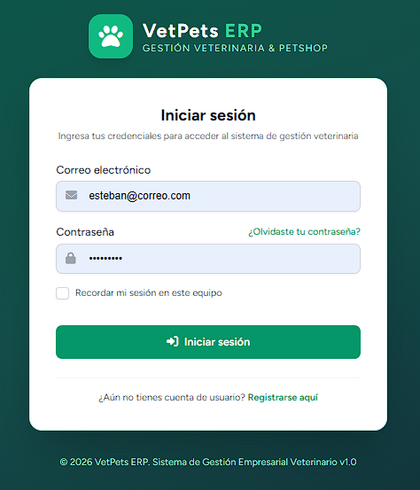
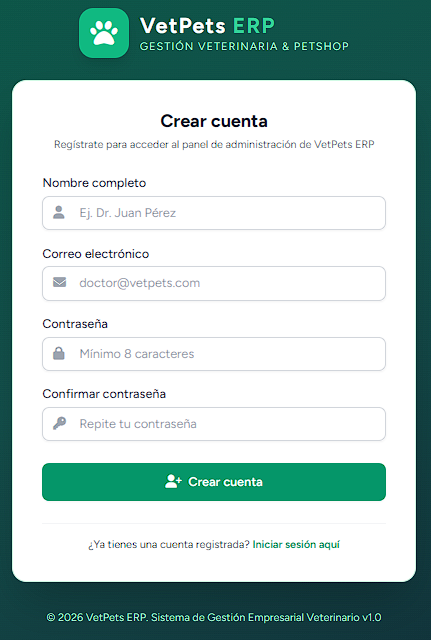
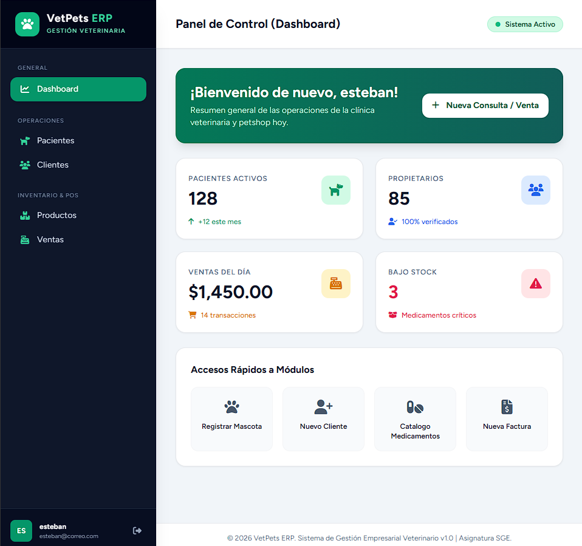

# VetPets ERP - Sistema de Gestión Empresarial Veterinario

**VetPets ERP** es una plataforma web desarrollada en **Laravel 11+**, diseñada para la administración integral de Clínicas Veterinarias y Tiendas de Mascotas (PetShop).

**Integrantes:** Jhon Esteban Molina Echavarria - Heiber Lozano Mercado  
**Asignatura:** Software de Gestión Empresarial (COTECNOVA)

---

## 🛠️ Estado del Proyecto (Avanzado hasta Clase 9: Integración Transaccional, Módulo de Clientes & Dashboard con KPIs)

El sistema integra arquitectura empresarial robusta:
- **Operaciones Transaccionales ACID:** Implementación de `DB::transaction` en la capa de servicios (`SaleService`) para el registro atómico de ventas y sus líneas de detalle.
- **Reglas de Negocio Automatizadas:** Descuento automático de stock de productos al consolidar una venta, validación de stock disponible antes de persistir la operación y regla de negocio inversa: reversión/restitución de inventario al anular ventas.
- **Módulo Integral de Clientes / Propietarios:** CRUD reactivo (`Owner` / `Client`) con protección de integridad referencial (no permite eliminar clientes con ventas activas).
- **Control de Acceso Basado en Roles (RBAC):** Seguridad granular con **Spatie Laravel-Permission**, middleware `HasMiddleware` y protección de vistas mediante directivas Blade `@can`.
- **Dashboard Ejecutivo en Tiempo Real:** Métricas clave del negocio (KPIs dinámicos: Productos Activos, Alertas de Stock Bajo $\le$ Mínimo, Total Clientes y Facturación del Mes) junto con el ranking del **Top 5 de Productos Más Vendidos** en el mes actual.
- **Persistencia Segura y Borrado Lógico:** `SoftDeletes` en Productos, Categorías y Ventas.

---

### 🗄️ Módulos y Entidades del Sistema

| Módulo | Entidad / Tabla | Modelo Eloquent | Característica Especial | Descripción |
| :--- | :--- | :--- | :---: | :--- |
| **Catálogo** | `categories` | `Category` | ♻️ `SoftDeletes` | Clasificación de servicios médicos y productos. Vistas completas con contador de productos asociados. |
| **Productos** | `products` | `Product` | ♻️ `SoftDeletes` | Catálogo con precios, stock actual, stock mínimo y control de alerta. |
| **Clientes** | `owners` | `Owner` | 🛡️ Integridad | Expedientes de propietarios de pacientes con validación contra ventas asociadas. |
| **Teléfonos** | `owner_phones` | `OwnerPhone` | N/A | Números de contacto telefónico de propietarios. |
| **Pacientes** | `pets` | `Pet` | N/A | Historias biológicas y clínicas de mascotas atendidas. |
| **Proveedores** | `providers` | `Provider` | N/A | Registro de laboratorios e insumos médicos veterinarios. |
| **Ventas POS** | `sales` | `Sale` | ⚡ Transaccional / ♻️ `SoftDeletes` | Encabezado de facturación consecutiva (`VET-YYYYMMDD-####`), subtotal, IVA (19%) y total. |
| **Líneas de Venta**| `sale_details` | `SaleDetail` | 📦 Movimiento Stock | Detalle de productos vendidos, cantidades, precio unitario y subtotal por línea. |
| **Seguridad** | `roles` / `permissions` | Spatie Models | 🛡️ `Spatie RBAC` | Matriz de permisos por rol (`admin`, `almacenista`, `vendedor`). |
| **Dashboard** | `DashboardController` | Eloquent Aggregates | 📊 KPIs & Analytics | Indicadores clave en tiempo real y Top 5 de productos más vendidos. |

---

## 🔑 Credenciales y Matriz de Roles (Spatie RBAC)

* **Servidor Local:** **`http://localhost:8060`**
* **Página de Login:** **`http://localhost:8060/login`**

| Usuario / Correo | Contraseña | Rol Asignado | Permisos Concedidos |
| :--- | :--- | :---: | :--- |
| **`admin@vetpets.com`** | `password123` | **Administrador (`admin`)** | Acceso total: Configuración global, catálogo, clientes, ventas, anulación y visualización de todos los KPIs. |
| **`esteban@vetpets.com`** | `password123` | **Almacenista (`almacenista`)** | Gestión completa de inventario, productos y categorías (Ver, crear, editar). Restringido de registrar ventas. |
| **`heiber@vetpets.com`** | `password123` | **Vendedor (`vendedor`)** | Consulta de catálogo, registro de clientes y emisión de ventas POS. Restringido de eliminar productos o modificar categorías. |

---

## 📸 Evidencias Técnicas e Interfaz del Sistema (Clase 9: Integración de Módulos & Dashboard)

### 👥 1. Módulo de Clientes / Propietarios (`/clients` Index)
Listado reactivo de clientes registrados en el sistema con búsqueda, visualización de documento, teléfono y correo electrónico:


### 🧾 2. Formulario de Nueva Venta con Productos y Cálculo Dinámico de Totales
Interfaz de caja / punto de venta (POS) donde se seleccionan el cliente y los productos, calculando automáticamente en tiempo real los subtotales, el IVA (19%) y el gran total:


### 🗄️ 3. Verificación de Transaccionalidad y Descuento de Stock en MySQL
Comprobación en motor de base de datos MySQL evidenciando la inserción atómica de la cabecera en `sales`, sus ítems en `sale_details` y la deducción exacta del stock en la tabla `products`:


### ⚠️ 4. Regla de Negocio: Control de Error por Stock Insuficiente
Manejo de excepciones empresariales impidiendo la venta cuando la cantidad solicitada excede las existencias reales en bodega, emitiendo una alerta clara sin corromper la base de datos:


### 📊 5. Dashboard Ejecutivo con KPIs Dinámicos y Ranking Top 5
Panel de mando para la toma de decisiones con tarjetas de métricas en vivo (Productos Activos, Alertas de Stock Bajo, Clientes, Facturación del Mes) y tabla de los 5 productos más vendidos:


### 🔄 6. Anulación de Venta y Restitución Automática de Inventario
Ejecución de la regla de negocio inversa: al anular una venta desde el listado, el sistema cambia su estado a `anulada`, aplica Soft Delete y devuelve íntegramente las unidades al inventario físico:


---

## 📸 Evidencias Técnicas Anteriores (Clase 8: Roles, Permisos Spatie & Soft Delete)

<details>
<summary><strong>🔍 Ver capturas y validaciones técnicas de la Clase 8 (Desplegar)</strong></summary>

### 🛡️ 1. Estructura de Roles y Permisos en MySQL
Muestra la semilla de roles (`admin`, `vendedor`, `almacenista`) y permisos creados mediante Spatie:


### ⚡ 2. Verificación de Asignación de Roles en Laravel Tinker
Comprobación en tiempo de ejecución del rol del usuario mediante `$user->hasRole('admin')`:


### 🔐 3. Protección de Controladores mediante `HasMiddleware`
Implementación de `HasMiddleware` e inyección de permisos por acción en controladores de Laravel:


### ♻️ 4. Eliminación Lógica (Soft Delete) y Notificación al Usuario
Envío de un producto a la papelera sin destrucción física de la base de datos:


### 🗃️ 5. Registro de la Columna `deleted_at` en MySQL
Evidencia del timestamp grabado en MySQL en la columna `deleted_at` tras aplicar el Soft Delete:


### 🚫 6. Bloqueo de Seguridad - Error 403 (Acceso Denegado / Forbidden)
Respuesta del sistema al intentar ingresar a una ruta protegida sin contar con el permiso requerido:


</details>

---

### 🖥️ Vistas Principales de la Interfaz

| Landing Page (Página de Inicio) | Login Personalizado |
|---|---|
|  |  |

| Registro de Usuarios | Panel de Control (Dashboard Base) |
|---|---|
|  |  |

---

## 🚀 Despliegue e Inicialización Local (Docker Sail)

Para poner a punto el proyecto desde cero en una máquina local:

```bash
# 1. Clonar el repositorio
git clone https://github.com/moliech/ERP_Veterinaria.git
cd ERP_Veterinaria

# 2. Instalar dependencias de PHP y entorno
composer install
cp .env.example .env
php artisan key:generate

# 3. Levantar contenedores Docker Sail
./vendor/bin/sail up -d

# 4. Ejecutar migraciones y sembrado de datos (Módulos, Roles/Permisos y Datos Iniciales)
./vendor/bin/sail php artisan migrate:fresh --seed
./vendor/bin/sail php artisan db:seed --class=RolePermissionSeeder

# 5. Compilar assets de frontend (Vite / Tailwind)
./vendor/bin/sail npm install
./vendor/bin/sail npm run build
```

---

## 🏛️ Estructura del Repositorio

```text
ERP_Veterinaria/
├── app/                       # Arquitectura y Lógica de Negocio
│   ├── Http/Controllers/      # Controladores protegidos (SaleController, ClientController, DashboardController, CategoryController, ProductController)
│   ├── Http/Requests/         # FormRequests de validación avanzada
│   ├── Models/                # Category, Product, Owner, OwnerPhone, Pet, Provider, Sale, SaleDetail (SoftDeletes)
│   └── Services/              # SaleService (Lógica desacoplada con DB::transaction y reglas de stock)
├── database/                  # Migraciones y Seeders
│   ├── migrations/            # Tablas base + clients + sales + sale_details + SoftDeletes + Spatie Tables
│   └── seeders/               # Seeders de dominio y RolePermissionSeeder
├── docs/                      # Documentación Técnica y Evidencias
│   ├── analisis.md            # Documento de Análisis del Negocio
│   ├── diccionario.md         # Diccionario de Datos del Esquema
│   ├── diagrama_mer.md        # Modelo Entidad-Relación (MER en Mermaid)
│   └── visual/                # Capturas de pantalla de la Interfaz y Evidencias Clase 8 y Clase 9
├── public/                    # Archivos públicos y manifest compilado por Vite
├── resources/                 # Vistas Blade (@can), componentes Tailwind CSS y JavaScript
├── routes/                    # Rutas web protegidas con auth, roles y restore (web.php)
├── compose.yaml               # Configuración de Docker Sail (Puerto 8060 & MySQL 3306)
├── composer.json              # Dependencias de PHP / Laravel (spatie/laravel-permission)
└── README.md                  # Documentación principal del repositorio
```

---

## 📄 Documentación Técnica

* 📋 **[Análisis de la Empresa](docs/analisis.md)**: Estructura general, procesos clave (Ventas, Compras, Inventarios) y listado de entidades.
* 📖 **[Diccionario de Datos](docs/diccionario.md)**: Especificación técnica detallada de cada tabla, campos, tipos de dato y restricciones.
* 🗂️ **[Diagrama Entidad-Relación](docs/diagrama_mer.md)**: Especificación visual y técnica del MER en sintaxis Mermaid.

---

## 🎨 Identidad Gráfica y Tecnologías

### Paleta de Colores
| Tono | Nombre | Código Hexadecimal | Muestra Visual |
| :--- | :--- | :---: | :---: |
| **Primario Corporativo** | Verde Esmeralda | `#059669` | 🟩 `` |
| **Fondo & Headers** | Slate Dark | `#0f172a` | ⬛ `` |
| **Superficie Neutra** | Grises Neutros | `#f8fafc` | ⬜ `` |

- **Librerías:** Spatie Laravel Permission, Laravel Breeze, Tailwind CSS, Font Awesome 6.5, Alpine.js.
- **Entorno:** PHP 8.x, MySQL 8.4, Docker Sail, Node.js 22 LTS, Vite 6.
