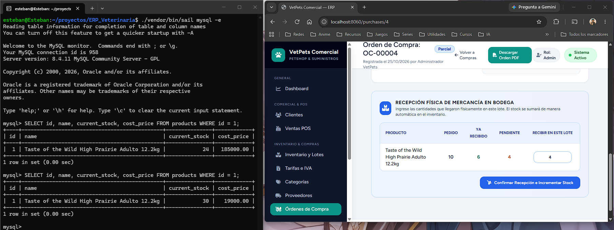
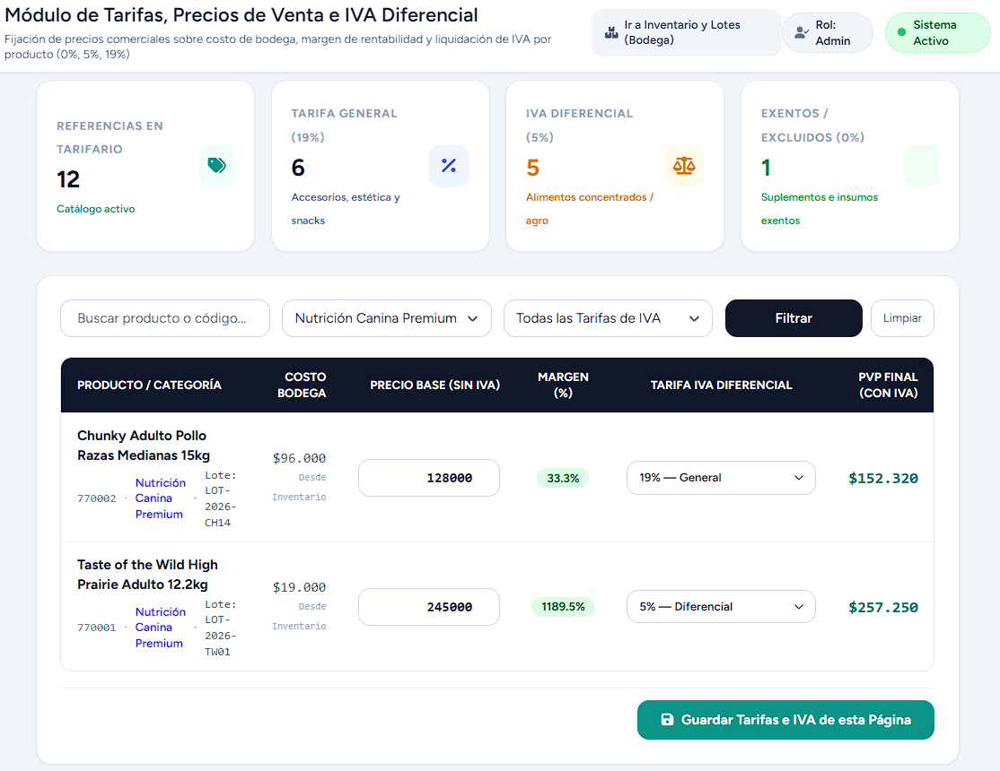
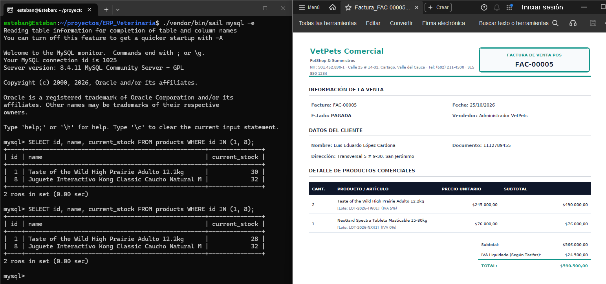
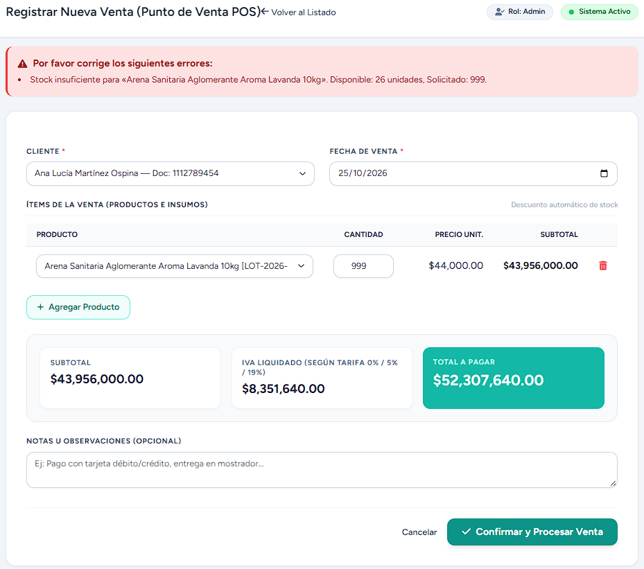
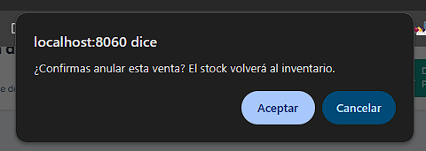
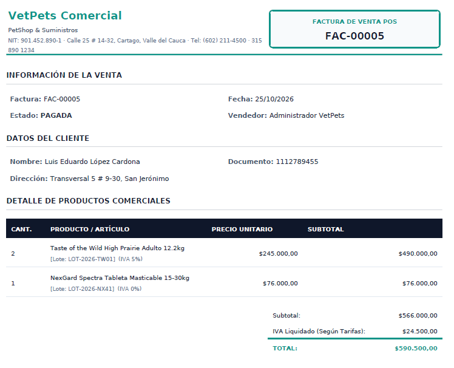
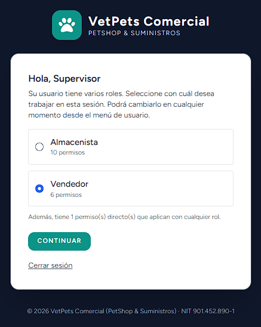
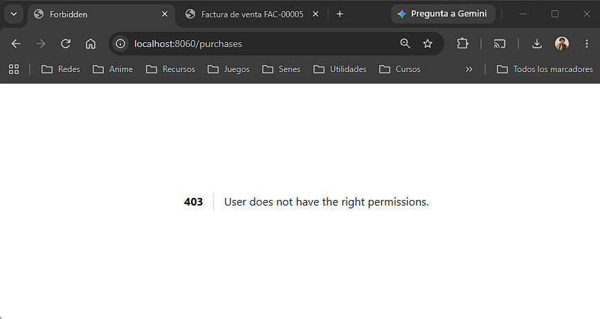
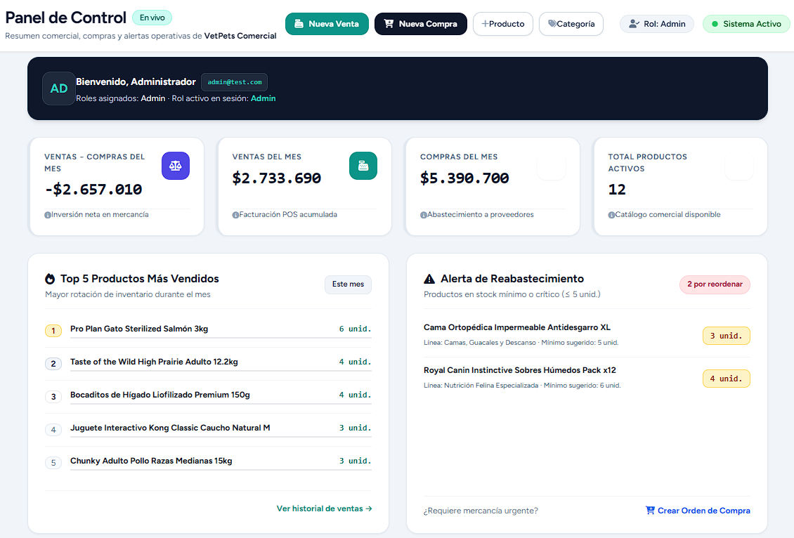

# VetPets ERP — Sistema de Gestión Empresarial para Tienda de Mascotas (PetShop)

**VetPets ERP** es una aplicación web empresarial desarrollada en **Laravel 11+, MySQL 8.4 y Docker Sail**, diseñada para la administración comercial integral de tiendas de mascotas. El sistema integra el ciclo comercial completo: catálogo, inventario y control de lotes con fechas de vencimiento, módulo de tarifas comerciales con IVA diferencial (0 %, 5 % y 19 %), proveedores, órdenes de compra con recepción parcial o total, facturación POS, documentos PDF, dashboard gerencial y un esquema de seguridad con rol activo en sesión.

* **Integrantes:** Jhon Esteban Molina Echavarria · Heiber Lozano Mercado
* **Asignatura:** Software de Gestión Empresarial (COTECNOVA - 2026)
* **Docente:** Ing. Jhon James Cano Sánchez
* **Etiqueta (Tag) de Entrega Oficial:** `avance-2`
* **Video de Sustentación:** [Ver Video en Google Drive](https://drive.google.com/drive/folders/154DKFAKOyDlauuwDyoacq1mFkrTdBTYA?usp=sharing)
* **Documento del Avance (Segundo Corte):** [Avance2_VetPets_Molina_Lozano.md](docs/avance2/Avance2_VetPets_Molina_Lozano.md)

---

## 📚 Índice de Entregas y Documentación del Proyecto

El repositorio mantiene la trazabilidad histórica de los avances y clases del semestre:

### 📑 Documentos Oficiales
* 📋 **[Documento de Avance — Segundo Corte (Markdown)](docs/avance2/Avance2_VetPets_Molina_Lozano.md)**: Informe completo con portada, resumen, análisis de negocio, modelo ER, 17 reglas de negocio, matriz de seguridad, integración y capturas.
* 📋 **[Análisis de la Empresa](docs/analisis.md)**: Modelo de negocio de PetShop & Retail, procesos clave y catálogo de entidades.
* 📖 **[Diccionario de Datos](docs/diccionario.md)**: Especificación técnica detallada de cada tabla, campos, tipos de dato, llaves y restricciones.
* 🗂️ **[Diagrama Entidad-Relación](docs/diagrama_mer.md)**: Diagrama MER en formato Mermaid con las tablas de compras, ventas, lotes, tarifas y seguridad.

### 📅 Histórico de Hitos y Clases Anteriores
* **[Clase 7: Roles y Permisos con Spatie](#-clase-7-y-8-roles-permisos-spatie--soft-delete)**: Configuración de roles (`admin`, `almacenista`, `vendedor`), `HasMiddleware` y Soft Delete.
* **[Clase 8 y 9: Integración de Módulos & Dashboard](#-clase-9-integración-de-módulos--dashboard-con-kpis)**: Clientes, transacciones con `DB::transaction`, descuento de stock y KPIs.
* **Clase 10: Compras, Proveedores y Recepción Parcial**: Órdenes de compra (`purchases`), actualización de costo y recepción parcial/total.
* **Clase 10.5 y Adicionales: Seguridad Avanzada, Rol Activo y Marca Blanca**: Matriz interactiva de permisos, Rol Activo en sesión, Identidad Corporativa y Gestión de Módulos.
* **Avance 2: Separación de Inventario y Lotes vs. Tarifas e IVA Diferencial**: Control de lotes perecederos, semáforo de vencimiento y cálculo de IVA al 0 %, 5 % y 19 %.

---

## 🚀 Despliegue e Inicialización Local (Docker Sail)

Para levantar el proyecto desde cero en una máquina local:

```bash
# 1. Clonar el repositorio
git clone https://github.com/moliech/ERP_Veterinaria.git
cd ERP_Veterinaria

# 2. Configurar variables de entorno e instalar dependencias
cp .env.example .env
composer install

# 3. Levantar contenedores Docker Sail (Web en puerto 8060, MySQL en 3307->3306)
./vendor/bin/sail up -d

# 4. Generar clave, ejecutar migraciones estructuradas y sembrado de datos iniciales
./vendor/bin/sail artisan key:generate
./vendor/bin/sail artisan migrate --seed

# 5. Compilar assets de frontend (Vite / Tailwind CSS)
./vendor/bin/sail npm install
./vendor/bin/sail npm run build
```

El sistema quedará disponible en: **`http://localhost:8060`**

---

## 🔑 Credenciales y Usuarios de Prueba por Rol

* **Servidor Local:** **`http://localhost:8060`**
* **Página de Login:** **`http://localhost:8060/login`**

| Usuario / Correo | Contraseña | Rol Asignado | Permisos y Propósito de Prueba |
| :--- | :--- | :---: | :--- |
| **`admin@test.com`** | `password` | **Administrador (`admin`)** | Acceso total: Configuración global, catálogo, clientes, ventas, compras, anulación, matriz de permisos, identidad corporativa y gestión de módulos. |
| **`almacenista@test.com`** | `password` | **Almacenista (`almacenista`)** | Gestión de bodega: categorías, inventario y lotes, proveedores y recepción de órdenes de compra. Sin acceso a ventas POS. |
| **`vendedor@test.com`** | `password` | **Vendedor (`vendedor`)** | Operación de mostrador: consulta de productos, registro de clientes y emisión de ventas POS. Sin acceso a compras ni proveedores. |
| **`supervisor@test.com`** | `password` | **Múltiples Roles (`supervisor`)** | **Demostración de Rol Activo:** Posee los roles `vendedor` y `almacenista`. Al iniciar sesión elige con cuál rol operar y puede conmutarlo desde el menú. Además, cuenta con el permiso directo `ver-reportes` para consultar el Dashboard en cualquier rol. |

---

## 🗄️ Módulos y Entidades del Sistema (Segundo Corte)

| Módulo | Entidad / Tabla | Controlador / Servicio | Característica Especial | Descripción |
| :--- | :--- | :--- | :---: | :--- |
| **Categorías** | `categories` | `CategoryController` | ♻️ `SoftDeletes` | Clasificación de familias comerciales del catálogo (alimentos, snacks, higiene, accesorios, medicamentos). |
| **Inventario y Lotes**| `products` | `ProductController` | 🏷️ Lotes / ♻️ `SoftDeletes` | Control de stock físico, costo de compra, código de lote y semáforo de vencimiento (*Lote vigente*, *Próximo a vencer*, *Lote vencido*, *No perecedero*). |
| **Tarifas e IVA** | `products` | `PricingController` | 💵 IVA Diferencial | Fijación del precio base de venta, cálculo automático del margen de utilidad (%) y asignación de IVA (**0 % Exento**, **5 % Alimentos/Insumos**, **19 % General**). |
| **Clientes** | `owners`, `owner_phones`| `ClientController` | 🛡️ Integridad Referencial | Directorio de clientes con documento, dirección, correo y múltiples teléfonos. |
| **Ventas POS** | `sales`, `sale_details` | `SaleService` | ⚡ `DB::transaction` | Facturación en mostrador con liquidación de IVA por producto, bloqueo de lotes vencidos, descuento de stock y anulación con devolución. |
| **Proveedores** | `providers` | `ProviderController` | ♻️ `SoftDeletes` | Catálogo de distribuidores mayoristas con NIT, teléfono y contacto. |
| **Órdenes de Compra** | `purchases`, `purchase_details` | `PurchaseService` | 📦 Recepción Parcial | Gestión de pedidos a proveedores con recepción parcial o total que suma stock y actualiza el costo de compra en bodega. |
| **Documentos PDF** | Vistas Blade | `DomPDF` | 📄 PDFs Corporativos | Generación de facturas de venta y órdenes de compra en PDF con encabezado dinámico y desglose fiscal. |
| **Dashboard** | Consultas agregadas | `DashboardController` | 📊 KPIs en Vivo | Indicadores mensuales (ventas, compras, balance), los cinco productos más vendidos, alertas de reabastecimiento y lotes por vencer. |
| **Seguridad** | `roles`, `permissions` | Spatie + `SecurityPolicyService` | 🛡️ Rol Activo | Matriz interactiva de permisos, asignación de rol activo en sesión y protección contra auto-desactivación del admin. |
| **Identidad Corporativa**| `company_settings` | `CompanySettingController` | 🎨 Marca Blanca | Configuración de razón social, NIT, color institucional reactivo, ícono y pie de factura. |
| **Gestión de Módulos**| `system_modules` | `SystemModuleController` | 🔌 Modularidad | Activación y desactivación dinámica de módulos con validación de dependencias. |

---

## 📸 Evidencias Técnicas e Interfaz del Sistema (Segundo Corte — `docs/avance2/`)

### 📦 1. Recepción Parcial de Compra y Aumento de Stock en MySQL
Detalle de la orden de compra en estado `parcial` tras recibir 6 de 10 unidades, acompañada de la consulta SQL que evidencia el incremento de `current_stock` y la actualización de `cost_price`:


### 🏷️ 2. Módulo de Tarifas e IVA Diferencial (`/tarifas`)
Configuración de precios comerciales con visualización del costo de compra, margen de rentabilidad calculado en vivo y asignación de tarifas de IVA (0 % exento, 5 % diferencial y 19 % general):


### 🧾 3. Venta POS con IVA Diferencial y Descuento en MySQL
Facturación en mostrador combinando productos con diferentes tarifas impositivas y consulta en base de datos demostrando la deducción de unidades en el inventario:


### ⚠️ 4. Reglas de Negocio: Control de Stock Insuficiente y Anulación
Manejo de excepciones empresariales impidiendo la venta sin existencias suficientes y comprobante de factura anulada con restitución de inventario:

| 4A. Alerta por Stock Insuficiente | 4B. Factura Anulada y Retorno de Stock |
| :---: | :---: |
|  |  |

### 📄 5. Factura de Venta Generada en PDF (`DomPDF`)
Documento formal descargable con encabezado de Identidad Corporativa, número consecutivo, lote de cada producto y discriminación del IVA:


### 🔐 6. Seguridad: Selección de Rol Activo y Bloqueo 403 Forbidden
Mecanismo de selección de rol activo al iniciar sesión y respuesta `403 Forbidden` al intentar ingresar a un módulo fuera del perfil en sesión:

| 6A. Selección de Rol Activo | 6B. Bloqueo 403 Forbidden |
| :---: | :---: |
|  |  |

### 📊 7. Dashboard de Control con Indicadores y Reabastecimiento
Panel principal con el balance mensual de operaciones, los cinco productos más vendidos, alertas de stock crítico y control de lotes con fechas de vencimiento:


---

## 📸 Evidencias Técnicas Anteriores

<details>
<summary><strong>🔍 Ver capturas y validaciones técnicas de la Clase 8 y Clase 9 (Desplegar)</strong></summary>

### 👥 Módulo de Clientes / Propietarios (Clase 9)


### 🧾 Formulario de Venta con Cálculo Dinámico


### 🗄️ Verificación de Stock en MySQL (Clase 9)


### 🛡️ Estructura de Roles y Permisos en MySQL (Clase 8)


### 🔐 Protección de Controladores con `HasMiddleware`


### ♻️ Eliminación Lógica (Soft Delete)


</details>

---

## 🏛️ Estructura del Repositorio

```text
ERP_Veterinaria/
├── app/                       # Arquitectura y Lógica de Negocio
│   ├── Http/Controllers/      # Controladores (Sale, Purchase, Product, Pricing, Client, Dashboard, Settings...)
│   ├── Http/Middleware/       # Middlewares (EnsureActiveRoleSelected, EnsureModuleEnabled, EnsureUserIsActive)
│   ├── Http/Requests/         # FormRequests de validación
│   ├── Models/                # Category, Product, Owner, Provider, Purchase, Sale, CompanySetting, SystemModule
│   └── Services/              # SaleService, PurchaseService, SecurityPolicyService (Transacciones ACID)
├── database/                  # Migraciones y Seeders
│   ├── migrations/            # Tablas comerciales, de abastecimiento, seguridad y configuración
│   └── seeders/               # Seeders con >= 10 registros por tabla comercial y transacciones iniciales
├── docs/                      # Documentación Técnica y Evidencias
│   ├── avance2/               # Documento oficial del Avance 2 y capturas de pantalla (figura1 a figura7)
│   ├── analisis.md            # Documento de Análisis del Negocio
│   ├── diccionario.md         # Diccionario de Datos del Esquema
│   ├── diagrama_mer.md        # Modelo Entidad-Relación (MER en Mermaid)
│   └── visual/                # Capturas de pantalla de clases anteriores
├── resources/views/           # Vistas Blade con soporte de Identidad Corporativa y paleta reactiva
├── routes/web.php             # Rutas web agrupadas por módulo activo y protegidas por RBAC
└── compose.yaml               # Configuración de Docker Sail (Puerto 8060 & MySQL 3307->3306)
```

---

## 🧪 Pruebas Automatizadas

El proyecto cuenta con una suite de pruebas automatizadas en PHPUnit cubriendo autenticación, roles, rol activo, permisos, reglas transaccionales, tarifas e IVA:

```bash
./vendor/bin/sail test
```
*Resultado de ejecución:* **30 tests passing (122 assertions)**.
