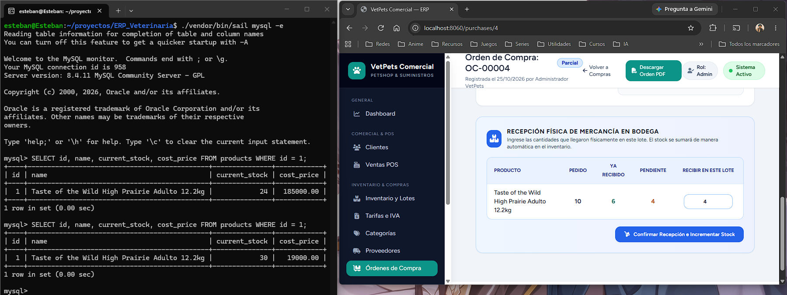
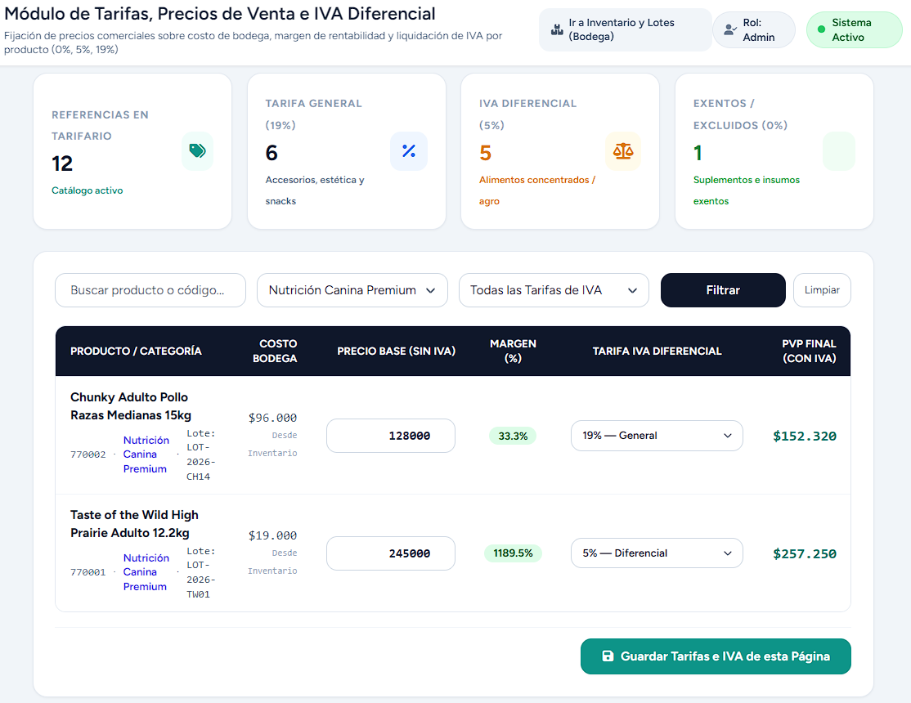
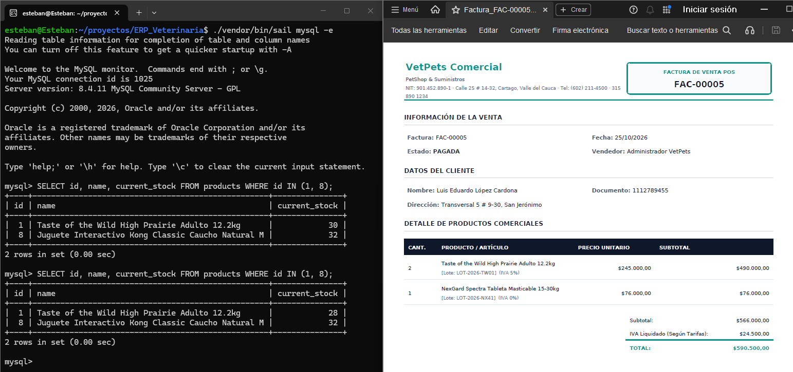
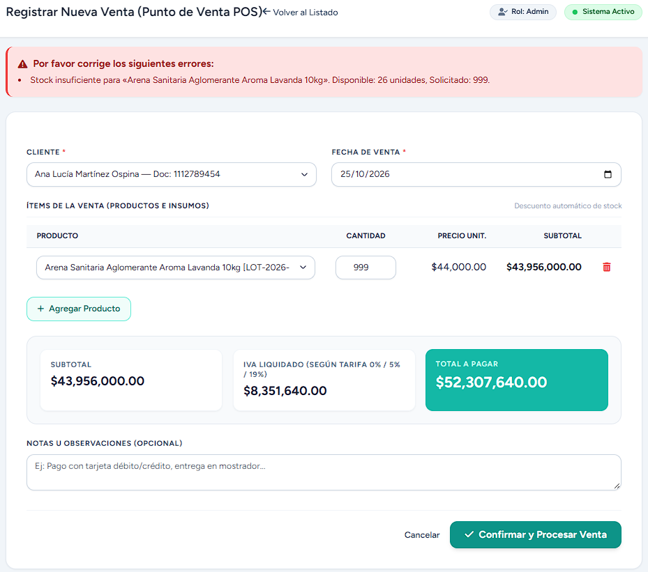
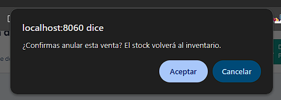
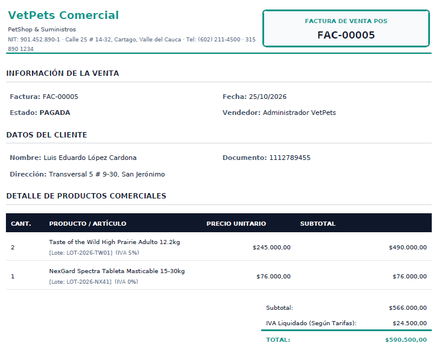
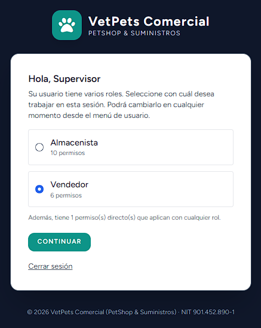
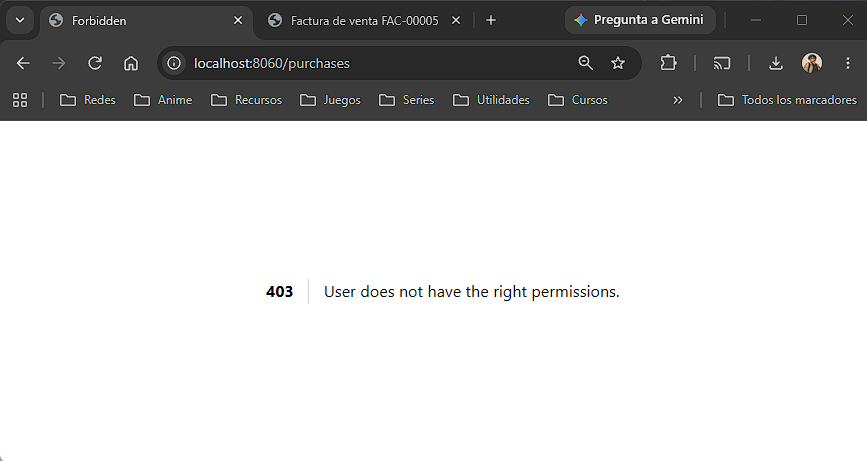
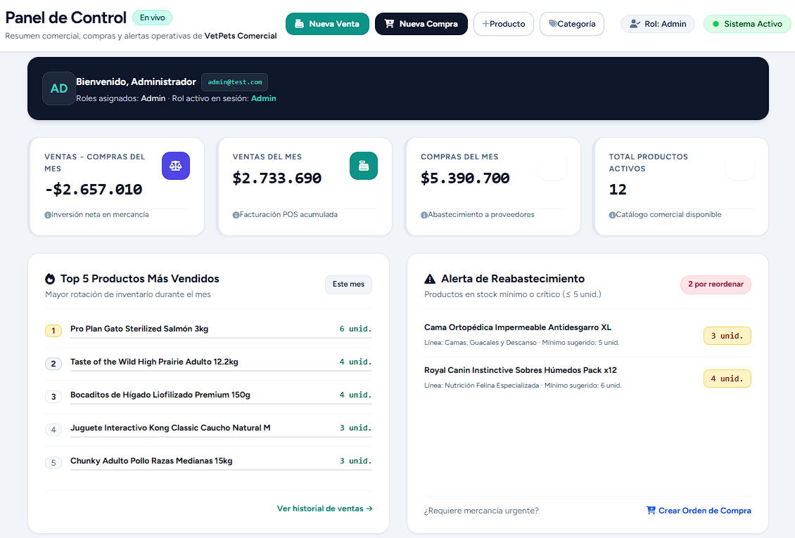

# VetPets ERP — Sistema de Gestión Empresarial para Tienda de Mascotas (PetShop)

[](https://github.com/moliech/ERP_Veterinaria/actions/workflows/pruebas.yml)


**VetPets ERP** es una aplicación web empresarial desarrollada en **Laravel 11+, MySQL 8.4 y Docker Sail**, diseñada para la administración comercial integral de tiendas de mascotas. El sistema integra el ciclo comercial completo: catálogo, inventario y control de lotes con fechas de vencimiento, módulo de tarifas comerciales con IVA diferencial (0 %, 5 % y 19 %), proveedores, órdenes de compra con recepción parcial o total, trazabilidad en **Kardex permanente**, facturación POS, documentos PDF, **API REST Sanctum v1**, **importación/exportación masiva en Excel**, **notificaciones multicanal (Mailpit + DB)**, **tareas programadas (Schedule)**, dashboard gerencial y un esquema de seguridad con **rol activo en sesión**.

* **Integrantes:** Jhon Esteban Molina Echavarria (`esteban`) · Heiber Lozano Mercado (`heiber`)
* **Asignatura:** Software de Gestión Empresarial (COTECNOVA - 2026)
* **Docente:** Ing. Jhon James Cano Sánchez
* **Entrega Oficial del Proyecto:** 25 de noviembre de 2026 (11:59 p. m.)
* **Sustentación / Exposición:** 26 de noviembre de 2026
* **Video de Sustentación:** [Ver Video en Google Drive](https://drive.google.com/drive/folders/154DKFAKOyDlauuwDyoacq1mFkrTdBTYA?usp=sharing)
* **Documento del Avance (Segundo Corte):** [Avance2_VetPets_Molina_Lozano.md](docs/avance2/Avance2_VetPets_Molina_Lozano.md)

---

## 📚 Índice de Entregas y Documentación del Proyecto

El repositorio mantiene la trazabilidad histórica de los avances y clases del semestre:

### 📑 Documentos Oficiales
* 📋 **[Documento de Avance — Segundo Corte (Markdown)](docs/avance2/Avance2_VetPets_Molina_Lozano.md)**: Informe completo con portada, resumen, análisis de negocio, modelo ER, 17 reglas de negocio, matriz de seguridad, integración y capturas.
* 📋 **[Análisis de la Empresa](docs/analisis.md)**: Modelo de negocio de PetShop & Retail, procesos clave y catálogo de entidades.
* 📖 **[Diccionario de Datos](docs/diccionario.md)**: Especificación técnica detallada de cada tabla, campos, tipos de dato, llaves y restricciones.
* 🗂️ **[Diagrama Entidad-Relación](docs/diagrama_mer.md)**: Diagrama MER en formato Mermaid con las tablas de compras, ventas, lotes, tarifas y seguridad.

### 📅 Histórico de Hitos y Clases Anteriores
* **[Clase 7: Roles y Permisos con Spatie](#-clase-7-y-8-roles-permisos-spatie--soft-delete)**: Configuración de roles (`admin`, `almacenista`, `vendedor`), `HasMiddleware` y Soft Delete.
* **[Clase 8 y 9: Integración de Módulos & Dashboard](#-clase-9-integración-de-módulos--dashboard-con-kpis)**: Clientes, transacciones con `DB::transaction`, descuento de stock y KPIs.
* **[Clase 10: Compras, Proveedores y Reportes PDF](docs/clase_10/README.md)**: Evidencias técnicas del módulo de abastecimiento, órdenes de compra, recepción parcial y generación de documentos en PDF.
* **Clase 10.5 y Adicionales: Seguridad Avanzada, Rol Activo y Marca Blanca**: Matriz interactiva de permisos, Rol Activo en sesión, Identidad Corporativa y Gestión de Módulos.
* **Avance 2: Separación de Inventario y Lotes vs. Tarifas e IVA Diferencial**: Control de lotes perecederos, semáforo de vencimiento y cálculo de IVA al 0 %, 5 % y 19 %.
* **Clase 12: Kardex Permanente y Auditoría Forense**: Asentamiento automático de movimientos (`InventoryService`), trazabilidad de existencias valorizadas y bitácora con Visual Diffs.
* **Clase 13: Interoperabilidad API REST Sanctum v1 y Excel v4**: Endpoints con autenticación por token Bearer, importación masiva con registro automático en Kardex y exportaciones estilizadas.
* **Clase 14: Automatización de Procesos Comerciales**: Eventos de negocio post-commit (`SaleRegistered`, `PurchaseReceived`), notificaciones multicanal (Mailpit + DB con DomPDF adjunto), colas (`ShouldQueue`) y Schedule de resumen diario (`routes/console.php`).
* **Clase 15: Calidad, CI/CD y Pruebas en Consola**: Pipeline de GitHub Actions en PHP 8.4 y MySQL 8.4, linter Laravel Pint (100% PASS), plantilla `.env.production.example` y pruebas con traza narrativa en consola.

---

## 🛠️ Prerrequisitos de Entorno & Mapeo de Puertos

Antes de clonar el proyecto, asegurar que los siguientes puertos estén libres en el equipo anfitrión:

| Servicio | Puerto Host | Puerto Contenedor | Propósito y Acceso |
| :--- | :---: | :---: | :--- |
| **Aplicación Web ERP** | **`8060`** | `80` | Interfaz web de usuario: **`http://localhost:8060`** |
| **Buzón de Notificaciones (Mailpit)** | **`8025`** | `8025` | Webmail para revisar correos y PDFs adjuntos: **`http://localhost:8025`** |
| **Servidor SMTP (Mailpit)** | **`1025`** | `1025` | Puerto de escucha SMTP para Laravel |
| **Base de Datos MySQL 8.4** | **`3307`** | `3306` | Base de datos principal (mapeada a `3307` para evitar conflicto con MySQL local) |

* **Requisitos del Sistema:** Docker Desktop (con integración WSL2 en Windows) o Docker Engine en Linux/macOS, y Git.

---

## 🚀 Despliegue e Inicialización Local (Docker Sail)

Instrucciones paso a paso para levantar el proyecto desde un clon totalmente limpio:

```bash
# 1. Clonar el repositorio
git clone https://github.com/moliech/ERP_Veterinaria.git
cd ERP_Veterinaria

# 2. Configurar variables de entorno desde la plantilla oficial
cp .env.example .env

# 3. Instalar dependencias de PHP (Elegir Opción A o B):

# Opción A (Si tienes Composer instalado en el Host):
composer install

# Opción B (Si NO tienes PHP/Composer en el Host — Contenedor temporal oficial de Sail):
docker run --rm \
    -u "$(id -u):$(id -g)" \
    -v "$(pwd):/var/www/html" \
    -w /var/www/html \
    laravelsail/php84-composer:latest \
    composer install --ignore-platform-reqs

# 4. Levantar los 3 contenedores de Sail (Web, MySQL 8.4 y Mailpit)
./vendor/bin/sail up -d

# 5. Generar Application Key
./vendor/bin/sail artisan key:generate

# 6. Ejecutar migraciones estructuradas y sembrado de datos con histórico de Kardex
./vendor/bin/sail artisan migrate --seed

# 7. Compilar librerías y estilos de frontend (Vite & Tailwind CSS)
./vendor/bin/sail npm install
./vendor/bin/sail npm run build
```

---

## 🌐 URLs y Servicios Activos

* 🖥️ **ERP Web (Login):** **`http://localhost:8060`**
* 📬 **Buzón Web de Notificaciones y Correos (Mailpit):** **`http://localhost:8025`**
* 🔌 **API REST v1 Base URL:** **`http://localhost:8060/api/v1`**

---

## 🧪 Comandos de Verificación Rápida y Demostración en Consola

Comandos listos para ejecutar y verificar la salud, estilo y funcionamiento del sistema:

```bash
# 1. Verificar estándar de estilo y formato de código (Laravel Pint - 100% PASS)
./vendor/bin/sail pint --test

# 2. Ejecutar las 2 Pruebas con Recorrido Visible en Consola (Demostración de Compra/Kardex y Venta API)
./vendor/bin/sail test tests/Feature/FlujoComercialKardexTest.php

# 3. Ejecutar la suite completa de pruebas automatizadas (41 pruebas en verde)
./vendor/bin/sail test

# 4. Ejecutar el comando del resumen diario comercial y verificar llegada a Mailpit (puerto 8025)
./vendor/bin/sail artisan erp:resumen-diario
```

---

## 🔑 Credenciales y Usuarios de Prueba por Rol

| Usuario / Correo | Contraseña | Rol Asignado | Permisos y Propósito de Demostración |
| :--- | :--- | :---: | :--- |
| **`admin@test.com`** | `password` | **Administrador (`admin`)** | Acceso total: Configuración global, catálogo, clientes, ventas, compras, anulación, matriz de permisos, identidad corporativa, gestión de módulos y reportes. |
| **`almacenista@test.com`** | `password` | **Almacenista (`almacenista`)** | Gestión de bodega: categorías, inventario y lotes con semáforo de vencimiento, proveedores, recepción de órdenes de compra y Kardex permanente. Sin acceso a ventas POS (bloqueo 403). |
| **`vendedor@test.com`** | `password` | **Vendedor (`vendedor`)** | Operación de mostrador: consulta de catálogo, registro de clientes y facturación POS con liquidación de IVA. Sin acceso a compras ni configuración (bloqueo 403). |
| **`supervisor@test.com`** | `password` | **Múltiples Roles (`supervisor`)** | **Demostración de Rol Activo:** Posee los roles `vendedor` y `almacenista`. Al iniciar sesión elige con cuál rol operar y puede conmutarlo desde la barra superior. Además, cuenta con el permiso directo `ver-reportes` para consultar el Dashboard en cualquier rol. |

---

## 🗄️ Módulos y Entidades del Sistema (Segundo Corte)

| Módulo | Entidad / Tabla | Controlador / Servicio | Característica Especial | Descripción |
| :--- | :--- | :--- | :---: | :--- |
| **Categorías** | `categories` | `CategoryController` | ♻️ `SoftDeletes` | Clasificación de familias comerciales del catálogo (alimentos, snacks, higiene, accesorios, medicamentos). |
| **Inventario y Lotes**| `products` | `ProductController` | 🏷️ Lotes / ♻️ `SoftDeletes` | Control de stock físico, costo de compra, código de lote y semáforo de vencimiento (*Lote vigente*, *Próximo a vencer*, *Lote vencido*, *No perecedero*). |
| **Tarifas e IVA** | `products` | `PricingController` | 💵 IVA Diferencial | Fijación del precio base de venta, cálculo automático del margen de utilidad (%) y asignación de IVA (**0 % Exento**, **5 % Alimentos/Insumos**, **19 % General**). |
| **Clientes** | `owners`, `owner_phones`| `ClientController` | 🛡️ Integridad Referencial | Directorio de clientes con documento, dirección, correo y múltiples teléfonos. |
| **Ventas POS** | `sales`, `sale_details` | `SaleService` | ⚡ `DB::transaction` | Facturación en mostrador con liquidación de IVA por producto, bloqueo de lotes vencidos, descuento de stock y anulación con devolución. |
| **Proveedores** | `providers` | `ProviderController` | ♻️ `SoftDeletes` | Catálogo de distribuidores mayoristas con NIT, teléfono y contacto. |
| **Órdenes de Compra** | `purchases`, `purchase_details` | `PurchaseService` | 📦 Recepción Parcial | Gestión de pedidos a proveedores con recepción parcial o total que suma stock y actualiza el costo de compra en bodega. |
| **Documentos PDF** | Vistas Blade | `DomPDF` | 📄 PDFs Corporativos | Generación de facturas de venta y órdenes de compra en PDF con encabezado dinámico y desglose fiscal. |
| **Dashboard** | Consultas agregadas | `DashboardController` | 📊 KPIs en Vivo | Indicadores mensuales (ventas, compras, balance), los cinco productos más vendidos, alertas de reabastecimiento y lotes por vencer. |
| **Seguridad** | `roles`, `permissions` | Spatie + `SecurityPolicyService` | 🛡️ Rol Activo | Matriz interactiva de permisos, asignación de rol activo en sesión y protección contra auto-desactivación del admin. |
| **Identidad Corporativa**| `company_settings` | `CompanySettingController` | 🎨 Marca Blanca | Configuración de razón social, NIT, color institucional reactivo, ícono y pie de factura. |
| **Gestión de Módulos**| `system_modules` | `SystemModuleController` | 🔌 Modularidad | Activación y desactivación dinámica de módulos con validación de dependencias. |
| **Kardex Permanente** | `inventory_movements` | `InventoryController` / `InventoryService` | 📈 Trazabilidad Valorizada | Movimientos automáticos (compras, ventas, anulaciones, ajustes) con saldo en unidades y exportación en PDF. |
| **Auditoría Forense** | `activity_log` | `AuditController` / Spatie Activitylog | 🔍 Visual Diffs | Registro forense inmutable de eventos críticos con comparación visual de cambios (antes vs. después). |
| **API REST v1** | Rutas `/api/v1` | `Api/AuthController`, `ProductController`, `SaleController` | 🔐 Sanctum Bearer | Endpoints seguros para login con selección de rol activo, catálogo en JSON y ventas transaccionales. |
| **Interoperabilidad Excel** | Clases `Exports/` & `Imports/` | `ExcelController` / Maatwebsite v4 | 📊 Excel Corporativo | Exportación de productos y ventas con estilos corporativos e importación masiva con registro automático en Kardex. |
| **Automatización** | `notifications` | `NotificationController` / `SendDailySummary` | 🔔 Multicanal & Schedule | Eventos post-commit, despacho a colas (`ShouldQueue`), avisos a Mailpit con PDF adjunto, tarea diaria a las 19:00 y campana en UI. |
| **Calidad y CI/CD** | `.github/workflows/` | GitHub Actions + Laravel Pint | 🚀 Integración Continua | Pipeline automatizado en la nube con PHP 8.4, MySQL 8.4, linter Pint (100% PASS) y 41 pruebas automatizadas. |

---

## 📸 Evidencias Técnicas e Interfaz del Sistema (Segundo Corte — `docs/avance2/`)

### 📦 1. Recepción Parcial de Compra y Aumento de Stock en MySQL
Detalle de la orden de compra en estado `parcial` tras recibir 6 de 10 unidades, acompañada de la consulta SQL que evidencia el incremento de `current_stock` y la actualización de `cost_price`:


### 🏷️ 2. Módulo de Tarifas e IVA Diferencial (`/tarifas`)
Configuración de precios comerciales con visualización del costo de compra, margen de rentabilidad calculado en vivo y asignación de tarifas de IVA (0 % exento, 5 % diferencial y 19 % general):


### 🧾 3. Venta POS con IVA Diferencial y Descuento en MySQL
Facturación en mostrador combinando productos con diferentes tarifas impositivas y consulta en base de datos demostrando la deducción de unidades en el inventario:


### ⚠️ 4. Reglas de Negocio: Control de Stock Insuficiente y Anulación
Manejo de excepciones empresariales impidiendo la venta sin existencias suficientes y comprobante de factura anulada con restitución de inventario:

| 4A. Alerta por Stock Insuficiente | 4B. Factura Anulada y Retorno de Stock |
| :---: | :---: |
|  |  |

### 📄 5. Factura de Venta Generada en PDF (`DomPDF`)
Documento formal descargable con encabezado de Identidad Corporativa, número consecutivo, lote de cada producto y discriminación del IVA:


### 🔐 6. Seguridad: Selección de Rol Activo y Bloqueo 403 Forbidden
Mecanismo de selección de rol activo al iniciar sesión y respuesta `403 Forbidden` al intentar ingresar a un módulo fuera del perfil en sesión:

| 6A. Selección de Rol Activo | 6B. Bloqueo 403 Forbidden |
| :---: | :---: |
|  |  |

### 📊 7. Dashboard de Control con Indicadores y Reabastecimiento
Panel principal con el balance mensual de operaciones, los cinco productos más vendidos, alertas de stock crítico y control de lotes con fechas de vencimiento:


---

## 📸 Evidencias Técnicas Anteriores

<details>
<summary><strong>📦 Ver evidencias técnicas de la Clase 10: Compras, Proveedores y Reportes PDF (Desplegar)</strong></summary>

> Memoria técnica completa, modelo de datos y reglas de abastecimiento documentadas en: **[`docs/clase_10/README.md`](docs/clase_10/README.md)**.

#### 🏢 Captura 1. Directorio de Proveedores (`/providers`)


#### 📋 Captura 2. Formulario de Orden de Compra (`/purchases/create`)


#### 📦 Captura 3. Recepción Parcial de Orden de Compra (6 de 10 unidades)


#### ⚠️ Captura 4. Control de Sobrerecepción y Validación de Excepciones


#### 🗄️ Captura 5. Aumento de Stock Físico en MySQL tras Recepción


#### 📄 Captura 6. Generación de Documentos Formales en PDF (`DomPDF`)


#### 📊 Captura 7. Indicadores de Compras en el Dashboard Gerencial


</details>

<details>
<summary><strong>🔍 Ver capturas y validaciones técnicas de la Clase 8 y Clase 9 (Desplegar)</strong></summary>

### 👥 Módulo de Clientes / Propietarios (Clase 9)


### 🧾 Formulario de Venta con Cálculo Dinámico


### 🗄️ Verificación de Stock en MySQL (Clase 9)


### 🛡️ Estructura de Roles y Permisos en MySQL (Clase 8)


### 🔐 Protección de Controladores con `HasMiddleware`


### ♻️ Eliminación Lógica (Soft Delete)


</details>

---

## 🏛️ Estructura del Repositorio

```text
ERP_Veterinaria/
├── app/                       # Arquitectura y Lógica de Negocio
│   ├── Http/Controllers/      # Controladores (Sale, Purchase, Product, Pricing, Client, Dashboard, Settings...)
│   ├── Http/Middleware/       # Middlewares (EnsureActiveRoleSelected, EnsureModuleEnabled, EnsureUserIsActive)
│   ├── Http/Requests/         # FormRequests de validación
│   ├── Models/                # Category, Product, Owner, Provider, Purchase, Sale, CompanySetting, SystemModule
│   └── Services/              # SaleService, PurchaseService, SecurityPolicyService (Transacciones ACID)
├── database/                  # Migraciones y Seeders
│   ├── migrations/            # Tablas comerciales, de abastecimiento, seguridad y configuración
│   └── seeders/               # Seeders con >= 10 registros por tabla comercial y transacciones iniciales
├── docs/                      # Documentación Técnica y Evidencias
│   ├── avance2/               # Documento oficial del Avance 2 y capturas de pantalla (figura1 a figura7)
│   ├── clase_10/              # Memoria técnica y 7 capturas de la Clase 10 (Compras, Proveedores, PDF)
│   ├── analisis.md            # Documento de Análisis del Negocio
│   ├── diccionario.md         # Diccionario de Datos del Esquema
│   ├── diagrama_mer.md        # Modelo Entidad-Relación (MER en Mermaid)
│   └── visual/                # Capturas de pantalla de clases anteriores
├── resources/views/           # Vistas Blade con soporte de Identidad Corporativa y paleta reactiva
├── routes/web.php             # Rutas web agrupadas por módulo activo y protegidas por RBAC
└── compose.yaml               # Configuración de Docker Sail (Puerto 8060 & MySQL 3307->3306)
```

---

## 🧪 Pruebas Automatizadas

El proyecto cuenta con una suite de pruebas automatizadas en PHPUnit cubriendo autenticación, roles, rol activo, permisos, reglas transaccionales, tarifas e IVA:

```bash
./vendor/bin/sail test
```
*Resultado de ejecución:* **30 tests passing (122 assertions)**.
