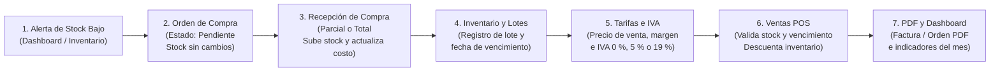
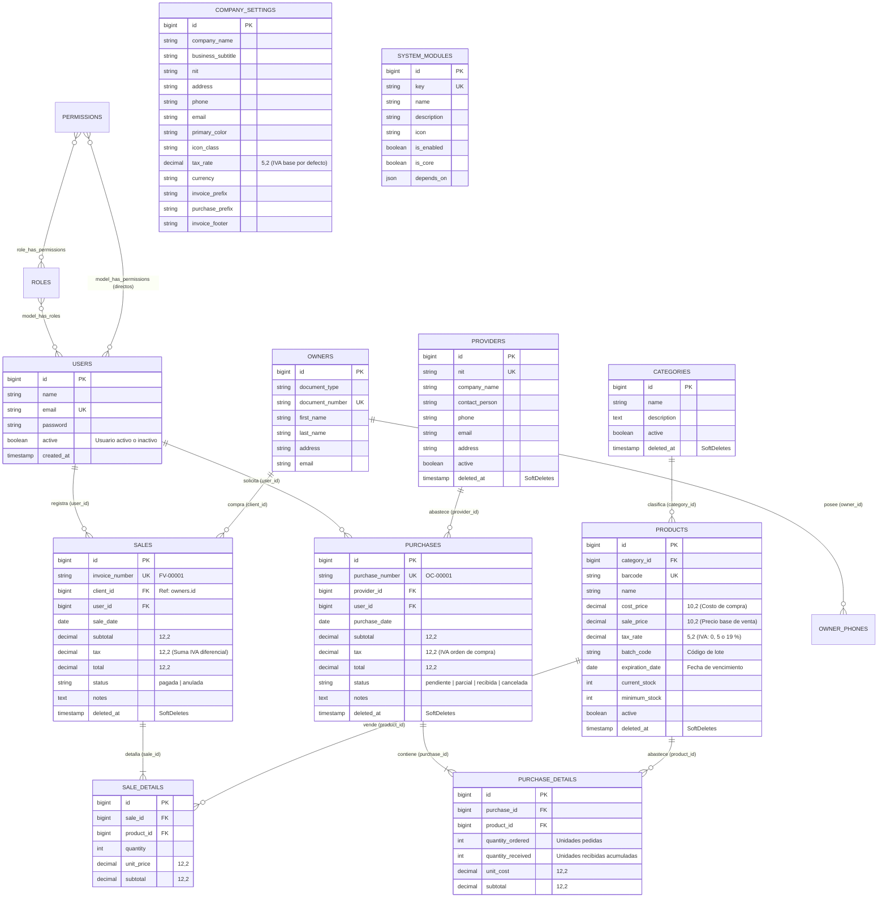

# ENTREGABLE SEGUNDO CORTE — AVANCE DEL PROYECTO ERP

---

## 1. Portada

* **Nombre del Proyecto:** VetPets ERP — Sistema de Gestión Empresarial para Tienda de Mascotas
* **Empresa / Modelo de Negocio:** VetPets S.A.S. (Comercialización de alimentos, suplementos, accesorios y artículos de cuidado para mascotas)
* **Integrantes:**
  * Jhon Esteban Molina Echavarria
  * Heiber Lozano Mercado
* **Asignatura:** Software de Gestión Empresarial (Seminario de Desarrollo de Aplicaciones Web en Laravel con Enfoque RAD)
* **Docente:** Ing. Jhon James Cano Sánchez
* **Institución:** Corporación de Estudios Tecnológicos del Norte del Valle — COTECNOVA
* **Fecha de Entrega:** 25 de octubre de 2026
* **Enlaces de Entrega:**
  * **Repositorio en GitHub:** `https://github.com/moliech/ERP_Veterinaria`
  * **Etiqueta (Tag) de Versión:** `avance-2`
  * **Video de Sustentación (≤ 10 min):** [Ver Video de Sustentación en Google Drive](https://drive.google.com/drive/folders/154DKFAKOyDlauuwDyoacq1mFkrTdBTYA?usp=sharing) (`https://drive.google.com/drive/folders/154DKFAKOyDlauuwDyoacq1mFkrTdBTYA?usp=sharing`)

---

## 2. Resumen del Avance

En este segundo corte se avanzó en la integración de los procesos de compras, inventario, tarifas, ventas y seguridad dentro de **VetPets ERP**, desarrollado con **Laravel 11, MySQL 8.4 y Docker Sail**. El documento presenta los módulos construidos en esta etapa y la forma en que se conectan entre sí:

1. **Proveedores y Órdenes de Compra:** Se implementó el registro de proveedores y de órdenes de compra (`purchases` y `purchase_details`). Mediante `PurchaseService`, el sistema permite registrar recepciones parciales o totales de mercancía. Al recibir unidades, se incrementa el stock del producto, se actualiza su costo de compra y se impide recibir una cantidad mayor a la solicitada.
2. **Inventario y Lotes:** El módulo de **Inventario y Lotes** (`/products`) administra las existencias actuales, el stock mínimo, el costo de compra (`cost_price`), el código de lote (`batch_code`) y la fecha de vencimiento (`expiration_date`). Además, muestra un indicador visual según el estado de cada lote (*Lote vigente*, *Próximo a vencer*, *Lote vencido* o *No perecedero*).
3. **Tarifas e IVA:** Se creó el módulo independiente de **Tarifas e IVA** (`/tarifas`) para separar el control físico de bodega de la fijación de precios comerciales. En esta vista se define el precio base de venta (`sale_price`), se consulta el margen de utilidad sobre el costo de compra y se asigna la tarifa de IVA que aplica a cada producto (**0 % Exento**, **5 % Diferencial** o **19 % General**).
4. **Clientes y Ventas POS:** Se integró el directorio de clientes (`owners`) con el módulo de **Ventas POS** (`/sales`). El servicio `SaleService` ejecuta el registro de la venta dentro de una transacción (`DB::transaction`), valida que exista stock suficiente, verifica que el lote no esté vencido, liquida el IVA según la tarifa de cada producto y descuenta las unidades vendidas. También permite anular una venta devolviendo las unidades al inventario.
5. **Documentos en PDF:** Se incorporó `barryvdh/laravel-dompdf` para generar en formato PDF tanto las facturas de venta (`FV-#####`) como las órdenes de compra (`OC-#####`).
6. **Seguridad, Identidad Corporativa y Gestión de Módulos:** Sobre `spatie/laravel-permission` se configuró el manejo de **Rol Activo en sesión** para usuarios con más de un rol, el uso de permisos directos individuales y una matriz de permisos en `/configuracion`. Adicionalmente, se agregaron las opciones de **Identidad Corporativa** (nombre de la empresa, NIT, color institucional y datos de facturación) y **Gestión de Módulos** (activación o desactivación de módulos validando sus dependencias).

### Tabla 1. Estado Actual de los Módulos del Sistema (Segundo Corte)

| Módulo del ERP | Tablas Principales | Controlador / Servicio Principal | Estado en el Segundo Corte |
| :--- | :--- | :--- | :--- |
| **1. Categorías** | `categories` | `CategoryController`, `SoftDeletes` | Implementado y probado |
| **2. Inventario y Lotes** | `products` | `ProductController`, control de lotes y vencimientos | Implementado y probado |
| **3. Tarifas e IVA** | `products` (`cost_price`, `sale_price`, `tax_rate`) | `PricingController`, cálculo de margen e IVA (0 %, 5 %, 19 %) | Implementado y probado |
| **4. Clientes** | `owners`, `owner_phones` | `ClientController`, Form Requests | Implementado y probado |
| **5. Ventas POS** | `sales`, `sale_details` | `SaleService` (`DB::transaction`), anulación y devolución de stock | Implementado y probado |
| **6. Proveedores** | `providers` | `ProviderController`, `SoftDeletes` | Implementado y probado |
| **7. Órdenes de Compra** | `purchases`, `purchase_details` | `PurchaseService` (`DB::transaction`), recepción parcial o total | Implementado y probado |
| **8. Documentos PDF** | Vistas en `resources/views/pdf/` | `SaleController::pdf()`, `PurchaseController::pdf()` (`DomPDF`) | Implementado y probado |
| **9. Dashboard** | Consultas sobre ventas, compras y productos | `DashboardController`, indicadores filtrados por permiso | Implementado y probado |
| **10. Seguridad y Accesos** | `users`, `roles`, `permissions` | `EnsureActiveRoleSelected`, `SecurityPolicyService` | Implementado y probado |
| **11. Identidad Corporativa y Gestión de Módulos** | `company_settings`, `system_modules` | `CompanySettingController`, `SystemModuleController`, `EnsureModuleEnabled` | Implementado y probado |

---

## 3. Análisis del Negocio Actualizado

### 3.1. Cambios respecto al Primer Corte
En el primer corte se había planteado un alcance mixto que incluía tanto la venta de artículos como la atención clínica veterinaria (pacientes, consultas médicas e historias clínicas). 

Para el segundo corte se revisó la complejidad del proyecto frente a los objetivos de la asignatura y se tomaron dos decisiones:
1. **Enfoque en los procesos comerciales de la tienda de mascotas:** Se descartaron los módulos clínicos para concentrar el proyecto en el flujo comercial (*Proveedores → Órdenes de Compra → Inventario y Lotes → Tarifas e IVA → Ventas POS*). Este ajuste permitió trabajar con mayor detalle las transacciones de compras, inventario y facturación.
2. **Parametrización mediante Identidad Corporativa y Gestión de Módulos:** En lugar de dejar fijos en las vistas el nombre del negocio, el NIT o los colores de la interfaz, se construyó la sección de **Identidad Corporativa** (`company_settings`) y la de **Gestión de Módulos** (`system_modules`). De esta forma, los datos de la empresa se actualizan desde el panel de configuración y se reflejan tanto en las pantallas como en los documentos PDF.

### 3.2. Flujo de Procesos del Negocio

1. **Proceso de Abastecimiento y Órdenes de Compra:**
   * Cuando las existencias de un producto son menores o iguales a su stock mínimo (`current_stock <= minimum_stock`), el sistema lo muestra en la sección de reabastecimiento del Dashboard.
   * El **Almacenista** o **Administrador** crea una Orden de Compra (`OC-00001`) asociada a un proveedor. Al guardarse en estado `pendiente`, la orden registra las cantidades pedidas (`quantity_ordered`) y el costo pactado, pero todavía no suma unidades al inventario porque la mercancía no ha ingresado a bodega.
   * Cuando el proveedor entrega el pedido, se registra la recepción indicando cuántas unidades llegaron (`quantity_received`). El servicio `PurchaseService` verifica que no se reciba más de lo pendiente, suma las unidades al `current_stock`, actualiza el costo de compra del producto (`cost_price`) y cambia el estado de la orden a `parcial` o `recibida`.
2. **Proceso de Inventario y Lotes:**
   * En **Inventario y Lotes** (`/products`) se controlan las existencias en bodega, el costo de compra, el número de lote (`batch_code`) y la fecha de vencimiento (`expiration_date`).
   * Si el producto es perecedero (como concentrados o medicamentos), el sistema calcula los días restantes hasta su vencimiento y muestra una etiqueta de estado (*Lote vigente*, *Próximo a vencer* cuando faltan 60 días o menos, o *Lote vencido*). Para artículos como correas, camas o juguetes, la fecha de vencimiento puede dejarse vacía y se clasifican como *No perecedero*.
   * Los productos, categorías y proveedores utilizan borrado lógico (`SoftDeletes`) para poder enviarlos a la papelera y restaurarlos sin afectar los registros de compras o ventas anteriores.
3. **Proceso de Tarifas e IVA:**
   * En el módulo **Tarifas e IVA** (`/tarifas`), se toma como referencia el costo de compra para definir el precio base de venta (`sale_price`) y revisar el porcentaje de margen de utilidad.
   * Como en una tienda de mascotas no todos los artículos tienen la misma carga impositiva, en este módulo se asigna a cada producto su tarifa de IVA: **0 % (Exento)** para medicamentos o antiparasitarios, **5 % (Tarifa Diferencial)** para alimentos concentrados y **19 % (Tarifa General)** para accesorios y artículos de higiene.
4. **Proceso de Ventas POS y Facturación:**
   * En **Ventas POS** (`/sales/create`), el vendedor selecciona al cliente y agrega los productos al detalle. El formulario toma el precio y el porcentaje de IVA configurados en **Tarifas e IVA** para calcular el subtotal, el impuesto de cada línea y el total de la factura.
   * Al guardar la venta, `SaleService::register()` ejecuta una transacción que bloquea las filas de los productos (`lockForUpdate()`), comprueba que el lote no esté vencido y que haya stock suficiente, descuenta las unidades vendidas y asigna el número secuencial de factura (`FV-00001`).
   * Si es necesario anular la venta, la opción de **Anular** cambia el estado de la factura a `anulada` y devuelve las unidades al stock del producto.

---

## 4. Modelo de Datos Actualizado

### 4.1. Diagrama Entidad-Relación (MER) del Segundo Corte

---

### 4.2. Diccionario de Datos de las Tablas Nuevas y Modificadas

#### Tabla 2. Diccionario de Datos — Tabla `providers` (Proveedores)
| Campo | Tipo de Dato | Nulo | Llave | Predeterminado | Descripción y Restricciones |
| :--- | :--- | :---: | :---: | :---: | :--- |
| `id` | `BIGINT UNSIGNED` | No | `PK` | `AUTO_INCREMENT` | Identificador único del proveedor. |
| `nit` | `VARCHAR(30)` | No | `UK` | — | NIT o identificación tributaria única del proveedor. |
| `company_name` | `VARCHAR(150)` | No | — | — | Razón social o nombre comercial del proveedor. |
| `contact_person` | `VARCHAR(120)` | Sí | — | `NULL` | Nombre de la persona de contacto comercial. |
| `phone` | `VARCHAR(30)` | Sí | — | `NULL` | Teléfono de contacto. |
| `email` | `VARCHAR(120)` | Sí | — | `NULL` | Correo electrónico del proveedor. |
| `address` | `VARCHAR(200)` | Sí | — | `NULL` | Dirección física del proveedor. |
| `active` | `TINYINT(1)` | No | — | `1` | Estado del proveedor (`1` = Activo, `0` = Inactivo). |
| `deleted_at` | `TIMESTAMP` | Sí | — | `NULL` | Fecha de envío a papelera (`SoftDeletes`). |
| `created_at` / `updated_at` | `TIMESTAMP` | Sí | — | `NULL` | Fechas de creación y actualización del registro. |

#### Tabla 3. Diccionario de Datos — Tabla `purchases` (Cabecera de Órdenes de Compra)
| Campo | Tipo de Dato | Nulo | Llave | Predeterminado | Descripción y Restricciones |
| :--- | :--- | :---: | :---: | :---: | :--- |
| `id` | `BIGINT UNSIGNED` | No | `PK` | `AUTO_INCREMENT` | Identificador único de la orden de compra. |
| `purchase_number` | `VARCHAR(25)` | No | `UK` | — | Número secuencial de la orden (ej. `OC-00001`). |
| `provider_id` | `BIGINT UNSIGNED` | No | `FK` | — | Referencia al proveedor (`providers.id`, `ON DELETE RESTRICT`). |
| `user_id` | `BIGINT UNSIGNED` | No | `FK` | — | Usuario que registró la orden (`users.id`, `ON DELETE RESTRICT`). |
| `purchase_date` | `DATE` | No | — | — | Fecha de emisión de la orden de compra. |
| `subtotal` | `DECIMAL(12,2)` | No | — | `0.00` | Suma de los subtotales de las líneas antes de impuestos. |
| `tax` | `DECIMAL(12,2)` | No | — | `0.00` | Impuesto calculado sobre la orden de compra. |
| `total` | `DECIMAL(12,2)` | No | — | `0.00` | Valor total de la orden (`subtotal + tax`). |
| `status` | `VARCHAR(20)` | No | — | `'pendiente'` | Estado de la orden: `pendiente`, `parcial`, `recibida` o `cancelada`. |
| `notes` | `TEXT` | Sí | — | `NULL` | Observaciones de la orden. |
| `deleted_at` | `TIMESTAMP` | Sí | — | `NULL` | Fecha de borrado lógico (`SoftDeletes`). |
| `created_at` / `updated_at` | `TIMESTAMP` | Sí | — | `NULL` | Fechas de creación y última modificación. |

#### Tabla 4. Diccionario de Datos — Tabla `purchase_details` (Detalle de Compra y Recepción)
| Campo | Tipo de Dato | Nulo | Llave | Predeterminado | Descripción y Restricciones |
| :--- | :--- | :---: | :---: | :---: | :--- |
| `id` | `BIGINT UNSIGNED` | No | `PK` | `AUTO_INCREMENT` | Identificador único de la línea de compra. |
| `purchase_id` | `BIGINT UNSIGNED` | No | `FK` | — | Orden de compra asociada (`purchases.id`, `ON DELETE CASCADE`). |
| `product_id` | `BIGINT UNSIGNED` | No | `FK` | — | Producto solicitado (`products.id`, `ON DELETE RESTRICT`). |
| `quantity_ordered` | `INT UNSIGNED` | No | — | — | Cantidad pedida al proveedor ($\ge 1$). |
| `quantity_received`| `INT UNSIGNED` | No | — | `0` | Cantidad recibida acumulada ($\le$ `quantity_ordered`). |
| `unit_cost` | `DECIMAL(12,2)` | No | — | — | Costo unitario de compra. |
| `subtotal` | `DECIMAL(12,2)` | No | — | — | Subtotal de la línea (`quantity_ordered * unit_cost`). |
| `created_at` / `updated_at` | `TIMESTAMP` | Sí | — | `NULL` | Fechas de creación y actualización. |

#### Tabla 5. Diccionario de Datos — Tabla `sales` (Cabecera de Facturas de Venta POS)
| Campo | Tipo de Dato | Nulo | Llave | Predeterminado | Descripción y Restricciones |
| :--- | :--- | :---: | :---: | :---: | :--- |
| `id` | `BIGINT UNSIGNED` | No | `PK` | `AUTO_INCREMENT` | Identificador único de la venta. |
| `invoice_number` | `VARCHAR(25)` | No | `UK` | — | Número secuencial de factura (ej. `FV-00001`). |
| `client_id` | `BIGINT UNSIGNED` | No | `FK` | — | Cliente asociado (`owners.id`, `ON DELETE RESTRICT`). |
| `user_id` | `BIGINT UNSIGNED` | No | `FK` | — | Usuario que registró la venta (`users.id`). |
| `sale_date` | `DATE` | No | — | — | Fecha de la venta. |
| `subtotal` | `DECIMAL(12,2)` | No | — | `0.00` | Suma de los subtotales de las líneas antes de impuestos. |
| `tax` | `DECIMAL(12,2)` | No | — | `0.00` | Total de IVA liquidado según la tarifa de cada producto vendido (0 %, 5 % o 19 %). |
| `total` | `DECIMAL(12,2)` | No | — | `0.00` | Total de la factura (`subtotal + tax`). |
| `status` | `VARCHAR(20)` | No | — | `'pagada'` | Estado de la factura: `pagada` o `anulada`. |
| `notes` | `TEXT` | Sí | — | `NULL` | Observaciones de la venta. |
| `deleted_at` | `TIMESTAMP` | Sí | — | `NULL` | Fecha de borrado lógico al anular (`SoftDeletes`). |
| `created_at` / `updated_at` | `TIMESTAMP` | Sí | — | `NULL` | Fechas de creación y actualización. |

#### Tabla 6. Diccionario de Datos — Tabla `sale_details` (Detalle de Venta)
| Campo | Tipo de Dato | Nulo | Llave | Predeterminado | Descripción y Restricciones |
| :--- | :--- | :---: | :---: | :---: | :--- |
| `id` | `BIGINT UNSIGNED` | No | `PK` | `AUTO_INCREMENT` | Identificador único de la línea de venta. |
| `sale_id` | `BIGINT UNSIGNED` | No | `FK` | — | Factura asociada (`sales.id`, `ON DELETE CASCADE`). |
| `product_id` | `BIGINT UNSIGNED` | No | `FK` | — | Producto vendido (`products.id`, `ON DELETE RESTRICT`). |
| `quantity` | `INT UNSIGNED` | No | — | — | Cantidad vendida ($\ge 1$). |
| `unit_price` | `DECIMAL(12,2)` | No | — | — | Precio unitario base al momento de la venta. |
| `subtotal` | `DECIMAL(12,2)` | No | — | — | Subtotal de la línea (`quantity * unit_price`). |
| `created_at` / `updated_at` | `TIMESTAMP` | Sí | — | `NULL` | Fechas de creación y actualización. |

#### Tabla 7. Diccionario de Datos — Tabla `products` (Inventario, Lotes y Tarifas)
| Campo | Tipo de Dato | Nulo | Llave | Predeterminado | Descripción y Restricciones |
| :--- | :--- | :---: | :---: | :---: | :--- |
| `id` | `BIGINT UNSIGNED` | No | `PK` | `AUTO_INCREMENT` | Identificador único del producto. |
| `category_id` | `BIGINT UNSIGNED` | No | `FK` | — | Categoría a la que pertenece (`categories.id`). |
| `barcode` | `VARCHAR(50)` | Sí | `UK` | `NULL` | Código de barras único. |
| `name` | `VARCHAR(150)` | No | — | — | Nombre del producto. |
| `cost_price` | `DECIMAL(10,2)` | No | — | `0.00` | Costo de compra del producto. |
| `sale_price` | `DECIMAL(10,2)` | No | — | `0.00` | Precio base de venta sin IVA (editable en **Tarifas e IVA**). |
| `tax_rate` | `DECIMAL(5,2)` | No | — | `19.00` | Porcentaje de IVA del producto (`0.00`, `5.00` o `19.00`). |
| `batch_code` | `VARCHAR(50)` | Sí | — | `NULL` | Código de lote o serie (`LOT-2026-...`). |
| `expiration_date` | `DATE` | Sí | — | `NULL` | Fecha de vencimiento del lote (`NULL` si no vence). |
| `current_stock` | `INT` | No | — | `0` | Cantidad disponible en inventario. |
| `minimum_stock` | `INT` | No | — | `5` | Stock mínimo para generar alerta de reabastecimiento. |
| `active` | `TINYINT(1)` | No | — | `1` | Estado del producto (`1` = Activo, `0` = Inactivo). |
| `deleted_at` | `TIMESTAMP` | Sí | — | `NULL` | Fecha de borrado lógico (`SoftDeletes`). |

---

## 5. Reglas de Negocio Implementadas

En la Tabla 8 se relacionan las **17 reglas de negocio** implementadas en el proyecto (el mínimo solicitado es de 8), indicando el módulo al que pertenecen, la clase donde están programadas y la forma en que se probaron.

### Tabla 8. Reglas de Negocio y Verificación

| # | Regla de Negocio | Módulo | Dónde se Implementa | Cómo se Probó |
| :---: | :--- | :---: | :--- | :--- |
| **1** | **Validación de stock antes de vender:** No se permite registrar una venta si la cantidad solicitada supera el `current_stock` del producto. | Ventas POS / Inventario y Lotes | `App\Services\SaleService::register()` (`lockForUpdate` + `ValidationException`) | Intento de venta en `/sales/create` con una cantidad mayor al stock disponible; el sistema detiene el registro y muestra el mensaje de error. |
| **2** | **Bloqueo de venta de lotes vencidos:** Si un producto tiene una `expiration_date` anterior a la fecha actual, no se permite su venta en caja. | Ventas POS / Inventario y Lotes | `App\Services\SaleService::register()` y `SaleController::create()` | Prueba automatizada en `SecurityConfigTest` enviando un producto con lote vencido; el servicio rechaza la operación y conserva el stock sin cambios. |
| **3** | **Cálculo de IVA diferencial por producto:** En cada venta, el impuesto se calcula línea por línea tomando el `tax_rate` (0 %, 5 % o 19 %) configurado para cada producto en **Tarifas e IVA**. | Tarifas e IVA / Ventas POS | `App\Http\Controllers\PricingController` y `App\Services\SaleService::register()` | Registro de una venta que combina un concentrado (5 %) y un antiparasitario exento (0 %), comprobando el valor de `sales.tax` y del PDF. |
| **4** | **Descuento de inventario al vender:** Al guardar una venta, el stock de cada producto disminuye en la cantidad vendida dentro de una transacción `DB::transaction`. | Ventas POS / Inventario y Lotes | `App\Services\SaleService::register()` (`DB::transaction`) | Creación de una factura y consulta en MySQL (`SELECT current_stock FROM products`) verificando la disminución de unidades. |
| **5** | **Devolución de stock al anular una venta:** Al anular una factura, su estado pasa a `anulada`, se marca con `SoftDeletes` y se suman de nuevo las unidades al `current_stock`. | Ventas POS / Inventario y Lotes | `App\Services\SaleService::cancel()` (`DB::transaction`) | Anulación de una venta desde `/sales` y consulta en MySQL comprobando que el stock vuelve al valor anterior. |
| **6** | **Protección al eliminar clientes con ventas:** No se permite eliminar un cliente que tenga facturas registradas. | Clientes | `App\Http\Controllers\ClientController::destroy()` | Intento de eliminar un cliente con ventas asociadas; el controlador impide el borrado y muestra un mensaje informativo. |
| **7** | **La orden de compra no suma stock al crearse:** Toda orden de compra se crea en estado `pendiente` con `quantity_received = 0` y no modifica las existencias de bodega hasta que se registre su recepción. | Órdenes de Compra | `App\Services\PurchaseService::create()` (`DB::transaction`) | Creación de una orden en `/purchases/create` y consulta en MySQL confirmando que `current_stock` no cambia. |
| **8** | **La recepción parcial o total aumenta el stock y actualiza el costo de compra:** Al recibir mercancía, el stock sube según las unidades recibidas y `cost_price` toma el costo unitario registrado en la orden. | Órdenes de Compra / Inventario y Lotes | `App\Services\PurchaseService::receive()` (`DB::transaction`) | Recepción de 6 unidades de 10 pedidas en `/purchases/{id}`; la orden cambia a `parcial`, el stock sube en 6 y se actualiza el costo de compra. |
| **9** | **No recibir más unidades de las pedidas:** El sistema rechaza cualquier recepción en la que la cantidad ingresada supere las unidades pendientes (`quantity_ordered - quantity_received`). | Órdenes de Compra | `App\Services\PurchaseService::receive()` (`ValidationException`) | Intento de recibir 15 unidades cuando solo faltaban 4 por entregar; el servicio devuelve error de validación. |
| **10** | **Restricción para cancelar órdenes de compra:** Solo se puede cancelar una orden si está en estado `pendiente` y no tiene unidades recibidas. | Órdenes de Compra | `App\Services\PurchaseService::cancel()` (`ValidationException`) | Intento de cancelar una orden en estado `parcial` o `recibida`; el sistema impide la cancelación. |
| **11** | **Protección al eliminar proveedores con compras:** No se permite borrar un proveedor que tenga órdenes de compra registradas. | Proveedores | `App\Http\Controllers\ProviderController::destroy()` | Intento de eliminar un proveedor con órdenes asociadas; el controlador bloquea la acción. |
| **12** | **Permisos según el Rol Activo en sesión:** Cuando un usuario tiene varios roles, solo aplica los permisos del rol que eligió para su sesión actual más sus permisos directos. | Seguridad y Accesos | `App\Models\User::hasEffectivePermission()` y `AppServiceProvider` (`Gate::before`) | Inicio de sesión con `supervisor@test.com` eligiendo el rol `vendedor`; al abrir `/purchases` recibe respuesta `403 Forbidden`. |
| **13** | **Bloqueo de usuarios inactivos:** Un usuario con `active = false` no puede iniciar sesión y, si su cuenta es desactivada mientras navega, se cierra su sesión en la siguiente petición. | Seguridad y Accesos | `LoginRequest::authenticate()` y Middleware `EnsureUserIsActive` | Desactivación de un usuario desde `/configuracion/usuarios` y prueba de inicio de sesión rechazada. |
| **14** | **No auto-desactivarse ni dejar el sistema sin administrador:** Un administrador no puede desactivar su propia cuenta ni quitar el rol `admin` al último administrador activo. | Seguridad y Accesos | `App\Services\SecurityPolicyService` | Prueba en `/configuracion/usuarios` intentando desactivar al propio usuario autenticado; el servicio rechaza el cambio. |
| **15** | **Protección del rol `admin` y de roles o permisos en uso:** El rol `admin` no puede eliminarse ni quedarse sin permisos, y no se pueden borrar roles o permisos asignados a usuarios. | Seguridad y Accesos | `App\Services\SecurityPolicyService` y `RoleController` | Prueba automatizada en `Tests\Feature\SecurityConfigTest` e intento desde la interfaz web. |
| **16** | **Validación de dependencias entre módulos:** No se permite desactivar un módulo (como **Inventario y Lotes**) si otro módulo que depende de él (como **Tarifas e IVA**, **Ventas POS** u **Órdenes de Compra**) sigue activo. | Gestión de Módulos | `App\Http\Controllers\Settings\SystemModuleController` y Middleware `EnsureModuleEnabled` | Intento de desactivar **Inventario y Lotes** con **Ventas POS** activo; el sistema muestra qué módulos dependen de él e impide desactivarlo. |
| **17** | **Clasificación de lotes por fecha de vencimiento:** El modelo evalúa la fecha de cada lote para mostrar si está vigente, próximo a vencer (60 días o menos), vencido o si no es perecedero. | Inventario y Lotes | `App\Models\Product::expirationStatus()` | Revisión en `/products` de productos con vencimiento cercano (22 días), vigentes y no perecederos. |

---

## 6. Matriz de Seguridad y Control de Acceso

### 6.1. Matriz `Rol × Módulo × Acción`

En la Tabla 9 se muestran los permisos configurados para los tres roles del sistema (`admin`, `almacenista` y `vendedor`), junto con el comportamiento del usuario de prueba `supervisor@test.com`, quien tiene asignados los roles `vendedor` y `almacenista` más el permiso directo `ver-reportes`.

#### Tabla 9. Matriz de Permisos por Rol y Módulo

| Módulo | Permiso (`acción-módulo`) | Admin (`admin`) | Almacenista (`almacenista`) | Vendedor (`vendedor`) | Supervisor (Rol Activo: `vendedor` + Directo) | Supervisor (Rol Activo: `almacenista` + Directo) |
| :--- | :--- | :---: | :---: | :---: | :---: | :---: |
| **Inventario y Lotes / Tarifas e IVA** | `ver-productos` | ✅ | ✅ | ✅ | ✅ (Por Rol) | ✅ (Por Rol) |
| | `crear-productos` | ✅ | ✅ | ❌ | ❌ | ✅ (Por Rol) |
| | `editar-productos` | ✅ | ✅ | ❌ | ❌ | ✅ (Por Rol) |
| | `eliminar-productos` | ✅ | ❌ | ❌ | ❌ | ❌ |
| **Categorías** | `ver-categorias` | ✅ | ✅ | ✅ | ✅ (Por Rol) | ✅ (Por Rol) |
| | `crear-categorias` | ✅ | ✅ | ❌ | ❌ | ✅ (Por Rol) |
| | `editar-categorias` | ✅ | ✅ | ❌ | ❌ | ✅ (Por Rol) |
| | `eliminar-categorias` | ✅ | ❌ | ❌ | ❌ | ❌ |
| **Clientes** | `ver-clientes` | ✅ | ❌ | ✅ | ✅ (Por Rol) | ❌ |
| | `crear-clientes` | ✅ | ❌ | ✅ | ✅ (Por Rol) | ❌ |
| | `editar-clientes` | ✅ | ❌ | ✅ | ✅ (Por Rol) | ❌ |
| | `eliminar-clientes` | ✅ | ❌ | ❌ | ❌ | ❌ |
| **Ventas POS** | `ver-ventas` | ✅ | ❌ | ✅ | ✅ (Por Rol) | ❌ |
| | `crear-ventas` | ✅ | ❌ | ✅ | ✅ (Por Rol) | ❌ |
| | `anular-ventas` / `eliminar-ventas` | ✅ | ❌ | ❌ | ❌ | ❌ |
| **Proveedores** | `ver-proveedores` | ✅ | ✅ | ❌ | ❌ | ✅ (Por Rol) |
| | `crear-proveedores` | ✅ | ✅ | ❌ | ❌ | ✅ (Por Rol) |
| | `editar-proveedores` | ✅ | ✅ | ❌ | ❌ | ✅ (Por Rol) |
| | `eliminar-proveedores` | ✅ | ❌ | ❌ | ❌ | ❌ |
| **Órdenes de Compra** | `ver-compras` | ✅ | ✅ | ❌ | ❌ | ✅ (Por Rol) |
| | `crear-compras` | ✅ | ✅ | ❌ | ❌ | ✅ (Por Rol) |
| | `recibir-compras` | ✅ | ✅ | ❌ | ❌ | ✅ (Por Rol) |
| | `anular-compras` | ✅ | ❌ | ❌ | ❌ | ❌ |
| **Reportes** | `ver-reportes` | ✅ | ❌ | ❌ | ⭐ **✅ (Directo)** | ⭐ **✅ (Directo)** |
| **Seguridad y Accesos** | `ver/crear/editar-usuarios` | ✅ | ❌ | ❌ | ❌ | ❌ |
| | `ver/crear/editar/eliminar-roles` | ✅ | ❌ | ❌ | ❌ | ❌ |
| | `ver/crear/eliminar-permisos` | ✅ | ❌ | ❌ | ❌ | ❌ |

---

### 6.2. Justificación del Rol Activo
Por defecto, cuando un usuario tiene dos roles en `spatie/laravel-permission` (por ejemplo, `vendedor` y `almacenista`), el paquete suma los permisos de ambos roles al mismo tiempo. En un sistema de gestión esto dificulta separar las funciones de bodega y de caja, porque una misma sesión podría registrar ingresos de mercancía y facturar ventas simultáneamente.

Para evitarlo, se desactivó la validación automática de Spatie (`'register_permission_check_method' => false`) y se definió en `AppServiceProvider` una regla `Gate::before` apoyada en el middleware `EnsureActiveRoleSelected`:
* Cuando un usuario con más de un rol inicia sesión, el sistema lo dirige a `/rol-activo` para que seleccione con cuál rol va a trabajar durante esa sesión.
* Si elige `vendedor`, únicamente tiene acceso a **Clientes** y **Ventas POS**; si intenta entrar por URL a `/purchases` o `/providers`, el servidor responde con `403 Forbidden`. Para operar en bodega debe usar la opción **Cambiar rol** y seleccionar `almacenista`.

### 6.3. Ejemplo de Permiso Directo (`supervisor@test.com`)
En ocasiones una persona necesita un permiso puntual que no forma parte de su rol principal, sin que sea necesario crear un rol nuevo solo para ese caso:
* **Caso implementado:** El usuario **Supervisor (`supervisor@test.com`)** tiene los roles `vendedor` y `almacenista`. Ninguno de esos dos roles incluye el permiso `ver-reportes`, pero el supervisor necesita consultar el balance del mes y el ranking de productos en el Dashboard.
* **Configuración:** Desde `/configuracion/usuarios/{id}/edit` se le asignó el permiso directo `ver-reportes` (guardado en `model_has_permissions`).
* **Evaluación en `User::hasEffectivePermission()`:**
  $$\text{Permisos Efectivos} = \text{Permisos del Rol Activo en Sesión} \cup \text{Permisos Directos del Usuario}$$
  De esta manera, tanto si el supervisor trabaja con el rol `vendedor` como si cambia al rol `almacenista`, mantiene activo el permiso `ver-reportes`. Esto también se puede comprobar en el filtro **«Ver como usuario»** dentro de `/configuracion/permisos`.

---

## 7. Integración de Procesos

A continuación se describe paso a paso cómo se conectan los módulos en un flujo completo:

1. **Paso 1 — Proveedor y Orden de Compra (`OC-00001`):**
   * En `/providers` se consulta o registra el proveedor y luego, en `/purchases/create`, se crea una orden de compra para un producto con pocas unidades.
   * La orden se guarda en estado **`pendiente`** (`quantity_received = 0`) y el stock del producto en MySQL permanece igual.
2. **Paso 2 — Recepción Parcial y Aumento de Stock en MySQL:**
   * Desde el detalle de la orden (`/purchases/{id}`), el almacenista registra una entrega parcial (por ejemplo, llegan 6 de las 10 unidades pedidas).
   * `PurchaseService::receive()` actualiza `quantity_received` a `6`, cambia el estado de la orden a **`parcial`**, suma `6` unidades a `products.current_stock` y actualiza `products.cost_price` con el costo de compra recibido.
   * *(Ver Figura 1 en la Sección 9).*
3. **Paso 3 — Revisión de Lote y Configuración de Tarifa e IVA:**
   * En **Inventario y Lotes** (`/products`) se consulta el código de lote (`batch_code`), la fecha de vencimiento (`expiration_date`) y su estado.
   * En **Tarifas e IVA** (`/tarifas`), se ajusta el precio base de venta (`sale_price`), se verifica el porcentaje de margen sobre el costo de compra y se selecciona la tarifa de IVA del producto (0 %, 5 % o 19 %).
   * *(Ver Figura 2 en la Sección 9).*
4. **Paso 4 — Registro de Venta POS y Descuento de Stock en MySQL:**
   * En `/sales/create`, el vendedor elige al cliente y agrega los productos. La pantalla calcula el subtotal, el IVA correspondiente a cada producto y el total de la factura.
   * Al guardar la venta (`FV-00001`), `SaleService::register()` comprueba que el lote esté vigente y descuenta las unidades vendidas de `products.current_stock`.
   * *(Ver Figura 3 en la Sección 9).*
5. **Paso 5 — Validación de Falta de Stock y Anulación de Venta:**
   * Si se intenta vender una cantidad mayor al stock disponible (o un producto con lote vencido), `SaleService` detiene la operación y muestra el mensaje de error sin modificar la base de datos.
   * Si se anula una factura desde `/sales`, `SaleService::cancel()` cambia su estado a **`anulada`** y devuelve las unidades al inventario.
   * *(Ver Figura 4 en la Sección 9).*
6. **Paso 6 — Documentos PDF, Seguridad y Actualización del Dashboard:**
   * Desde `/sales/{id}/pdf` se descarga la factura formal con los datos de **Identidad Corporativa**, lote y desglose de impuestos *(Ver Figura 5)*.
   * La sesión opera bajo el esquema de **Rol Activo**, bloqueando con `403 Forbidden` el acceso a módulos fuera del perfil seleccionado *(Ver Figura 6)*.
   * Al mismo tiempo, los totales del mes y las alertas de reabastecimiento se actualizan en `/dashboard` *(Ver Figura 7)*.

---

## 8. Dashboard y Toma de Decisiones

El controlador `DashboardController` muestra los indicadores según los permisos efectivos del usuario autenticado *(Ver Figura 7 en la Sección 9)*:

### Tabla 10. Indicadores del Dashboard y Decisiones que Apoyan

| Indicador / Sección | Regla de Cálculo | Permiso Requerido | Qué decisión permite tomar |
| :--- | :--- | :---: | :--- |
| **1. Ventas − Compras del mes** | Total de ventas no anuladas del mes menos total de compras no anuladas del mes | `ver-reportes` (o `ver-ventas` + `ver-compras`) | Revisar si durante el mes las ventas superan el gasto en compras de mercancía o si hubo mayor salida por reabastecimiento. |
| **2. Ventas del mes** | `Sale::where('status', '!=', 'anulada')->whereMonth(...)->sum('total')` | `ver-ventas` | Hacer seguimiento a los ingresos facturados en el mes actual. |
| **3. Compras del mes** | `Purchase::where('status', '!=', 'anulada')->whereMonth(...)->sum('total')` | `ver-compras` | Controlar el valor acumulado de las órdenes de compra emitidas a proveedores en el mes. |
| **4. Total productos activos** | `Product::where('active', true)->count()` | `ver-productos` | Conocer cuántas referencias activas tiene actualmente el catálogo de la tienda. |
| **5. Los cinco productos más vendidos** | Suma de `sale_details.quantity` agrupada por producto en el mes actual | `ver-reportes` y `ver-ventas` | Identificar los artículos de mayor salida para priorizar su reposición y negociar compras con proveedores. |
| **6. Productos para reabastecimiento** | Productos activos con `current_stock <= 5` o `current_stock <= minimum_stock` | `ver-productos` | Detectar qué productos están por agotarse y pasar directamente a crear su orden de compra. |

---

## 9. Evidencias de Funcionamiento

A continuación se presentan las capturas de pantalla organizadas según los procesos del sistema:

### Figura 1. Recepción Parcial de Compra y Aumento de Stock en MySQL
Detalle de la orden de compra en estado `parcial` tras recibir 6 de 10 unidades, acompañada de la consulta SQL que evidencia el incremento de `current_stock` y la actualización de `cost_price`.

---

### Figura 2. Configuración de Tarifas e IVA Diferencial (`/tarifas`)
Módulo de precios comerciales con visualización del costo de compra, margen de rentabilidad calculado en vivo y asignación de tarifas de IVA (0 % exento, 5 % diferencial y 19 % general).

---

### Figura 3. Venta POS con IVA Diferencial y Descuento en MySQL
Facturación en mostrador combinando productos con diferentes tarifas impositivas y consulta en base de datos demostrando la deducción de unidades en el inventario.

---

### Figura 4. Control de Reglas Transaccionales (Alerta de Stock y Anulación de Venta)
Mensaje de bloqueo al intentar vender más unidades de las existentes y comprobante de factura `anulada` con restitución de existencias en MySQL.

| 4A. Alerta por Stock Insuficiente | 4B. Factura Anulada y Retorno de Stock |
| :---: | :---: |
|  |  |

---

### Figura 5. Factura de Venta Generada en PDF (`DomPDF`)
Documento descargable con encabezado institucional de **Identidad Corporativa**, numeración secuencial, discriminación de lotes y liquidación detallada del IVA.

---

### Figura 6. Seguridad: Selección de Rol Activo y Bloqueo de Acceso (`403`)
Pantalla intermedia de `/rol-activo` para el usuario con múltiples perfiles y evidencia del bloqueo de acceso no autorizado al intentar entrar a un módulo restringido.

| 6A. Selección de Rol Activo | 6B. Bloqueo 403 Forbidden |
| :---: | :---: |
|  |  |

---

### Figura 7. Dashboard de Control con Indicadores y Reabastecimiento (`/dashboard`)
Panel principal con el balance mensual de operaciones, los cinco productos más vendidos, alertas de stock crítico y control de lotes con fechas de vencimiento.

---

## 10. Dificultades Encontradas y Soluciones Aplicadas

Durante el desarrollo del segundo corte se presentaron varios problemas técnicos y de alcance que se resolvieron de la siguiente manera:

1. **Ajuste del alcance del proyecto (retiro de la parte clínica veterinaria):**
   * **Problema:** En el primer corte se habían incluido módulos clínicos (pacientes, consultas e historias médicas) junto con los módulos comerciales. Al iniciar el desarrollo de compras, recepciones parciales, facturación y permisos del segundo corte, cubrir ambos frentes al mismo tiempo dispersaba el trabajo y restaba profundidad al flujo comercial.
   * **Solución:** Se ajustó el alcance para enfocar el sistema en la operación comercial de una tienda de mascotas. Además, se agregaron las secciones de **Identidad Corporativa** y **Gestión de Módulos** para poder configurar los datos del negocio y los módulos activos desde la interfaz.
2. **Error de compilación por directivas Blade dentro de comentarios HTML:**
   * **Problema:** En `dashboard.blade.php` se había escrito un comentario HTML `<!-- Accesos con @can -->`. Laravel interpretó `@can` como una directiva real sin cierre `@endcan`, generando el error `ParseError: unexpected end of file`.
   * **Solución:** Se reemplazaron esos comentarios por comentarios propios de Blade (`{{-- ... --}}`) y se limpió la caché de vistas con `php artisan view:clear`.
3. **Diferencia en los nombres de columnas del modelo `Owner` (Clientes):**
   * **Problema:** En `SaleController` se consultaban inicialmente las columnas `name` y `first_surname`, pero la tabla `owners` tenía definidas `first_name` y `last_name`, lo que producía el error `SQLSTATE[42S22]: Unknown column 'name'`.
   * **Solución:** Se unificaron las consultas y vistas de ventas y PDF para usar `first_name` y `last_name`.
4. **Referencias a `stock` frente a `current_stock` en el modelo `Product`:**
   * **Problema:** Algunas vistas llamaban a `$product->stock`, mientras que la columna en la tabla `products` se llama `current_stock`.
   * **Solución:** Se agregó el accesor `getStockAttribute()` en `App\Models\Product` para devolver el valor de `current_stock` y mantener compatibilidad en todas las vistas.
5. **Trabajo en paralelo entre las ramas `esteban` y `heiber`:**
   * **Problema:** Al registrar en `routes/web.php` y `bootstrap/app.php` controladores y middlewares que todavía se estaban programando en la rama del compañero, las pruebas fallaban porque las clases aún no existían en la rama local.
   * **Solución:** Se envolvieron esas rutas con `if (class_exists(...))` mientras se trabajaba por separado, y una vez realizada la integración (`git merge`) quedaron conectadas de forma directa.
6. **Actualización del menú lateral en `resources/views/layouts/app.blade.php`:**
   * **Problema:** El diseño del proyecto usa una barra lateral propia dentro de `layouts/app.blade.php` y no el archivo `layouts/navigation.blade.php` de Laravel Breeze, por lo que los enlaces agregados en `navigation.blade.php` no aparecían en pantalla.
   * **Solución:** Se trasladaron todos los enlaces de navegación (**Inventario y Lotes**, **Tarifas e IVA**, **Proveedores**, **Órdenes de Compra**, **Seguridad y Accesos**, **Identidad Corporativa**, **Gestión de Módulos** y el indicador de **Rol Activo**) directamente al menú lateral de `layouts/app.blade.php`.
7. **Persistencia en caché de Identidad Corporativa con `CACHE_STORE=database`:**
   * **Problema:** En Laravel 11, el almacenamiento de caché en base de datos tiene la opción `'serializable_classes' => false`. Como `CompanySetting::current()` guardaba directamente el objeto del modelo Eloquent en caché, al recargar la página se obtenía un objeto incompleto (`__PHP_Incomplete_Class`), entraba al bloque `catch` y volvía a mostrar los datos por defecto.
   * **Solución:** Se modificó `CompanySetting::current()` para guardar en caché únicamente el arreglo de atributos (`attributesToArray()`) y reconstruir el modelo al leerlo. También se definieron variables CSS en el layout principal para que el color elegido en **Identidad Corporativa** se aplique de forma uniforme en los botones y encabezados.

---

## 11. Plan para el Tercer Corte

Siguiendo los cuatro puntos planteados en la guía de la asignatura para la entrega final (auditoría, API, automatización y pruebas), en el tercer corte se trabajará en:

1. **Auditoría y Kardex de movimientos:**
   * Crear una tabla de bitácora para registrar qué usuario, en qué fecha y con cuál rol activo creó, editó o anuló compras, ventas, tarifas y permisos.
   * Construir una vista de **Kardex por producto** donde se puedan consultar en orden cronológico todas las entradas por compras y salidas por ventas de cada lote.
2. **API REST con Laravel Sanctum:**
   * Exponer endpoints básicos protegidos por token (`/api/v1/products`, `/api/v1/sales`, `/api/v1/kpis`) para consultar el catálogo, registrar pedidos y leer indicadores respetando los permisos del usuario.
3. **Automatización de alertas y reportes:**
   * Programar un comando en consola (`Artisan Schedule`) que revise diariamente los productos con stock bajo o con lotes próximos a vencer y genere las alertas correspondientes, además de permitir exportar los reportes de ventas y compras a Excel/CSV.
4. **Ampliación de las pruebas automatizadas:**
   * Sumar nuevas pruebas en PHPUnit a las 30 pruebas actuales para cubrir los casos de borde de recepciones múltiples, kardex, auditoría y respuestas de la API.
