# INFORME FINAL — PROYECTO DE SOFTWARE DE GESTIÓN EMPRESARIAL (ERP)
## VetPets ERP: Sistema de Gestión Empresarial Modular y Parametrizable para Retail Comercial PetShop

---

## Portada

* **Título del Proyecto:** VetPets ERP — Sistema de Gestión Empresarial Modular y Parametrizable para Retail Comercial PetShop con Kardex Transaccional, Punto de Venta POS, Seguridad RBAC con Rol Activo y Automatización de Procesos
* **Empresa / Caso de Estudio:** VetPets Comercial S.A.S. (Comercio minorista de alimentos concentrados, suplementos, fármacos de venta libre y accesorios para mascotas)
* **Autores / Integrantes:**
  * **Jhon Esteban Molina Echavarría**
  * **Heiber Lozano Mercado**
* **Programa Académico:** Ingeniería de Sistemas / Tecnología en Gestión de Sistemas de Información
* **Institución:** Corporación de Estudios Tecnológicos del Norte del Valle (COTECNOVA)
* **Asignatura:** Software de Gestión Empresarial (Semestre VI — 2026)
* **Docente:** Ing. Jhon James Cano Sánchez
* **Fecha de Entrega:** 25 de noviembre de 2026
* **Fecha de Sustentación Presencial:** 26 de noviembre de 2026 (8:15 p. m.)
* **Enlaces de Entrega y Verificación:**
  * **Repositorio en GitHub:** [https://github.com/moliech/ERP_Veterinaria](https://github.com/moliech/ERP_Veterinaria) (Etiqueta: `final`)
  * **Video de Respaldo:** [https://drive.google.com/drive/folders/154DKFAKOyDlauuwDyoacq1mFkrTdBTYA?usp=sharing](https://drive.google.com/drive/folders/154DKFAKOyDlauuwDyoacq1mFkrTdBTYA?usp=sharing)

---

## Resumen

El presente informe documenta el análisis, diseño, implementación y validación de **VetPets ERP**, un sistema de planificación de recursos empresariales desarrollado para la gestión comercial de tiendas minoristas de mascotas (*PetShop*). El proyecto resuelve problemáticas operativas críticas de pequeñas empresas del sector: la desarticulación entre órdenes de compra y existencias reales, el riesgo de comercializar lotes vencidos, los errores en la liquidación manual del impuesto al valor agregado (IVA), la falta de segregación de funciones en empleados multi-rol y la ausencia de trazabilidad sobre cambios administrativos. Construido con **Laravel 11, PHP 8.4, MySQL 8.4 y Docker Sail** bajo arquitectura MVC extendida con servicios de dominio transaccionales (`DB::transaction`), el sistema integra seis procesos centrales: abastecimiento con recepción parcial o total, control de inventario por movimientos de Kardex, fijación de tarifas con IVA diferencial (0 %, 5 % y 19 %), facturación POS con comprobantes internos en PDF, seguridad RBAC de 42 permisos con **Rol Activo en sesión** y automatización asíncrona de alertas y reportes. Además, incorpora una API RESTful v1 con **Laravel Sanctum** (7 endpoints), exportación e importación masiva en Excel con validación por fila y auditoría de modelos y eventos de seguridad. Los 11 componentes del segundo avance evolucionaron a **15 subsistemas funcionales** respaldados por **42 pruebas automatizadas (284 aserciones en 14 clases de prueba)**, verificación PSR-12 con **Laravel Pint** (170 archivos) e integración continua en **GitHub Actions**.

**Palabras clave:** ERP, Laravel, Kardex, control de acceso basado en roles, integración continua.

---

## Tabla de Contenido

*(Generada automáticamente en Word con actualización de campos)*

---

## 1. Introducción

Las pequeñas y medianas empresas (pymes) dedicadas al comercio minorista de productos para mascotas (*PetShops*) gestionan una operación diaria de alta rotación que combina referencias con exigencias logísticas y tributarias heterogéneas: alimentos concentrados, suplementos y antiparasitarios sujetos a fecha de caducidad, así como accesorios de cuidado general. Sin embargo, muchos establecimientos continúan operando con hojas de cálculo aisladas que desvinculan las compras en bodega de la facturación en mostrador (Laudon y Laudon, 2020).

De acuerdo con Monk y Wagner (2013), el valor estructural de un sistema *Enterprise Resource Planning* (ERP) consiste en sustituir los silos de información por una base de datos relacional única donde cada evento operativo propaga actualizaciones consistentes hacia toda la organización. En el comercio minorista, esto exige que la recepción física de mercancía actualice, en una misma transacción atómica, el historial de movimientos (Kardex), el stock disponible en el punto de venta (POS) y los indicadores financieros gerenciales.

Este informe presenta la ingeniería aplicada en **VetPets ERP** para **VetPets Comercial S.A.S.** A lo largo de diez capítulos se abordan el problema, los objetivos, el marco teórico, la metodología incremental, el análisis y diseño (procesos, 17 reglas de negocio, modelo relacional y seguridad RBAC), la implementación de los 15 subsistemas y la trazabilidad de los 17 requisitos funcionales, la verificación automatizada, los resultados operativos y las conclusiones. Los procedimientos detallados, diccionarios de datos completos, matriz de los 42 permisos y especificaciones de la API se consolidan en los Anexos A–E.

---

## 2. Planteamiento del Problema

### 2.1. Situación Actual del Negocio

El diagnóstico operativo de **VetPets Comercial S.A.S.** evidenció cinco deficiencias recurrentes que afectan el control interno y la rentabilidad:

1. **Desarticulación entre órdenes de compra y entregas fraccionadas:** Los proveedores mayoristas suelen despachar pedidos en varias entregas. Sin control de recepciones parciales sobre una misma orden, el personal de bodega suma el pedido completo antes de su arribo o duplica registros, desfasando el stock contable frente al inventario físico.
2. **Merma por caducidad y ausencia de trazabilidad en inventario:** Modificar existencias sobrescribiendo directamente una celda impide auditar si una variación provino de una compra, una venta, una anulación o un ajuste físico. Además, sin validación sobre la fecha de vencimiento del lote vigente, existe el riesgo de facturar productos expirados.
3. **Inconsistencias en la liquidación del IVA y falta de control de márgenes:** El catálogo mezcla bienes gravados al 0 %, 5 % y 19 %. Cuando la tarifa no se parametriza por referencia ni se separa la gestión física de bodega de la fijación comercial de precios, se producen errores de cobro en caja y se pierde visibilidad sobre el margen bruto frente al último costo de compra.
4. **Falta de segregación de funciones en empleados multi-rol:** En pymes es común que un supervisor cubra turnos tanto en bodega como en caja. Los sistemas convencionales que acumulan simultáneamente los permisos de todos los roles asignados permiten alterar existencias y facturar dentro de la misma sesión, debilitando el control interno (Ferraiolo et al., 2003).
5. **Carencia de alertas tempranas e interoperabilidad:** El agotamiento de existencias se detecta de forma reactiva al revisar estanterías, sin notificaciones automáticas por umbral mínimo ni resúmenes diarios. Asimismo, la actualización masiva de catálogos resulta lenta sin importación validada desde Excel ni una API para integraciones externas.

### 2.2. Formulación de la Pregunta Problema

> *¿Cómo diseñar, implementar y validar un sistema de gestión empresarial (ERP) modular y parametrizable en Laravel que integre compras con recepción parcial, inventario por movimientos de Kardex, tarifas con IVA diferencial y ventas POS, garantizando segregación de funciones mediante Rol Activo en sesión, trazabilidad por auditoría y automatización de alertas operativas para VetPets Comercial S.A.S.?*

---

## 3. Objetivos

### 3.1. Objetivo General

Desarrollar e implementar un sistema de planificación de recursos empresariales (ERP) web para **VetPets Comercial S.A.S.** con **Laravel 11, MySQL 8.4 y Docker Sail**, que integre transaccionalmente compras, inventario por Kardex, tarifas con IVA diferencial y ventas POS, incorporando control de acceso RBAC con Rol Activo, auditoría de modelos y de seguridad, interoperabilidad vía API REST y Excel, automatización asíncrona y aseguramiento de calidad mediante pruebas automatizadas e integración continua.

### 3.2. Objetivos Específicos

1. **Diseñar** el modelo relacional normalizado, las reglas de negocio y la arquitectura de seguridad RBAC con Rol Activo en sesión para segregar funciones entre administrador, almacenista, vendedor y supervisor.
2. **Construir** los módulos maestros y transaccionales mediante servicios de dominio (`PurchaseService`, `InventoryService`, `SaleService`, `AccessControlService`) respaldados por transacciones atómicas (`DB::transaction`), trazabilidad en Kardex y comprobantes internos en PDF con identidad corporativa.
3. **Implementar** auditoría de modelos y bitácora de seguridad (`spatie/laravel-activitylog`), interoperabilidad (API RESTful v1 con Sanctum, exportación e importación masiva en Excel) y automatización asíncrona (eventos, notificaciones multicanal y tareas programadas).
4. **Verificar y validar** los 17 requisitos funcionales mediante pruebas automatizadas en PHPUnit, verificación de estilo con Laravel Pint, integración continua en GitHub Actions y datos semilla reproducibles.

---

## 4. Marco Teórico

### 4.1. Sistemas ERP Modulares en Pymes

Un sistema ERP articula los procesos interfuncionales de la organización sobre una base de datos compartida, eliminando la doble digitación y los retrasos en la toma de decisiones (Monk y Wagner, 2013; Laudon y Laudon, 2020). En pequeñas y medianas empresas comerciales, la literatura especializada señala que la viabilidad de un ERP depende de su modularidad y capacidad de parametrización sin intervenir el código fuente ante ajustes tributarios o cambios de marca (Esteves y Pastor, 2001; Panorama Consulting Group, 2023). Bajo este principio, **VetPets ERP** incorpora parametrización corporativa (`company_settings`) y gestión de módulos con validación de dependencias (`system_modules`).

### 4.2. Control de Inventarios y Kardex Permanente (NIC 2)

Según la Norma Internacional de Contabilidad 2 (NIC 2) del International Accounting Standards Board (IASB, 2021), la gestión de existencias requiere registrar sistemáticamente entradas, salidas y costos asociados. El **Kardex** permanente documenta cada variación física (`entrada` o `salida`), su concepto operativo (`inventario_inicial`, `compra`, `venta`, `anulacion_venta`, `ajuste`), el saldo resultante (`balance`), el costo unitario (`unit_cost`) y la referencia polimórfica al documento origen. Para prevenir condiciones de carrera en entornos concurrentes, el saldo maestro (`current_stock`) se modifica exclusivamente mediante transacciones con bloqueo pesimista (`SELECT ... FOR UPDATE`) (Silberschatz et al., 2019).

Conforme a la NIC 2 (IASB, 2021), **VetPets ERP** preserva el costo unitario histórico en cada asiento de `inventory_movements` y actualiza `products.cost_price` al último costo de recepción para evaluar el margen comercial en tiempo real. Asimismo, los datos almacenados permiten reconstruir el Costo Promedio Ponderado (CPP) en valoración contable:

$$CPP_{\text{nuevo}} = \frac{(Q_a \times C_a) + (Q_n \times C_n)}{Q_a + Q_n}$$

Donde $Q_a$ y $C_a$ representan la cantidad y costo unitario previos, y $Q_n$ y $C_n$ la cantidad y costo de la nueva recepción.

### 4.3. Control de Acceso Basado en Roles (RBAC) y Segregación de Funciones

El estándar *Role-Based Access Control* (RBAC) del NIST (Ferraiolo et al., 2001) asigna permisos a roles organizacionales en lugar de cuentas individuales, diferenciando los roles asignados al usuario de los roles activados en una sesión. Ferraiolo et al. (2003) definen la **Segregación Dinámica de Funciones** (*Dynamic Separation of Duty* — DSoD) como el mecanismo que impide activar simultáneamente roles incompatibles en una misma sesión. Sobre `spatie/laravel-permission` (Spatie, 2024b), **VetPets ERP** materializa DSoD mediante el **Rol Activo en sesión** (`EnsureActiveRoleSelected`) combinado con permisos directos puntuales (`model_has_permissions`).

### 4.4. Auditoría de Sistemas, Interoperabilidad y Automatización

Los marcos de control interno (Romney y Steinbart, 2021) exigen pistas de auditoría que identifiquen quién ejecutó cada cambio (`causer`), sobre qué entidad (`subject`), cuándo (`created_at`) y qué valores variaron (`old` frente a `attributes`), capacidades implementadas con `spatie/laravel-activitylog` (Spatie, 2024a) en modelos de negocio y en el canal de seguridad. En materia de interoperabilidad, el estilo arquitectónico REST (Fielding, 2000; Pressman y Maxim, 2020) respaldado por tokens con alcance limitado de **Laravel Sanctum** (Laravel, 2024) resuelve la integración sincrónica, mientras que el procesamiento por lotes con `maatwebsite/excel` (Maatwebsite, 2024) habilita la carga masiva validada fila por fila. Finalmente, el desacoplamiento de notificaciones mediante arquitecturas orientadas a eventos y colas asíncronas (Fowler, 2002; Laravel, 2024), sumado a pruebas automatizadas (PHPUnit), estándar PSR-12 e integración continua (Pressman y Maxim, 2020), garantiza la calidad evolutiva del software.

---

## 5. Metodología

### 5.1. Desarrollo Incremental, Control de Versiones y Entorno Tecnológico

El proyecto se desarrolló bajo un enfoque iterativo e incremental (RAD) articulado en cinco iteraciones alineadas con las sesiones del curso: (1) entorno Docker Sail, entidades maestras con `FormRequest`, `SoftDeletes` y RBAC base; (2) servicios transaccionales de compras y ventas POS, separación de Tarifas e IVA, comprobantes PDF, Rol Activo, Identidad Corporativa y Gestión de Módulos (etiqueta `avance-2`); (3) Kardex permanente (`InventoryService`), auditoría con `activitylog` y validación cromática WCAG 2.1 AA; (4) API REST v1 con Sanctum y Excel v4 con validación por fila; y (5) automatización con eventos post-transacción, colas en Mailpit, tarea programada diaria, ampliación a 42 pruebas (incluyendo *smoke test* de 39 rutas), localización al español (`lang/es.json`), Laravel Pint y GitHub Actions (etiqueta `final`).

El trabajo colaborativo en Git se dividió en dos ramas para evitar conflictos de fusión: la rama **`main` / `esteban`** (Jhon Esteban Molina Echavarría) gestionó el núcleo arquitectónico, migraciones compartidas, servicios centrales (`SaleService`, `PurchaseService`, `AccessControlService`), rutas, Rol Activo, layout principal, CI/CD e integración final; mientras que la rama **`heiber`** (Heiber Lozano Mercado) construyó controladores modulares, `FormRequests`, vistas de Kardex, auditoría y notificaciones, las clases de Excel y `InventoryService`. La Tabla 1 resume la plataforma tecnológica empleada.

#### Tabla 1. Stack Tecnológico y Herramientas de VetPets ERP

| Capa / Componente | Tecnología / Paquete | Versión | Función Principal |
| :--- | :--- | :---: | :--- |
| **Contenedores** | Docker Desktop + Laravel Sail (WSL 2) | 24.04 | Servicios `laravel.test` (8060), `mysql` (3307) y `mailpit` (8025/1025). |
| **Backend y BD** | PHP + Laravel / MySQL Community | 8.4 / 11.x / 8.4 | Arquitectura MVC + Servicios de Dominio con persistencia InnoDB (`lockForUpdate`). |
| **Seguridad y Auditoría** | `spatie/laravel-permission` y `activitylog` | 6.x / 4.x | 42 permisos RBAC con Rol Activo y bitácora (`old` vs. `attributes`) en 6 modelos + canal `seguridad`. |
| **API, PDF y Excel** | `laravel/sanctum`, `laravel-dompdf`, `maatwebsite/excel` | 4.x / 3.x / 4.x | API REST v1 (7 endpoints), 3 reportes PDF Marca Blanca y carga/descarga Excel v4. |
| **Frontend y Calidad** | Blade, Tailwind CSS, Alpine.js, PHPUnit, Pint, GitHub Actions | 3.x / 11.x | Interfaz responsiva, 42 pruebas (284 aserciones), PSR-12 en 170 archivos y CI en la nube. |

*Nota.* Elaboración propia a partir de `composer.json`, `package.json` y `compose.yaml`.

### 5.2. Declaración sobre el Uso de Herramientas de Inteligencia Artificial

Conforme a los lineamientos de integridad académica de la asignatura, se declara el uso de herramientas de inteligencia artificial generativa como soporte en: (1) consulta de patrones de Eloquent, pruebas funcionales y sintaxis de `.github/workflows/pruebas.yml`; (2) generación de datos comerciales realistas para `CommercialTransactionsSeeder.php`; y (3) revisión editorial bajo las normas de la American Psychological Association (2020), séptima edición. Todo código, migración, regla de negocio y prueba fue validado y ejecutado directamente por los autores en Docker Sail y GitHub Actions.

---

## 6. Análisis y Diseño

### 6.1. Evolución del Alcance, Atención a la Retroalimentación y Flujo de Procesos

Tras especializar el alcance hacia el comercio minorista (*PetShop*) en el segundo avance (11 componentes funcionales, etiqueta `avance-2`), el sistema evolucionó a **15 subsistemas técnicos** en la entrega final. En cumplimiento del **Requisito 17**, la Tabla 2 documenta la resolución de los compromisos y observaciones del segundo corte.

#### Tabla 2. Trazabilidad de Compromisos del Segundo Avance frente a la Entrega Final

| Compromiso / Observación del Avance 2 | Resolución en Entrega Final (Tag `final`) | Evidencia en Código / Informe |
| :--- | :--- | :--- |
| **1. Historial de movimientos (Kardex)** | Tabla `inventory_movements`, `InventoryService`, vista `/inventario/kardex`, PDF horizontal y comando `kardex:inicializar`. | `InventoryService.php`, Sección 7.2. |
| **2. Auditoría y bitácora de seguridad** | `LogsActivity` en 6 modelos de negocio (`Product`, `Category`, `Client`, `Provider`, `Sale`, `Purchase`) y canal `activity('seguridad')`. | `AuditController.php`, Sección 7.4. |
| **3. API REST con Sanctum** | API `/api/v1` con **7 endpoints**, selección de rol incrustada en token (`rol:<nombre>`) y colección Postman. | `routes/api.php`, Sección 7.5 y Anexo E. |
| **4. Interoperabilidad Excel v4** | `ProductsExport`, `SalesExport`, `ProductsTemplateExport` y `ProductsImport` (`SkipsOnFailure`) con apertura en Kardex. | `ExcelController.php`, Sección 7.6. |
| **5. Automatización y tareas programadas** | Eventos `SaleRegistered` y `PurchaseReceived`, notificaciones en Mailpit/campana y comando diario `erp:resumen-diario` (19:00). | `app/Events/`, `routes/console.php`, Sección 7.7. |
| **6. Pruebas, PSR-12 y CI/CD** | Suite ampliada de 30 a **42 pruebas (284 aserciones en 14 clases)**, Pint sin errores (170 archivos) y pipeline en GitHub Actions. | `tests/Feature/`, `.github/workflows/pruebas.yml`, Cap. 8. |
| **7. Higiene documental APA 7** | Fórmulas y diagramas renderizados gráficamente, figuras/tablas numeradas APA 7 y cinco anexos técnicos completos. | Figuras 1–14, Tablas 1–16 y Anexos A–E. |

*Nota.* Elaboración propia a partir del informe del segundo corte y el historial Git del repositorio.

La Figura 1 ilustra la secuencia operativa integrada de extremo a extremo, junto con las tres capas transversales de seguridad, auditoría y automatización.

**Figura 1**  
*Diagrama de Flujo de los Procesos Comerciales Integrados en VetPets ERP*


*Nota.* Interacción entre abastecimiento (`PurchaseService`), Kardex (`InventoryService`), tarifas e IVA (`PricingController`) y ventas POS/API (`SaleService`). Fuente: Elaboración propia.

### 6.2. Catálogo de Reglas de Negocio

Para garantizar la integridad del negocio sin importar el canal de entrada (web, Excel o API REST), se implementaron **17 reglas de negocio** en la capa de servicios y middlewares (superando el mínimo de 8 del **Requisito 7**), sintetizadas en la Tabla 3.

#### Tabla 3. Catálogo de las 17 Reglas de Negocio Implementadas y Verificadas

| # | Regla de Negocio | Módulo | Implementación (`App\...`) | Verificación Automatizada |
| :---: | :--- | :--- | :--- | :--- |
| **RN-01** | Orden de compra `pendiente` inicia con `received_quantity = 0` sin alterar stock ni Kardex. | Compras | `PurchaseService::register()` | `FlujoComercialKardexTest` |
| **RN-02** | Recepción parcial o total no puede superar el saldo pendiente ni ser negativa. | Compras | `PurchaseService::receive()` | `ValidationException` en recepción |
| **RN-03** | La recepción actualiza estado (`parcial`/`recibida`), `cost_price` y asienta entrada en Kardex. | Compras / Kardex | `PurchaseService::receive()` / `InventoryService::entry()` | `FlujoComercialKardexTest` |
| **RN-04** | Solo se puede anular una orden de compra sin unidades recibidas (`received_quantity == 0`). | Compras | `PurchaseService::cancel()` | `ValidationException` si ya hubo ingreso |
| **RN-05** | Todo cambio de stock pasa por `InventoryService` con `lockForUpdate` y asiento en Kardex. | Inventario | `InventoryService::move()`, `entry()`, `exit()`, `adjust()` | `FlujoComercialKardexTest`, `ApiRestTest` |
| **RN-06** | Bloqueo de venta si la cantidad supera `current_stock`, revirtiendo `DB::transaction`. | Ventas POS | `SaleService::register()` / `InventoryService::move()` | `ValidationException` + rollback |
| **RN-07** | Bloqueo de venta de productos con `expiration_date` vencida (`isPast()`), indicando el lote. | Ventas / Lotes | `SaleService::register()` | `SecurityConfigTest` |
| **RN-08** | Bloqueo de facturación y ocultamiento en API para productos con `active = false`. | Ventas / API | `SaleService::register()` / `Api\ProductController` | Validación en servicio y filtro API |
| **RN-09** | Liquidación de IVA diferencial por línea (`0 %`, `5 %` o `19 %`) según tarifa del producto. | Tarifas / Ventas | `SaleService::register()` / `PricingController::update()` | `SecurityConfigTest`, `FlujoComercialKardexTest` |
| **RN-10** | Al anular una venta se marca `anulada`, aplica `SoftDelete` y reintegra stock (`anulacion_venta`). | Ventas / Kardex | `SaleService::cancel()` | Verificación funcional + `SmokeRoutesTest` |
| **RN-11** | Consecutivos únicos (`FAC-#####`, `OC-#####`) generados según prefijos en `company_settings`. | Config. / Ventas | `SaleService::generateNextInvoiceNumber()`, `PurchaseService` | `FlujoComercialKardexTest` |
| **RN-12** | Segregación dinámica por Rol Activo en sesión web y en habilidad `rol:<nombre>` de Sanctum. | Seguridad RBAC | `User::hasEffectivePermission()`, `EnsureActiveRoleSelected` | `SecurityConfigTest`, `ApiRestTest` |
| **RN-13** | Cuentas con `active = false` son bloqueadas en login web/API y expulsadas si tienen sesión abierta. | Seguridad RBAC | `LoginRequest`, `EnsureUserIsActive`, `Api\AuthController` | `SecurityConfigTest` |
| **RN-14** | Prohibida la auto-desactivación y la eliminación o inactivación del último administrador activo. | Seguridad RBAC | `AccessControlService::saveUser()`, `toggleActive()` | `SecurityConfigTest` |
| **RN-15** | El rol `admin` conserva todos los permisos y no pueden borrarse roles o permisos en uso. | Seguridad RBAC | `AccessControlService::deletePermission()`, `RoleController` | `SecurityConfigTest` |
| **RN-16** | No se puede desactivar un módulo `is_core` ni uno con módulos dependientes activos. | Módulos | `SystemModule::getBlockingDependents()`, `EnsureModuleEnabled` | `SecurityConfigTest` |
| **RN-17** | Al cruzar stock $\le 5$ o $\le \text{minimum\_stock}$ post-venta se encola alerta por correo y campana. | Automatización | `SaleRegistered`, `CheckLowStock`, `LowStockNotification` | `Clase14Test` |

*Nota.* Todas las reglas están respaldadas en `app/Services/`, `app/Http/Middleware/` y `tests/Feature/`.

### 6.3. Modelo Entidad-Relación (MER) y Síntesis del Diccionario de Datos

El esquema relacional consta de **23 migraciones** que generan **30 tablas físicas en MySQL 8.4** (3FN), organizadas en cuatro grupos: (1) **10 tablas de operación comercial y Kardex** (`categories`, `products`, `providers`, `owners`, `owner_phones`, `purchases`, `purchase_details`, `sales`, `sale_details`, `inventory_movements`, más la tabla histórica `pets`); (2) **6 tablas de parametrización, trazabilidad y acceso** (`company_settings`, `system_modules`, `activity_log`, `notifications`, `personal_access_tokens`, `users`); (3) **5 tablas RBAC de Spatie** (`roles`, `permissions`, `role_has_permissions`, `model_has_roles`, `model_has_permissions`); y (4) **8 tablas de infraestructura Laravel** (`sessions`, `password_reset_tokens`, `cache`, `cache_locks`, `jobs`, `job_batches`, `failed_jobs`, `migrations`).

Cabe precisar que el control de caducidad (`batch_code` y `expiration_date`) reside en la ficha activa de `products`, permitiendo clasificar cada referencia (*Vigente*, *Próximo a vencer*, *Vencido* o *No perecedero*) y aplicar RN-07 sin requerir una tabla auxiliar de múltiples lotes simultáneos. Las tablas nucleares (`products`, `inventory_movements`, `purchases`/`purchase_details` y `sales`/`sale_details`) y las tablas complementarias se detallan campo por campo en el **Anexo C**. La Figura 2 presenta el Modelo Entidad-Relación actualizado.

**Figura 2**  
*Diagrama Entidad-Relación (MER) de la Base de Datos de VetPets ERP*


*Nota.* Relaciones entre catálogos maestros, cabeceras/detalles transaccionales, Kardex, auditoría, notificaciones, parametrización y seguridad RBAC. Fuente: Elaboración propia.

### 6.4. Seguridad RBAC, Rol Activo y Arquitectura de Software

En cumplimiento de los **Requisitos 3 y 4**, `RolePermissionSeeder` registra **42 permisos individuales** (**32 permisos operativos** de módulos comerciales y **10 permisos administrativos** de gestión de usuarios, roles y permisos) estructurados bajo la convención `accion-modulo` (`PermissionCatalog.php`). El modelo diferencia entre **3 roles base persistidos** en `roles` (`admin`, `almacenista`, `vendedor`) y **4 perfiles operativos de puesto de trabajo**: el cuarto perfil (**Supervisor de Turno**, `supervisor@test.com`) combina `almacenista` y `vendedor` bajo selección obligatoria de **Rol Activo en sesión** más el **permiso directo** `ver-reportes` en `model_has_permissions`.

Para materializar la segregación dinámica de funciones, se desactivó el gate por defecto de Spatie (`config/permission.php`) y se registró en `AppServiceProvider::boot()` una regla `Gate::before` delegada a `User::hasEffectivePermission()`:

$$\text{Permisos Efectivos}(u) = \text{Permisos}(\text{RolActivo}(u)) \cup \text{PermisosDirectos}(u)$$

La autorización se aplica en **dos capas obligatorias**: (1) en el servidor mediante middlewares (`EnsureUserIsActive`, `EnsureActiveRoleSelected`, `EnsureModuleEnabled` y `permission:*` con `HasMiddleware` en controladores), bloqueando con `403 Forbidden` accesos directos por URL; y (2) en la interfaz mediante directivas Blade `@can` y `@canany`. La matriz completa de los 42 permisos por rol se detalla en el **Anexo D**.

Arquitectónicamente, el sistema sigue el patrón **MVC + Capa de Servicios** en cuatro niveles: (1) **Entrada HTTP** (middlewares y `FormRequests` que validan datos antes del controlador); (2) **Controladores livianos** que coordinan vistas Blade, PDFs, Excel o recursos JSON; (3) **Capa de Servicios de Dominio** (`PurchaseService`, `SaleService`, `InventoryService`, `AccessControlService` y `Theme\ThemeContrastService`, este último verificando relación de contraste mínima $4.5:1$ según **WCAG 2.1 Nivel AA** del World Wide Web Consortium, 2018); y (4) **Persistencia y Eventos** (modelos Eloquent con `SoftDeletes`, `LogsActivity` y eventos `ShouldDispatchAfterCommit`).

---

## 7. Desarrollo e Implementación

### 7.1. Consolidación de los 15 Subsistemas y Entidades Maestras

La Tabla 4 mapea la evolución desde los 11 componentes del segundo avance hasta los **15 subsistemas** finales, y la Tabla 5 verifica los cinco atributos obligatorios del **Requisito 2** en las cuatro entidades maestras.

#### Tabla 4. Mapa de los 15 Subsistemas Funcionales de VetPets ERP

| # | Subsistema / Módulo | Tablas Principales | Controlador / Servicio Clave | Etapa |
| :---: | :--- | :--- | :--- | :--- |
| **1–2** | **Categorías e Inventario/Lotes** | `categories`, `products` | `CategoryController`, `ProductController` | Corte 1–2 |
| **3** | **Tarifas e IVA Diferencial** | `products` (`sale_price`, `tax_rate`) | `PricingController` | Corte 2 |
| **4–5** | **Clientes y Proveedores** | `owners`, `owner_phones`, `providers` | `ClientController`, `ProviderController` | Corte 1–2 |
| **6–7** | **Compras (Recepción) y Ventas POS** | `purchases/*`, `sales/*` | `PurchaseController`/`Service`, `SaleController`/`Service` | Corte 2–3 |
| **8–9** | **Documentos PDF y Dashboard KPIs** | `company_settings`, agregados | `Sale/Purchase/InventoryController::pdf()`, `DashboardController` | Corte 2–3 |
| **10–11** | **RBAC con Rol Activo, Marca Blanca y Módulos** | `users`, `roles`, `permissions`, `company_settings`, `system_modules` | `ActiveRoleController`, `Settings\*`, `AccessControlService`, `ThemeContrastService` | Corte 2–3 |
| **12** | **Kardex Permanente y Ajustes** | `inventory_movements`, `products` | `InventoryController`, `InventoryService`, `kardex:inicializar` | **Corte 3** |
| **13** | **Auditoría y Bitácora de Seguridad** | `activity_log` | `AuditController`, `LogsActivity`, canal `seguridad` | **Corte 3** |
| **14** | **API REST v1 (Sanctum) y Excel v4** | `personal_access_tokens`, `products`, `sales` | `Api\*Controller`, `ExcelController`, `ProductsImport` | **Corte 3** |
| **15** | **Eventos, Colas y Tareas Programadas** | `notifications`, `jobs` | `NotificationController`, `SendDailySummary`, `CheckLowStock` | **Corte 3** |

*Nota.* En la navegación lateral (`layouts/app.blade.php`) los subsistemas se organizan en cinco áreas: *Catálogo e Inventario*, *Abastecimiento*, *Comercial y POS*, *Control y Auditoría* y *Configuración*.

#### Tabla 5. Verificación del Requisito 2 en las Cuatro Entidades Maestras

| Entidad Maestra (Modelo) | Controlador CRUD Completo | `FormRequest` de Validación | `SoftDeletes` | Papelera (`onlyTrashed`) y Restauración (`restore`) |
| :--- | :--- | :--- | :---: | :--- |
| **1. Productos** (`Product`) | `ProductController` (`/products`) | `Store/UpdateProductRequest` | `products.deleted_at` | Filtro `trashed=1` y `PATCH /products/{id}/restore` |
| **2. Categorías** (`Category`) | `CategoryController` (`/categories`) | `Store/UpdateCategoryRequest` | `categories.deleted_at` | Filtro `trashed=1` y `PATCH /categories/{id}/restore` |
| **3. Proveedores** (`Provider`) | `ProviderController` (`/providers`) | `Store/UpdateProviderRequest` | `providers.deleted_at` | Filtro `trashed=1` y `PATCH /providers/{id}/restore` |
| **4. Clientes** (`Owner`) | `ClientController` (`/clients`) | `Store/UpdateClientRequest` | `owners.deleted_at` | Filtro `trashed=1` y `PATCH /clients/{id}/restore` |

*Nota.* Fuente: `app/Models/`, `app/Http/Controllers/`, `app/Http/Requests/` y `routes/web.php`.

### 7.2. Servicios Transaccionales (Kardex, Compras y Ventas POS) y Documentos PDF

Toda variación de existencias se centraliza en `App\Services\InventoryService::move()`, el cual aplica bloqueo pesimista (`lockForUpdate()`), impide saldos negativos y registra el asiento en `inventory_movements` (el modelo `Product` mapea el accesor/mutador `stock` directamente sobre la columna física `current_stock`):

```php
// Extracto clave de app/Services/InventoryService.php
return DB::transaction(function () use ($product, $type, $quantity, $concept, $reference, $unitCost, $notes) {
    $product = Product::withTrashed()->lockForUpdate()->findOrFail($product->id);
    $balance = $type === 'entrada' ? $product->stock + $quantity : $product->stock - $quantity;
    if ($balance < 0) {
        throw ValidationException::withMessages(['items' => "Stock insuficiente para «{$product->name}»."]);
    }
    $product->update(['stock' => $balance]); // Persiste en products.current_stock
    return InventoryMovement::create([
        'product_id' => $product->id, 'type' => $type, 'concept' => $concept,
        'quantity' => $quantity, 'balance' => $balance, 'unit_cost' => $unitCost,
        'reference_type' => $reference?->getMorphClass(), 'reference_id' => $reference?->getKey(),
        'user_id' => auth()->id(), 'notes' => $notes,
    ]);
});
```

Sobre esta base, `PurchaseService::receive()` valida que la entrega no exceda el saldo pendiente (`RN-02`), asienta la entrada en Kardex (`InventoryService::entry()`), actualiza `cost_price`, transiciona el estado (`parcial` o `recibida`) y despacha `PurchaseReceived`. Por su parte, `SaleService::register()` valida producto activo (`RN-08`), vigencia del lote (`RN-07`) y existencias (`RN-06`), liquida el IVA diferencial (`0 %`, `5 %`, `19 %`), emite el consecutivo (`FAC-#####`), descuenta el Kardex y despacha `SaleRegistered`. Al anular mediante `SaleService::cancel()`, se restituyen las unidades bajo `anulacion_venta` y las rutas de consulta/PDF usan `->whereNumber()->withTrashed()` para mostrar el documento histórico con sello **`ANULADA`** sin producir errores `404`.

En cumplimiento del **Requisito 9**, el ERP emite **tres documentos PDF** con `barryvdh/laravel-dompdf` vinculados dinámicamente a `CompanySetting::current()`: (1) **Comprobante Interno de Venta** (`/sales/{sale}/pdf`) con desglose de IVA y código de lote (soporte comercial interno, distinto a la facturación electrónica DIAN); (2) **Orden de Compra y Acta de Recepción** (`/purchases/{purchase}/pdf`), adjuntada automáticamente en las notificaciones de recepción; y (3) **Reporte de Kardex** (`/inventario/kardex/{product}/pdf`) en orientación horizontal con rango explícito de fechas. La Figura 3 evidencia la consulta del Kardex permanente.

**Figura 3**  
*Kardex de Inventario Permanente con Conciliación de Saldo en Bodega y Exportación PDF*

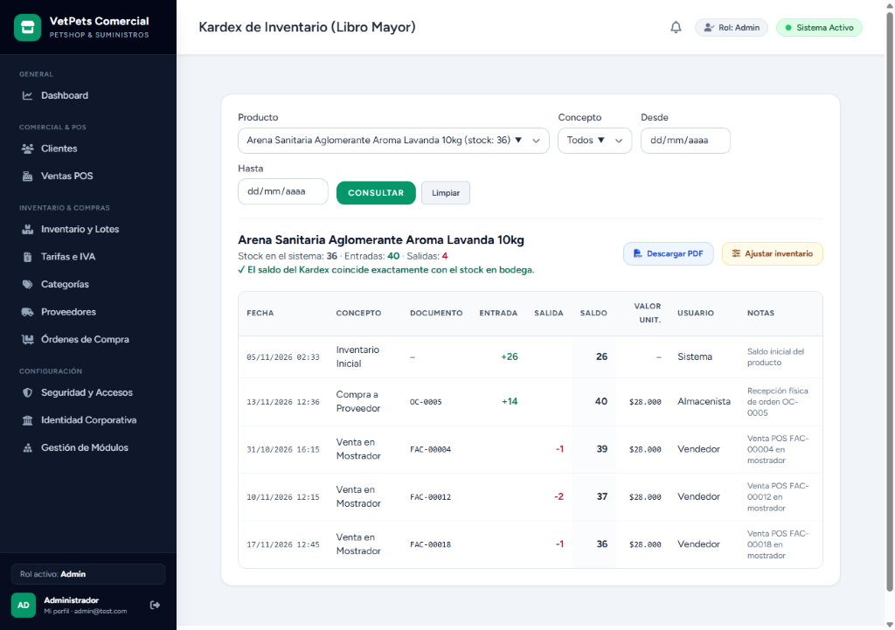

*Nota.* Vista `/inventario/kardex` filtrable por producto, concepto y rango de fechas, con conciliación frente al stock físico y acceso a ajuste auditado y descarga PDF. Fuente: Elaboración propia.

### 7.3. Auditoría, Interoperabilidad (API REST v1 y Excel v4) y Automatización

* **Auditoría y Bitácora de Seguridad (Req. 10):** Los seis modelos de negocio (`Category`, `Product`, `Client`, `Provider`, `Sale`, `Purchase`) usan el trait `LogsActivity` (`logOnlyDirty()`), registrando `old` vs. `attributes` en `activity_log`. Adicionalmente, `AccessControlService::saveUser()` escribe en el canal dedicado `activity('seguridad')` cada asignación o cambio de roles y permisos directos. La vista `/auditoria` (`AuditController`, ilustrada en el Anexo A) ofrece filtros por módulo/canal, evento, usuario y fechas con comparación visual (*Visual Diffs*).
* **API RESTful v1 con Sanctum (Req. 12):** Implementada en `routes/api.php` con 7 endpoints (Tabla 6). En `POST /api/v1/login`, si el usuario es multi-rol se exige el campo `role` (`422` si se omite) y se incrusta la habilidad `rol:<nombre>` en el token Bearer. En peticiones posteriores, `User::activeRole()` extrae dicho rol del `currentAccessToken()` para evaluar permisos efectivos, garantizando respuestas `401 Unauthorized` y `403 Forbidden`. La colección completa (`ERP_API.postman_collection.json`) y ejemplos JSON se documentan en el **Anexo E**.
* **Excel v4 con Validación por Fila (Req. 13):** `ExcelController` coordina la exportación de productos (`/productos/exportar`) y ventas (`/ventas/exportar`), la descarga de plantilla (`/productos/plantilla`) y la carga masiva (`/productos/importar`). `ProductsImport` implementa `WithValidation`, `SkipsOnFailure` y `prepareForValidation()` (normalización de códigos de barras), procesando filas válidas con apertura en Kardex (`inventario_inicial`) y reportando las filas rechazadas con número de fila, campo y motivo (ver Anexo A).
* **Automatización Asíncrona y Schedule (Req. 14):** Dos eventos `ShouldDispatchAfterCommit` (`SaleRegistered` $\to$ `CheckLowStock` $\to$ `LowStockNotification`; y `PurchaseReceived` $\to$ `NotifyPurchaseReceived` $\to$ `PurchaseReceivedNotification` con PDF adjunto) operan por los canales `['mail', 'database']` hacia Mailpit (puerto 8025) y la campana web (`/notificaciones`). En `routes/console.php` se programan `erp:resumen-diario` a las 19:00 (`America/Bogota`, `DailySummaryNotification`) y `activitylog:clean --days=180` a las 00:00 (evidencia en Mailpit en el Anexo A).

#### Tabla 6. Catálogo de los 7 Endpoints de la API REST v1 (`routes/api.php`)

| Método y Ruta | Controlador | Seguridad / Permiso | Función y Códigos HTTP |
| :--- | :--- | :--- | :--- |
| `POST /api/v1/login` | `Api\AuthController@login` | Público | Valida credenciales y rol; emite token Sanctum `rol:<nombre>` (`201`, `422`). |
| `GET /api/v1/me` | `Api\AuthController@me` | `auth:sanctum`, `active_user` | Retorna perfil, `rol_activo` del token y lista de `permisos` efectivos (`200`, `401`). |
| `POST /api/v1/logout` | `Api\AuthController@logout` | `auth:sanctum`, `active_user` | Revoca y elimina el token Bearer actual (`200`, `401`). |
| `GET /api/v1/products` | `Api\ProductController@index` | `permission:ver-productos` | Catálogo paginado de productos activos (`ProductResource`) con filtros (`200`, `403`). |
| `GET /api/v1/products/{product}` | `Api\ProductController@show` | `permission:ver-productos` | Detalle JSON de un producto con categoría y stock (`200`, `404`). |
| `POST /api/v1/sales` | `Api\SaleController@store` | `permission:crear-ventas` | **Escritura transaccional:** Registra venta vía `SaleService` y descuenta Kardex (`201`, `403`, `422`). |
| `GET /api/v1/sales/{sale}` | `Api\SaleController@show` | `permission:ver-ventas` | Retorna factura completa (`SaleResource`) con cliente y renglones (`200`, `403`, `404`). |

*Nota.* Ejemplos cURL y respuestas JSON completas disponibles en el **Anexo E**.

### 7.4. Datos Semilla (Seeders) y Matriz de los 17 Requisitos Funcionales

Para garantizar un despliegue evaluable inmediato (`./vendor/bin/sail artisan migrate:fresh --seed`, **Requisito 16**), `DatabaseSeeder` carga los **42 permisos** y 3 roles base, identidad corporativa, 8 módulos configurables, 10 categorías, 10 proveedores, 12 productos con tarifas de IVA diferenciadas y fechas de vencimiento, 10 clientes, 8 órdenes de compra, 20 ventas POS con su historial completo en `inventory_movements` y las 5 cuentas de demostración de la Tabla 7. La Tabla 8 consolida la verificación de los **17 requisitos funcionales** exigidos por la guía oficial.

#### Tabla 7. Usuarios de Demostración Cargados por `DatabaseSeeder` (Contraseña: `password`)

| Perfil Operativo | Correo Electrónico | Roles Base (Spatie) | Permiso Directo | Estado | Propósito en Sustentación |
| :--- | :--- | :--- | :---: | :---: | :--- |
| **Administrador** | `admin@test.com` | `admin` (42 permisos) | — | Activo | Control total, Configuración, Matriz RBAC, Marca Blanca y Auditoría. |
| **Vendedor POS** | `vendedor@test.com` | `vendedor` | — | Activo | Clientes, consulta de catálogo y Ventas POS (bloqueado en Compras/Kardex). |
| **Almacenista** | `almacenista@test.com` | `almacenista` | — | Activo | Catálogo, Excel, Kardex, Proveedores y Compras (bloqueado en Ventas POS). |
| **Supervisor** | `supervisor@test.com` | `vendedor`, `almacenista` | `ver-reportes` | Activo | Demuestra selección de **Rol Activo** en sesión/API y permiso directo persistente. |
| **Ex-Empleado** | `inactivo@test.com` | `vendedor` | — | **Inactivo** | Demuestra rechazo inmediato en login web y API (`RN-13`). |

*Nota.* Credenciales documentadas igualmente en `README.md` y en el Anexo B.

#### Tabla 8. Matriz de Cumplimiento y Trazabilidad de los 17 Requisitos Funcionales

| # | Requisito Funcional (Guía Oficial) | Estado | Implementación Principal (`ERP_Veterinaria`) | Evidencia |
| :---: | :--- | :---: | :--- | :--- |
| **1** | Autenticación (Breeze) y usuarios activos/inactivos. | Cumplido | `LoginRequest`, `EnsureUserIsActive`, `AccessControlService`. | Sec. 6.2 (RN-13), Tabla 7, Cap. 8. |
| **2** | Mínimo 4 entidades maestras con CRUD, FormRequests, SoftDelete, papelera y restauración. | Cumplido | `Product`, `Category`, `Provider`, `Owner` y 8 `FormRequests`. | Sec. 7.1 (**Tabla 5**). |
| **3** | Roles por puesto (mín. 4), permisos por módulo/acción, middleware y `@can`. | Cumplido | `RolePermissionSeeder` (42 permisos), `HasMiddleware`, `@can`. | Sec. 6.4 y **Anexo D**. |
| **4** | Configuración: multi-rol, permisos directos, rol activo, matriz y protecciones. | Cumplido | `ActiveRoleController`, `EnsureActiveRoleSelected`, `AccessControlService`. | Sec. 6.2 (RN-12–15), Fig. 7. |
| **5** | Proceso de salida (venta POS) cabecera/detalle, transacción, consecutivo y anulación. | Cumplido | `SaleController`, `SaleService::register()` y `cancel()`. | Sec. 7.2, Fig. 6 y Anexo A. |
| **6** | Proceso de entrada (compra) con recepción total o parcial. | Cumplido | `PurchaseController`, `PurchaseService::register()` y `receive()`. | Sec. 7.2 y Fig. 6. |
| **7** | Mínimo 8 reglas de negocio en servicios y probadas. | Cumplido | **17 reglas de negocio** en servicios, middlewares y listeners. | Sec. 6.2 (**Tabla 3**). |
| **8** | Dashboard con mínimo 6 KPIs filtrados por permisos y tabla accionable. | Cumplido | `DashboardController::__invoke()` y `dashboard.blade.php`. | Sec. 9.2 (**Tabla 10**) y Fig. 8. |
| **9** | Mínimo 2 documentos PDF con identidad de la empresa. | Cumplido | **3 PDFs** (`pdf/sale`, `pdf/purchase`, `pdf/kardex`) vía `DomPDF`. | Sec. 7.2 y Anexo A. |
| **10** | Auditoría (`activitylog`) de mínimo 5 modelos + bitácora de seguridad. | Cumplido | `LogsActivity` en **6 modelos** + canal `activity('seguridad')`. | Sec. 7.3 y Anexo A. |
| **11** | Kardex permanente; el recurso controlado solo cambia por movimientos. | Cumplido | `InventoryMovement`, `InventoryService`, `InventoryController`. | Sec. 4.2, 7.2 y Fig. 3. |
| **12** | API REST v1 con Sanctum: login con rol, mín. 4 endpoints (1 escritura) y colección. | Cumplido | **7 endpoints** (`Api\*Controller`) + `ERP_API.postman_collection.json`. | Sec. 7.3 (**Tabla 6**) y **Anexo E**. |
| **13** | Exportación a Excel e importación masiva con validación por fila. | Cumplido | `ExcelController`, `Products/SalesExport`, `ProductsImport` (`SkipsOnFailure`). | Sec. 7.3 y Anexo A. |
| **14** | Mínimo 2 eventos con listeners, 2 notificaciones (correo + campana) y 1 tarea programada. | Cumplido | `SaleRegistered`, `PurchaseReceived`, 3 notificaciones y `erp:resumen-diario`. | Sec. 7.3 y `Clase14Test`. |
| **15** | Mínimo 10 pruebas en verde, Pint sin errores y GitHub Actions en verde. | Cumplido | **42 pruebas (284 aserciones, 14 clases)**, Pint 0 errores (170 arch.), CI. | Cap. 8 (**Tabla 9**, Figs. 4–5). |
| **16** | Seeders con datos realistas y usuario por rol documentado en README. | Cumplido | `DatabaseSeeder`, `CommercialTransactionsSeeder` y `README.md`. | Sec. 7.4 (**Tabla 7**) y Anexo B. |
| **17** | Atención de la retroalimentación del avance 2. | Cumplido | Cierre de los 7 compromisos del corte 2 y formato APA 7. | Sec. 6.1 (**Tabla 2**). |

*Nota.* Elaboración propia a partir de los lineamientos oficiales del proyecto final.

---

## 8. Pruebas y Aseguramiento de la Calidad

### 8.1. Estrategia, Entorno y Consolidado de las 42 Pruebas Automatizadas

La verificación automatizada se ejecuta con **PHPUnit 11** sobre **MySQL 8.4** tanto en local (`./vendor/bin/sail test`) como en **GitHub Actions** (contenedor de servicio `mysql:8.4`), empleando el trait `RefreshDatabase` para garantizar aislamiento entre casos. La suite comprende **42 pruebas automatizadas** en **14 clases de prueba** con **284 aserciones** (superando ampliamente el mínimo de 10 pruebas del **Requisito 15**), consolidadas en la Tabla 9. El detalle método por método de las pruebas de dominio empresarial y la salida literal de las dos pruebas con recorrido narrativo en consola (`FlujoComercialKardexTest`) se documentan en el **Anexo B**.

#### Tabla 9. Consolidado de la Suite de Pruebas Automatizadas (`./vendor/bin/sail test`)

| Archivo / Suite (`tests/`) | Clases | Pruebas | Aserciones | Cobertura de Requisitos y Reglas | Resultado |
| :--- | :---: | :---: | :---: | :--- | :---: |
| `Unit/ExampleTest` y `Feature/ExampleTest` | 2 | 2 | 3 | Arranque de la aplicación y respuesta HTTP base. | **PASS** |
| `Feature/Auth/*.php` y `ProfileTest.php` | 7 | 23 | 59 | **Req. 1:** Login, cierre de sesión, recuperación de contraseña, verificación y perfil. | **PASS** |
| `Feature/SecurityConfigTest.php` | 1 | 5 | 60 | **Req. 1, 3, 4, 7, 9, 10:** Rol Activo, usuario inactivo, protecciones RBAC, Marca Blanca, dependencias de módulos, tarifas IVA y bloqueo de lote vencido. | **PASS** |
| `Feature/ApiRestTest.php` | 1 | 5 | 106 | **Req. 5, 11, 12:** Login API con rol en token Sanctum, catálogo JSON, venta con Kardex, bloqueo `403` y revocación en logout. | **PASS** |
| `Feature/Clase14Test.php` | 1 | 4 | 11 | **Req. 14:** Eventos `SaleRegistered` y `PurchaseReceived`, alerta de stock bajo, comando `erp:resumen-diario` y centro de notificaciones. | **PASS** |
| `Feature/FlujoComercialKardexTest.php` | 1 | 2 | 6 | **Req. 5, 6, 7, 11, 12, 15:** Dos pruebas integrales con traza narrativa en consola (compra con recepción parcial y venta API con IVA 19 % y Kardex). | **PASS** |
| `Feature/SmokeRoutesTest.php` | 1 | 1 | 39 | **Integridad Global (Req. 1–16):** Recorrido de 39 rutas clave (CRUDs, formularios `/create`, PDFs de anuladas, Excel, Kardex, Auditoría, Configuración y Perfil) verificando `200 OK`. | **PASS** |
| **Total Verificado en PHPUnit** | **14** | **42** | **284** | **Cobertura integral de seguridad, transacciones, API y automatización** | **42 PASS** |

*Nota.* Fuente: Salida real de `./vendor/bin/sail test`. Detalle individual por método y traza de consola en el **Anexo B**.

**Figura 4**  
*Ejecución Completa de la Suite PHPUnit en Consola (`42 passed, 284 assertions`)*

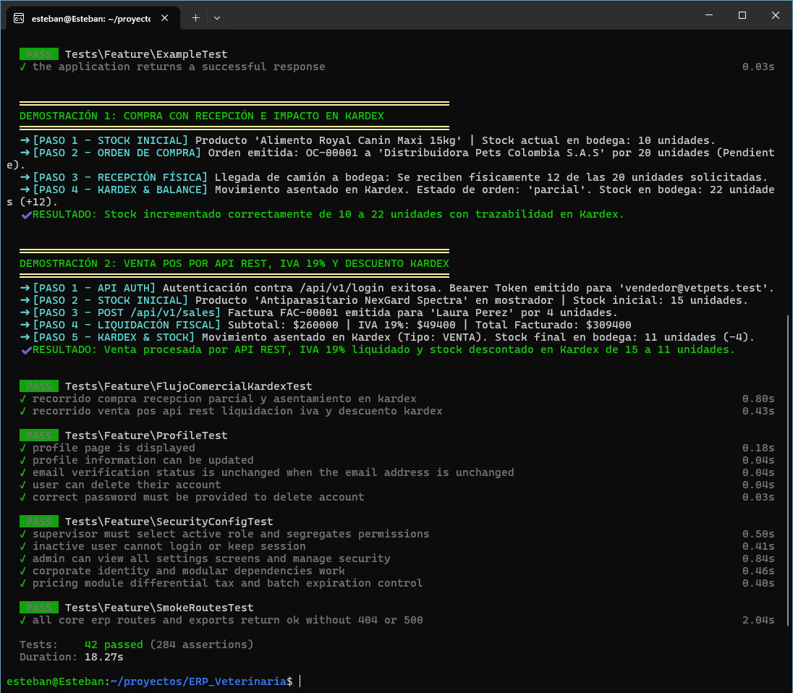

*Nota.* Salida real de `./vendor/bin/sail test` mostrando las pruebas narrativas de Kardex, el *smoke test* de 39 rutas y los 42 casos aprobados sin fallos. Fuente: Elaboración propia.

### 8.2. Verificación de Estilo (Laravel Pint) e Integración Continua (GitHub Actions)

Antes de cada integración a `main` se validó el cumplimiento de **PSR-12** mediante `./vendor/bin/sail pint --test`, obteniendo **`PASS`** sobre los **170 archivos PHP** del repositorio. En la nube, `.github/workflows/pruebas.yml` aprovisiona Ubuntu con PHP 8.4, Node.js 22 y MySQL 8.4, compila activos de Vite, ejecuta `./vendor/bin/pint --test`, aplica migraciones y corre las **42 pruebas** automáticamente en cada `push` o `pull_request` (Figura 5).

**Figura 5**  
*Pipeline de Integración Continua en Verde en GitHub Actions*

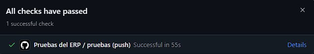

*Nota.* Ejecución exitosa del flujo de pruebas y estilo en `https://github.com/moliech/ERP_Veterinaria`. Fuente: Elaboración propia.

---

## 9. Resultados y Análisis de Impacto

### 9.1. Resultados Funcionales, Operativos y Evidencias Clave

La puesta en marcha de **VetPets ERP** resuelve de forma verificable las cinco problemáticas diagnosticadas en el Capítulo 2:

1. **Control real de entregas fraccionadas y separación comercial de tarifas:** `PurchaseService::receive()` desacopla la orden `pendiente` del ingreso físico en bodega (`parcial`/`recibida`) asentado en Kardex, mientras que el módulo **Tarifas e IVA** (`/tarifas`) separa la fijación de precios, márgenes y tarifas tributarias (0 %, 5 %, 19 %) de la gestión de estantería (Figura 6).
2. **Protección del inventario en ventas POS y trazabilidad de anulaciones:** `SaleService` bloquea ventas sin existencias o con lotes expirados, liquida el IVA diferencial y permite anular facturas restituyendo unidades al Kardex sin perder la consulta histórica ni el PDF con sello **`ANULADA`** (Figura 7A–7B).
3. **Segregación dinámica de funciones en perfiles multi-rol:** El selector de **Rol Activo** (`/rol-activo`) garantiza que `supervisor@test.com` opere bajo un único rol por turno (`vendedor` o `almacenista`), bloqueando con `403 Forbidden` rutas no autorizadas mientras conserva su permiso directo `ver-reportes` (Figura 7C–7D).
4. **Visibilidad operativa y mantenimiento automatizado:** La auditoría con *Visual Diffs*, la importación masiva en Excel con reporte de filas erróneas y las notificaciones en Mailpit/campana reducen el trabajo manual repetitivo (capturas detalladas integradas en el **Anexo A**).

**Figura 6**  
*Evidencias de Abastecimiento y Gestión Comercial: Recepción Parcial en MySQL y Tarifas con IVA Diferencial*

| 6A. Recepción Parcial de Compra y Stock en MySQL | 6B. Módulo de Tarifas, Margen e IVA Diferencial (`/tarifas`) |
| :---: | :---: |
|  | 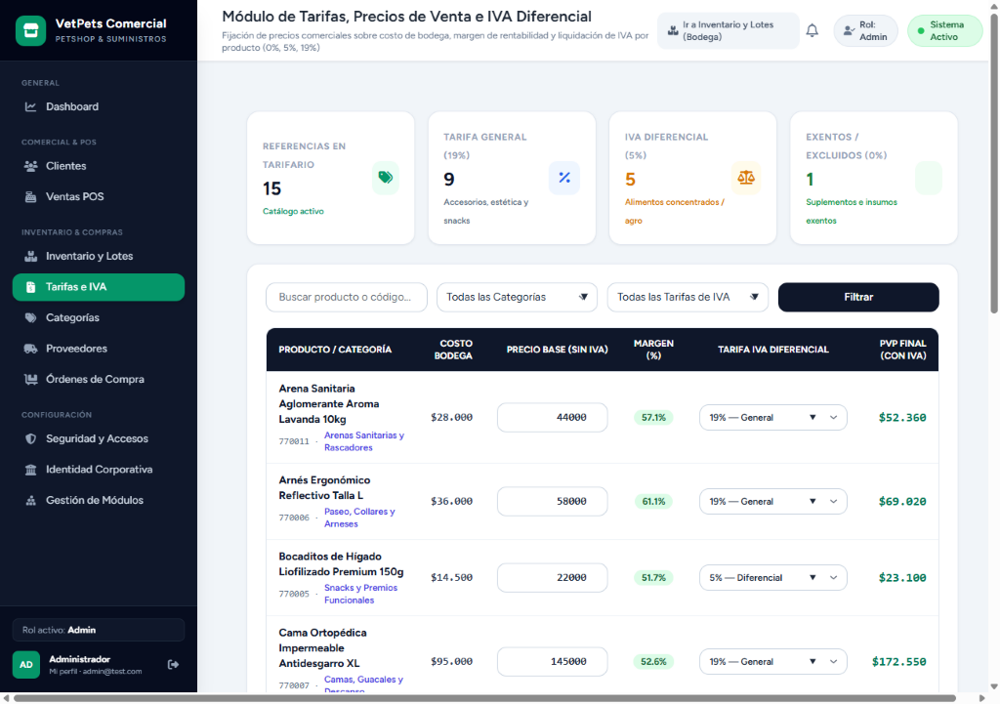 |

*Nota.* A la izquierda (6A), orden en estado `parcial` (6 de 10 unidades) verificada en MySQL; a la derecha (6B), cálculo automático de margen sobre el último costo y selector de IVA (0 %, 5 %, 19 %). Fuente: Elaboración propia.

**Figura 7**  
*Validaciones de Reglas de Negocio: Control de Stock, Factura Anulada y Segregación por Rol Activo*

| 7A. Bloqueo por Stock Insuficiente (`RN-06`) | 7B. Consulta de Factura Anulada con Sello `ANULADA` (`RN-10`) |
| :---: | :---: |
|  | 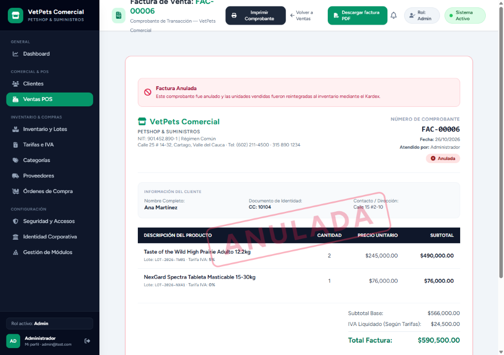 |
| **7C. Selección de Rol Activo (`RN-12`)** | **7D. Bloqueo `403 Forbidden` por Rol Activo** |
| 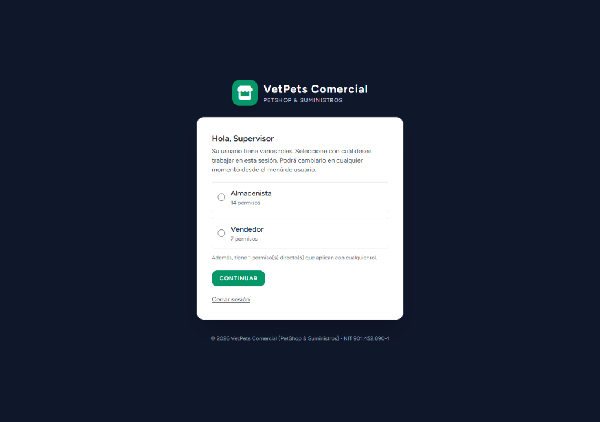 | 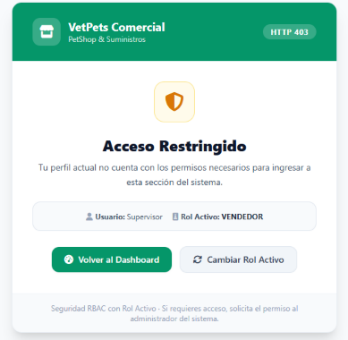 |

*Nota.* Evidencia funcional de protección transaccional en ventas POS y segregación de funciones del usuario `supervisor@test.com` operando como `vendedor` al intentar acceder a `/purchases`. Fuente: Elaboración propia.

### 9.2. Dashboard de Indicadores (KPIs), Tablas Accionables y Toma de Decisiones

En cumplimiento del **Requisito 8**, `DashboardController` presenta un cuadro de mando adaptado a los permisos efectivos del usuario y a los módulos habilitados (Figura 8), integrando **7 indicadores y tablas accionables** que conectan el análisis gerencial con la ejecución operativa inmediata (Tabla 10).

**Figura 8**  
*Dashboard Gerencial con KPIs Financieros y Tablas Accionables de Reabastecimiento y Caducidad*

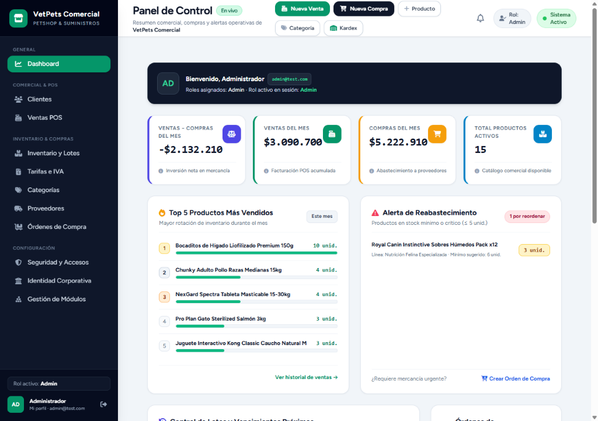

*Nota.* Vista `/dashboard` con indicadores mensuales, campana de notificaciones, Top 5 de productos más vendidos y tablas accionables de stock crítico y lotes próximos a vencer. Fuente: Elaboración propia.

#### Tabla 10. Indicadores (KPIs) y Tablas Accionables del Dashboard para la Toma de Decisiones

| # | Indicador (KPI) / Tabla | Regla de Cálculo (`DashboardController`) | Permiso | Acción Directa en Interfaz | Decisión Gerencial u Operativa |
| :---: | :--- | :--- | :---: | :--- | :--- |
| **1** | **Balance Mensual (Ventas − Compras)** | Suma `sales.total` no anuladas menos `purchases.total` no anuladas del mes. | `ver-reportes` | Indicador cromático (`+$` superávit verde / `-$` inversión índigo). | Evaluar liquidez operativa mensual y regular el ritmo de nuevas órdenes de compra. |
| **2** | **Ventas del Mes** | `Sale::where('status','!=','anulada')->whereMonth(...)->sum('total')` | `ver-ventas` | Acceso directo a `/sales` y botón **Nueva Venta** (`/sales/create`). | Monitorear cumplimiento de metas comerciales frente a periodos anteriores. |
| **3** | **Compras del Mes y Pendientes** | Suma de compras válidas del mes + conteo en estado `pendiente` o `parcial`. | `ver-compras` | Enlace a `/purchases` para gestionar recepciones en tránsito. | Controlar el presupuesto comprometido con proveedores y entregas parciales abiertas. |
| **4** | **Productos Activos en Catálogo** | `Product::where('active', true)->count()` | `ver-productos` | Acceso directo a `/products` y al Kardex (`/inventario/kardex`). | Supervisar amplitud del surtido disponible y detectar referencias inactivas. |
| **5** | **Top 5 Productos Más Vendidos** | `SaleDetail` agrupado por `product_id` (mes actual, ventas válidas, `limit(5)`). | `ver-reportes`, `ver-ventas` | Tabla con código de barras, precio y volumen vendido con enlace al producto. | Identificar artículos estrella para negociar descuentos por volumen con proveedores. |
| **6** | **Tabla Accionable: Stock Crítico** | Productos activos con `current_stock <= 5` o `<= minimum_stock`. | `ver-productos` | Botón directo **«Crear orden de compra»** (`/purchases/create`) y Kardex. | Prevenir quiebres de inventario generando pedidos de reposición en un clic. |
| **7** | **Tabla Accionable: Caducidad ($\le 60$ días)** | Productos activos con `expiration_date <= now()->addDays(60)`. | `ver-productos` | Insignia *Vencido* / *Próximo a vencer* y enlace a `/products/{id}/edit` y `/tarifas`. | Mitigar pérdidas por merma aplicando promociones en tarifas o retiro por ajuste de Kardex. |

*Nota.* Fuente: `app/Http/Controllers/DashboardController.php` y `resources/views/dashboard.blade.php`.

---

## 10. Conclusiones y Trabajo Futuro

### 10.1. Conclusiones

1. **Cumplimiento integral de los 17 requisitos:** **VetPets ERP** evolucionó de 11 componentes iniciales a **15 subsistemas funcionales** verificables que cubren la totalidad de los requisitos funcionales y no funcionales exigidos para la cadena comercial de **VetPets Comercial S.A.S.** (Tabla 8).
2. **Integridad transaccional mediante Kardex:** Centralizar toda variación de existencias en `InventoryService` dentro de `DB::transaction` con `lockForUpdate` garantiza coherencia entre recepciones parciales de compras, cargas masivas en Excel, ventas POS, anulaciones y el libro mayor `inventory_movements`.
3. **Segregación dinámica y trazabilidad verificable:** La combinación de **42 permisos** (32 operativos y 10 administrativos), **Rol Activo en sesión y en tokens Sanctum**, permisos directos, auditoría de 6 modelos de negocio y canal dedicado `activity('seguridad')` consolida un control interno robusto sin sacrificar operatividad.
4. **Calidad y entrega continua:** El flujo colaborativo en ramas Git, el formateo PSR-12 en **170 archivos** con Laravel Pint y las **42 pruebas automatizadas (284 aserciones en 14 clases)** ejecutadas en GitHub Actions aseguran estabilidad ante cambios futuros y despliegue reproducible con Docker Sail.

### 10.2. Trabajo Futuro

1. **Facturación Electrónica DIAN:** Integrar `SaleService` mediante colas asíncronas con un proveedor tecnológico autorizado para emitir XML UBL 2.1, CUFE, firma digital y código QR oficial.
2. **Gestión Multi-Lote FEFO (*First Expired, First Out*):** Extender el modelo actual de lote vigente hacia una tabla auxiliar `product_batches` para descontar automáticamente en POS las unidades del lote más próximo a vencer.
3. **Aplicación Móvil / PWA y Pasarela de Pagos:** Consumir la API REST v1 existente desde una interfaz móvil con lector de códigos de barras para conteos físicos e integrar conciliación de pagos electrónicos (PSE/tarjetas).

---

## Referencias

American Psychological Association. (2020). *Publication manual of the American Psychological Association* (7th ed.). https://doi.org/10.1037/0000165-000

Esteves, J., & Pastor, J. (2001). Enterprise resource planning systems research: An annotated bibliography. *Communications of the Association for Information Systems*, *7*(1), 1–52. https://doi.org/10.17705/1CAIS.00708

Ferraiolo, D. F., Kuhn, D. R., & Chandramouli, R. (2003). *Role-based access control*. Artech House.

Ferraiolo, D. F., Sandhu, R., Gavrila, S., Kuhn, D. R., & Chandramouli, R. (2001). Proposed NIST standard for role-based access control. *ACM Transactions on Information and System Security*, *4*(3), 224–274. https://doi.org/10.1145/501978.501980

Fielding, R. T. (2000). *Architectural styles and the design of network-based software architectures* [Tesis doctoral, University of California, Irvine]. UCI Campus Repository. https://ics.uci.edu/~fielding/pubs/dissertation/top.htm

Fowler, M. (2002). *Patterns of enterprise application architecture*. Addison-Wesley Professional.

International Accounting Standards Board. (2021). *Norma Internacional de Contabilidad 2 (NIC 2): Inventarios*. IFRS Foundation. https://www.ifrs.org/issued-standards/list-of-standards/ias-2-inventories/

Laravel. (2024). *Laravel 11.x documentation*. https://laravel.com/docs/11.x

Laudon, K. C., & Laudon, J. P. (2020). *Sistemas de información gerencial* (16.ª ed.). Pearson Educación.

Maatwebsite. (2024). *Laravel Excel documentation (v3.1 / v4.x)*. Spartner. https://docs.laravel-excel.com/

Monk, E., & Wagner, B. (2013). *Concepts in enterprise resource planning* (4th ed.). Cengage Learning.

Panorama Consulting Group. (2023). *The 2023 ERP report: People, process, technology*. https://www.panorama-consulting.com/

Pressman, R. S., & Maxim, B. R. (2020). *Ingeniería de software: Un enfoque práctico* (9.ª ed.). McGraw-Hill Education.

Romney, M. B., & Steinbart, P. J. (2021). *Accounting information systems* (15th ed.). Pearson.

Silberschatz, A., Korth, H. F., & Sudarshan, S. (2019). *Database system concepts* (7th ed.). McGraw-Hill Education.

Spatie. (2024a). *Laravel-activitylog documentation (v4)*. https://spatie.be/docs/laravel-activitylog/v4/introduction

Spatie. (2024b). *Laravel-permission documentation (v6)*. https://spatie.be/docs/laravel-permission/v6/introduction

World Wide Web Consortium. (2018). *Web Content Accessibility Guidelines (WCAG) 2.1*. W3C Recommendation. https://www.w3.org/TR/WCAG21/

---

## Anexos

A continuación se incorporan los cinco anexos técnicos y operativos exigidos en los lineamientos del proyecto final, incluyendo el detalle completo de procedimientos, pruebas, diccionario de datos, matriz de los 42 permisos y especificación de la API REST v1.

---

### Anexo A: Manual de Usuario por Proceso Operativo y Evidencias Complementarias

#### A.1. Ingreso al Sistema y Selección de Rol Activo
1. Acceder a `http://localhost:8060/login` e ingresar las credenciales asignadas (Tabla 7).
2. **Usuario con un solo rol (`admin`, `vendedor`, `almacenista`):** Redirección directa a `/dashboard`.
3. **Usuario multi-rol (`supervisor@test.com`):** El sistema presenta `/rol-activo` para elegir el puesto del turno (*Vendedor* o *Almacenista*). Para alternar de rol sin cerrar sesión, pulsar **«Cambiar rol»** en la parte inferior del menú lateral.

#### A.2. Catálogo, Papelera, Tarifas e Importación Masiva en Excel
1. **Productos (`/products`):** Crear/editar referencias con categoría, código de barras, stock mínimo, lote (`batch_code`) y vencimiento (`expiration_date`). El borrado lógico envía los registros a la papelera (activable mediante el filtro **«Ver Papelera / Eliminados»** para restaurarlos en un clic).
2. **Tarifas e IVA (`/tarifas`):** Definir precio base de venta y tarifa de IVA (`0 %`, `5 %` o `19 %`) visualizando el margen porcentual sobre el último costo de compra.
3. **Exportación e Importación Excel (`/productos/importar`):** Descargar la plantilla `.xlsx` oficial, diligenciar las filas y subir el archivo (`.xlsx`, `.xls` o `.csv`). Las filas válidas se cargan con asiento `inventario_inicial` en Kardex y las inválidas se listan detallando número de fila, campo y causa (Figura 9).

**Figura 9**  
*Interfaz de Importación Masiva de Productos en Excel (`/productos/importar`)*

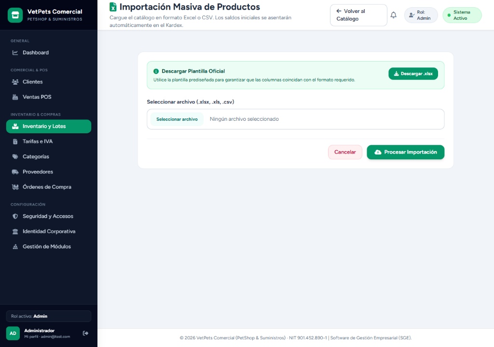

*Nota.* Carga de catálogo en Excel v4 con descarga de plantilla oficial y validación fila por fila (`SkipsOnFailure`). Fuente: Elaboración propia.

#### A.3. Abastecimiento, Kardex, Ventas POS y Comprobantes PDF
1. **Compras (`/purchases`):** Emitir orden en estado `pendiente` (`OC-#####`); al arribar la mercancía, registrar unidades recibidas en `/purchases/{id}` (transición a `parcial` o `recibida` con asiento en Kardex y correo con PDF adjunto).
2. **Kardex (`/inventario/kardex`):** Consultar movimientos de *Todos los productos* o de una referencia específica por rango de fechas, descargar el libro mayor en PDF horizontal o registrar ajustes por conteo físico con justificación obligatoria.
3. **Ventas POS (`/sales/create`) y Anulaciones:** Seleccionar cliente y artículos (validando stock y vigencia del lote), facturar con IVA diferencial y descargar el comprobante PDF (`/sales/{id}/pdf`, Figura 10). Los administradores pueden anular facturas restituyendo el inventario al Kardex; toda factura o compra anulada permanece consultable con sello **`ANULADA`**.

**Figura 10**  
*Evidencias de Facturación POS: Registro con IVA Diferencial y Comprobante Interno en PDF*

| 10A. Venta POS con IVA Diferencial y Descuento en MySQL | 10B. Comprobante Interno PDF (Marca Blanca) |
| :---: | :---: |
|  |  |

*Nota.* A la izquierda (10A), facturación combinando distintas tarifas de IVA; a la derecha (10B), PDF generado con `DomPDF` y datos de `company_settings`. Fuente: Elaboración propia.

#### A.4. Auditoría, Notificaciones, Mi Perfil y Configuración del Sistema
1. **Auditoría (`/auditoria`):** Filtrar cambios de los 6 modelos de negocio o del canal `seguridad` por evento, usuario y fechas con comparación visual de valores anteriores y nuevos (Figura 11).
2. **Notificaciones y Correo:** Consultar alertas de stock bajo y recepciones en la campana superior (`/notificaciones`) o revisar los correos y el resumen diario en Mailpit (`http://localhost:8025`, Figura 12).
3. **Mi Perfil (`/profile`) y Configuración (`/configuracion`):** Cada usuario puede actualizar sus datos y contraseña en español. El administrador gestiona usuarios (incluyendo clonación de roles/permisos en un clic), roles, matriz de los 42 permisos, Identidad Corporativa y Gestión de Módulos (Figura 13).

**Figura 11**  
*Módulo de Auditoría y Bitácora de Seguridad con Comparación Visual de Cambios (`/auditoria`)*

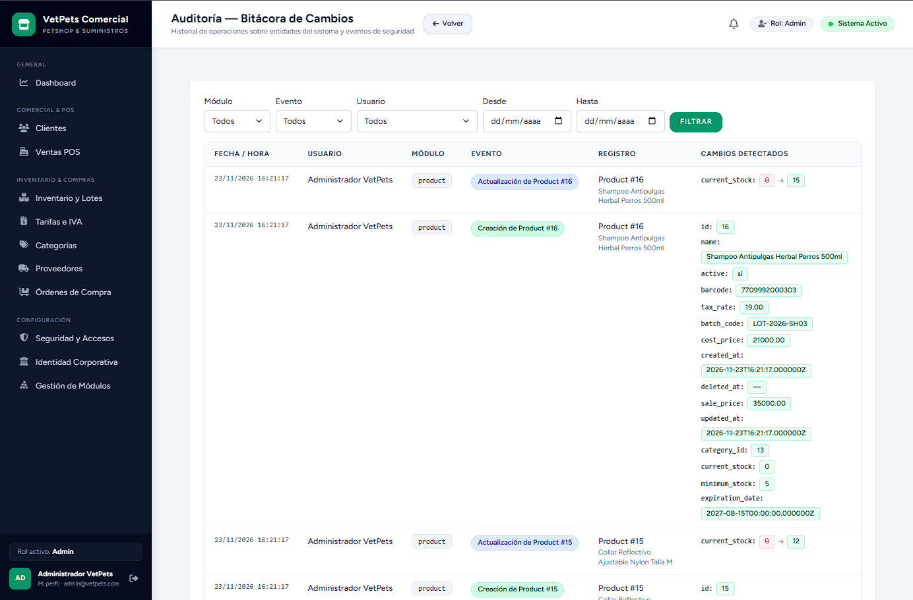

*Nota.* Inspección de atributos anteriores (`old`) y nuevos (`attributes`) sobre modelos de negocio y eventos del canal `seguridad`. Fuente: Elaboración propia.

**Figura 12**  
*Notificación de Resumen Gerencial Diario Capturada en Mailpit (`http://localhost:8025`)*

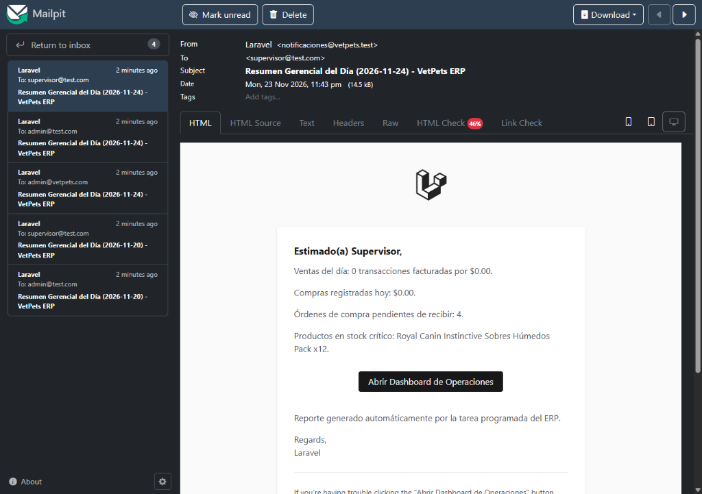

*Nota.* Correo despachado por `erp:resumen-diario` hacia el servidor SMTP local Mailpit. Fuente: Elaboración propia.

**Figura 13**  
*Panel de Gestión de Módulos con Protección de Módulos Núcleo y Dependencias Activas*

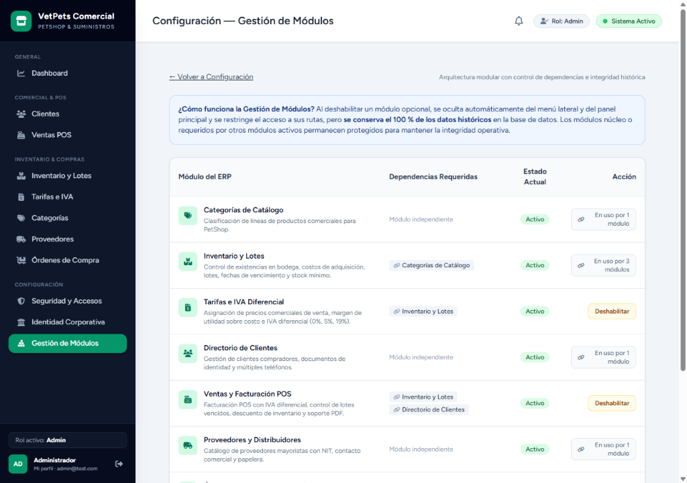

*Nota.* Pantalla `/configuracion/modulos` evidenciando el bloqueo preventivo sobre módulos núcleo y con dependientes activos. Fuente: Elaboración propia.

---

### Anexo B: Manual de Instalación, Despliegue y Detalle de Pruebas Automatizadas

#### B.1. Prerrequisitos y Despliegue Paso a Paso con Docker Sail
* **Prerrequisitos:** Docker Desktop (con WSL 2 en Windows) o Docker Engine, Git y puertos libres `8060` (Web), `3307` (MySQL) y `8025`/`1025` (Mailpit).
* **Pasos de instalación desde cero:**

```bash
# 1. Clonar repositorio y ubicarse en la etiqueta oficial
git clone https://github.com/moliech/ERP_Veterinaria.git
cd ERP_Veterinaria
git checkout final

# 2. Configurar entorno (.env.example ya trae puertos 8060, 3307 y Mailpit 1025)
cp .env.example .env

# 3. Instalar dependencias Composer (Opción A: local | Opción B: contenedor Docker sin PHP host)
composer install
# Alternativa Zero-PHP Host:
# docker run --rm -u "$(id -u):$(id -g)" -v "$(pwd):/var/www/html" -w /var/www/html \
#   laravelsail/php84-composer:latest composer install --ignore-platform-reqs

# 4. Levantar contenedores, generar llave, poblar BD y compilar frontend
./vendor/bin/sail up -d
./vendor/bin/sail artisan key:generate
./vendor/bin/sail artisan migrate:fresh --seed
./vendor/bin/sail npm install && ./vendor/bin/sail npm run build
```

* **Accesos:** Aplicación web en `http://localhost:8060` | Mailpit en `http://localhost:8025` | Credenciales en la Tabla 7 (contraseña `password`).
* **Comandos de verificación:**

```bash
./vendor/bin/sail test                                   # 42 pruebas, 284 aserciones (14 clases)
./vendor/bin/sail test --filter=FlujoComercialKardexTest # 2 pruebas narrativas de sustentación
./vendor/bin/sail pint --test                            # Estándar PSR-12 (170 archivos, PASS)
./vendor/bin/sail artisan erp:resumen-diario             # Disparo manual de resumen diario
```

#### B.2. Detalle Individual de las Pruebas de Dominio Empresarial

#### Tabla 11. Detalle Método por Método de las Pruebas de Dominio (`tests/Feature/`)

| Clase de Prueba | Método de Prueba | Regla / Requisito Validado | Resultado |
| :--- | :--- | :--- | :---: |
| **`SecurityConfigTest`** | `test_supervisor_must_select_active_role_and_segregates_permissions` | **RN-12 (Req. 3–4):** Obliga a elegir Rol Activo; bloquea `/purchases` como `vendedor` y `/sales` como `almacenista` conservando `ver-reportes`. | **PASS** |
| | `test_inactive_user_cannot_login_or_keep_session` | **RN-13 (Req. 1):** Rechaza login de usuario inactivo y expulsa sesión abierta al desactivarlo. | **PASS** |
| | `test_admin_can_view_all_settings_screens_and_manage_security` | **RN-14–15 (Req. 4, 10):** Valida pantallas de configuración, bloqueo de borrado de permisos en uso y no auto-desactivación. | **PASS** |
| | `test_corporate_identity_and_modular_dependencies_work` | **RN-16 (Req. 4, 9):** Actualización de `company_settings`, bloqueo de apagado con dependientes y `403` al apagar módulo hoja. | **PASS** |
| | `test_pricing_module_differential_tax_and_batch_expiration_control` | **RN-07, RN-09 (Req. 5, 7):** Tarifas de IVA diferencial (`0 %`, `5 %`, `19 %`) y rechazo de venta de lote vencido. | **PASS** |
| **`ApiRestTest`** | `test_login_y_deteccion_de_rol_activo_por_token` | **RN-12 (Req. 12):** Exige `role` en login multi-rol (`422`) y retorna permisos efectivos en `/api/v1/me`. | **PASS** |
| | `test_catalogo_de_productos_por_api` | **RN-08 (Req. 12):** Respuesta paginada y filtrada de `GET /api/v1/products` con `ProductResource`. | **PASS** |
| | `test_vendedor_puede_registrar_venta_transaccional_con_kardex` | **RN-05, RN-06, RN-09 (Req. 5, 11–12):** `POST /api/v1/sales` factura, descuenta stock y asienta Kardex. | **PASS** |
| | `test_almacenista_no_puede_crear_ventas_en_api` | **RN-12 (Req. 3, 12):** Token `rol:almacenista` recibe `403 Forbidden` al intentar facturar. | **PASS** |
| | `test_logout_revoca_el_token` | **Req. 12:** `POST /api/v1/logout` elimina el registro de `personal_access_tokens`. | **PASS** |
| **`Clase14Test`** | `test_evento_sale_registered_dispara_alerta_stock_bajo_cuando_cruza_umbral` | **RN-17 (Req. 14):** Venta que deja stock $\le 5$ encola `LowStockNotification`. | **PASS** |
| | `test_evento_purchase_received_notifica_al_usuario_creador` | **RN-03 (Req. 6, 14):** Recepción en `PurchaseService` despacha `PurchaseReceivedNotification` con PDF. | **PASS** |
| | `test_comando_resumen_diario_ejecuta_y_notifica_a_usuarios_con_permiso_reportes` | **Req. 14:** `erp:resumen-diario` notifica a `admin` y `supervisor` (`ver-reportes`), excluyendo al vendedor común. | **PASS** |
| | `test_usuario_puede_acceder_al_centro_de_notificaciones_y_marcar_como_leidas` | **Req. 14:** Valida `/notificaciones`, marcado como leídas y bloqueo `403` sobre alertas ajenas. | **PASS** |
| **`FlujoComercialKardexTest`** | `test_recorrido_compra_recepcion_parcial_y_asentamiento_en_kardex` | **RN-01–03, RN-05 (Req. 6, 11):** Traza en consola de compra de 20 uds., recepción parcial de 12 y entrada en Kardex. | **PASS** |
| | `test_recorrido_venta_pos_api_rest_liquidacion_iva_y_descuento_kardex` | **RN-05–06, RN-09, RN-11 (Req. 5, 11–12):** Traza en consola de venta API con IVA 19 % y salida en Kardex. | **PASS** |
| **`SmokeRoutesTest`** | `test_all_core_erp_routes_and_exports_return_ok_without_404_or_500` | **Req. 1–16:** Verifica `200 OK` en 39 rutas críticas (CRUDs, `/create`, PDFs de anuladas, Excel, Kardex, Auditoría, Perfil). | **PASS** |

*Nota.* Fuente: Suite ejecutada con `./vendor/bin/sail test` (42 pruebas totales sumando las 25 pruebas de Breeze, Perfil y ExampleTest).

#### B.3. Salida Literal de las Pruebas con Recorrido Narrativo en Consola (`FlujoComercialKardexTest`)

```text
$ ./vendor/bin/sail test tests/Feature/FlujoComercialKardexTest.php
  DEMOSTRACIÓN 1: COMPRA CON RECEPCIÓN E IMPACTO EN KARDEX
  ➜ [PASO 1 - STOCK INICIAL] 'Alimento Royal Canin Maxi 15kg' | Stock en bodega: 10 uds.
  ➜ [PASO 2 - ORDEN DE COMPRA] OC-00001 a 'Distribuidora Pets Colombia S.A.S' por 20 uds (Pendiente).
  ➜ [PASO 3 - RECEPCIÓN FÍSICA] Se reciben físicamente 12 de las 20 unidades solicitadas.
  ➜ [PASO 4 - KARDEX & BALANCE] Orden: 'parcial'. Stock en bodega: 22 unidades (+12).
  ✔ RESULTADO: Stock incrementado de 10 a 22 unidades con trazabilidad en Kardex.

  DEMOSTRACIÓN 2: VENTA POS POR API REST, IVA 19% Y DESCUENTO KARDEX
  ➜ [PASO 1 - API AUTH] Bearer Token emitido en /api/v1/login para 'vendedor@vetpets.test'.
  ➜ [PASO 2 - STOCK INICIAL] 'Antiparasitario NexGard Spectra' | Stock inicial: 15 uds.
  ➜ [PASO 3 - POST /api/v1/sales] Factura FAC-00001 emitida para 'Laura Perez' por 4 uds.
  ➜ [PASO 4 - LIQUIDACIÓN FISCAL] Subtotal: $260000 | IVA 19%: $49400 | Total: $309400
  ➜ [PASO 5 - KARDEX & STOCK] Movimiento VENTA asentado. Stock final: 11 unidades (-4).
  PASS  Tests\Feature\FlujoComercialKardexTest (2 passed, 6 assertions)
```

---

### Anexo C: Diccionario de Datos Completo del Sistema

Las Tablas 12 a 15 documentan la estructura íntegra de las **30 tablas físicas** generadas en MySQL 8.4 a partir de las 23 migraciones del proyecto (`database/migrations/`).

#### Tabla 12. Diccionario de Datos: Tabla `products` (Catálogo, Existencias, Tarifas y Caducidad)

| Columna | Tipo de Dato (MySQL) | Nulo | Clave / Defecto | Descripción Técnica |
| :--- | :--- | :---: | :---: | :--- |
| `id` | `BIGINT UNSIGNED` | No | `PK`, `AI` | Identificador único del producto. |
| `category_id` | `BIGINT UNSIGNED` | No | `FK` (`categories.id`) | Categoría comercial (`ON DELETE CASCADE`). |
| `barcode` | `VARCHAR(50)` | Sí | `UNIQUE` / `NULL` | Código de barras o referencia EAN/SKU. |
| `name` | `VARCHAR(150)` | No | — | Nombre comercial del producto. |
| `cost_price` / `sale_price` | `DECIMAL(10,2)` | No | `0.00` / — | Último costo de compra y precio base de venta. |
| `tax_rate` | `DECIMAL(5,2)` | No | `19.00` | Tarifa porcentual de IVA (`0.00`, `5.00`, `19.00`). |
| `current_stock` / `minimum_stock` | `INT` | No | `0` / `5` | Saldo físico (vía `InventoryService`) y umbral mínimo. |
| `batch_code` / `expiration_date` | `VARCHAR(50)` / `DATE` | Sí | `NULL` | Código de lote y fecha de caducidad vigentes. |
| `active` / `deleted_at` | `TINYINT(1)` / `TIMESTAMP` | No/Sí | `1` / `NULL` | Estado comercial y marca de `SoftDeletes`. |

*Nota.* Incluye además `created_at` y `updated_at` (`TIMESTAMP`).

#### Tabla 13. Diccionario de Datos: Tabla `inventory_movements` (Kardex Permanente)

| Columna | Tipo de Dato (MySQL) | Nulo | Clave / Índice | Descripción Técnica |
| :--- | :--- | :---: | :---: | :--- |
| `id` | `BIGINT UNSIGNED` | No | `PK`, `AI` | Identificador secuencial del asiento en Kardex. |
| `product_id` | `BIGINT UNSIGNED` | No | `FK` (`products.id`), `IDX` | Producto afectado (`ON DELETE RESTRICT`). |
| `type` | `ENUM('entrada','salida')` | No | — | Sentido físico del movimiento. |
| `concept` | `VARCHAR(30)` | No | — | `inventario_inicial`, `compra`, `venta`, `anulacion_venta`, `ajuste`. |
| `quantity` / `balance` | `INT UNSIGNED` / `INT` | No | — | Unidades transadas ($> 0$) y saldo físico resultante. |
| `unit_cost` | `DECIMAL(12,2)` | Sí | — | Costo o precio unitario de referencia del movimiento. |
| `reference_type` / `reference_id` | `VARCHAR(255)` / `BIGINT` | Sí | `IDX` (Polimórfico) | Documento origen (`Purchase`, `Sale` o `NULL`). |
| `user_id` / `notes` | `BIGINT` / `VARCHAR(255)` | Sí | `FK` (`users.id`) | Responsable y justificación obligatoria en ajustes. |

*Nota.* Fuente: `2026_11_04_053824_create_inventory_movements_table.php`.

#### Tabla 14. Diccionario de Datos: Compras (`purchases`, `purchase_details`) y Ventas (`sales`, `sale_details`)

| Tabla | Columnas y Tipos Principales | Claves | Descripción Técnica |
| :--- | :--- | :---: | :--- |
| **`purchases`** | `id`, `purchase_number` (`VARCHAR(30)`), `provider_id`, `user_id`, `purchase_date` (`DATE`), `status` (`ENUM`: pendiente, parcial, recibida, anulada), `subtotal`/`tax`/`total` (`DECIMAL(12,2)`), `received_at`, `notes`, `deleted_at`. | `PK`, `UQ(purchase_number)`, `FK(provider_id, user_id)` | Cabecera de orden de compra con ciclo de vida de recepciones parciales y borrado lógico. |
| **`purchase_details`** | `id`, `purchase_id`, `product_id`, `quantity` (`INT UNSIGNED`), `received_quantity` (`INT UNSIGNED`), `unit_cost`, `subtotal` (`DECIMAL(12,2)`). | `PK`, `FK(purchase_id, product_id)` | Renglones de la orden comparando unidades pedidas frente a recibidas. |
| **`sales`** | `id`, `invoice_number` (`VARCHAR(20)`), `client_id` (`owners.id`), `user_id`, `sale_date` (`DATE`), `subtotal`/`tax`/`total` (`DECIMAL(14,2)`), `status` (`ENUM`: pendiente, pagada, anulada), `notes`, `deleted_at`. | `PK`, `UQ(invoice_number)`, `FK(client_id, user_id)` | Cabecera de facturación POS con consecutivo corporativo y soporte de anulación. |
| **`sale_details`** | `id`, `sale_id`, `product_id`, `quantity` (`INT`), `unit_price` (`DECIMAL(12,2)`), `subtotal` (`DECIMAL(14,2)`). | `PK`, `FK(sale_id, product_id)` | Detalle de productos facturados en mostrador o vía API REST. |

*Nota.* Fuente: Migraciones de compras y ventas en `database/migrations/`.

#### Tabla 15. Diccionario de Datos: Tablas Maestras Complementarias, Configuración, Auditoría, RBAC e Infraestructura

| Nombre de la Tabla | Columnas y Tipos Principales (MySQL 8.4) | Claves / Restricciones | Propósito en el Sistema |
| :--- | :--- | :--- | :--- |
| **`users`** | `id`, `name`, `email` (`UQ`), `email_verified_at`, `password`, `active` (`TINYINT(1) DEFAULT 1`), `remember_token`, `timestamps`. | `PK(id)`, `UQ(email)` | Operadores del ERP con interruptor de acceso activo/inactivo (`RN-13`). |
| **`categories`** | `id`, `name` (`VARCHAR(100)`), `description`, `timestamps`, `deleted_at`. | `PK(id)`, `SoftDeletes` | Familias comerciales de productos PetShop. |
| **`providers`** | `id`, `name`, `nit` (`UQ`), `contact_name`, `phone`, `email`, `address`, `active`, `timestamps`, `deleted_at`. | `PK(id)`, `UQ(nit)`, `SoftDeletes` | Proveedores mayoristas y laboratorios. |
| **`owners` y `owner_phones`** | `owners`: `id`, `document_type`, `document_number` (`UQ`), `first_name`, `last_name`, `email` (`UQ`), `address`, `city`, `deleted_at`. `owner_phones`: `id`, `owner_id`, `phone_number`, `type`, `is_primary`. | `PK`, `UQ`, `FK(owner_id)` (`1:N`) | Directorio de clientes compradores y sus líneas telefónicas. |
| **`company_settings`** | `id`, `company_name`, `business_subtitle`, `nit`, `address`, `phone`, `email`, `tax_rate`, `currency`, `invoice_prefix`, `purchase_prefix`, `primary_color`, `icon_class`, `invoice_footer`. | `PK(id)` (registro único cacheado) | Parametrización Marca Blanca para interfaz web y documentos PDF. |
| **`system_modules`** | `id`, `key` (`UQ`), `name`, `description`, `icon`, `is_enabled`, `is_core`, `depends_on` (`JSON`). | `PK(id)`, `UQ(key)` | Modularidad activable con validación de dependencias (`RN-16`). |
| **`activity_log`** | `id`, `log_name` (`IDX`), `description`, `subject_type/id`, `event`, `causer_type/id`, `properties` (`JSON`), `batch_uuid`. | `PK`, índices polimórficos | Auditoría de 6 modelos de negocio y canal `seguridad`. |
| **`notifications`** | `id` (`UUID PK`), `type`, `notifiable_type/id`, `data`, `read_at`, `timestamps`. | `PK(UUID)` | Centro de notificaciones web (campana interactiva). |
| **`personal_access_tokens`** | `id`, `tokenable_type/id`, `name`, `token` (`UQ`), `abilities`, `last_used_at`, `expires_at`. | `PK`, `UQ(token)` | Tokens Bearer Sanctum con habilidad `["rol:<nombre>"]`. |
| **Spatie RBAC (5 tablas)** | `roles`, `permissions`, `role_has_permissions`, `model_has_roles`, `model_has_permissions`. | Claves compuestas e índices FK | Motor RBAC de 3 roles base, 42 permisos y permisos directos. |
| **Infraestructura (8) + `pets`** | `sessions`, `password_reset_tokens`, `cache`, `cache_locks`, `jobs`, `job_batches`, `failed_jobs`, `migrations` y `pets`. | Estándar Laravel | Sesiones, caché, colas asíncronas, migraciones y tabla histórica inicial. |

*Nota.* Total verificado: 30 tablas físicas en MySQL 8.4.

---

### Anexo D: Matriz Completa de Seguridad (42 Permisos, Roles y Acciones)

La Tabla 16 lista los **42 permisos individuales** registrados en `database/seeders/RolePermissionSeeder.php` (**32 permisos operativos** de módulos comerciales y **10 permisos administrativos** de configuración de usuarios, roles y permisos), junto con su asignación sobre los **3 roles base** (`admin`, `almacenista`, `vendedor`) y el comportamiento en el cuarto perfil operativo (**Supervisor**, bajo Rol Activo + permiso directo `ver-reportes`).

#### Tabla 16. Catálogo Completo de los 42 Permisos del Sistema (`RolePermissionSeeder.php`)

| # | Permiso (`accion-modulo`) | Módulo | `admin` | `almacenista` | `vendedor` | `supervisor` (Rol Activo / Directo) | Controlador Protegido |
| :---: | :--- | :--- | :---: | :---: | :---: | :---: | :--- |
| 1 | `ver-productos` | Productos / Tarifas | Sí | Sí | Sí | Ambos roles | `ProductController`, `PricingController`, `Api\ProductController` |
| 2 | `crear-productos` | Productos | Sí | Sí | No | Solo `almacenista` | `ProductController@create,store` |
| 3 | `editar-productos` | Productos / Tarifas | Sí | Sí | No | Solo `almacenista` | `ProductController@edit,update`, `PricingController@update` |
| 4 | `eliminar-productos` | Productos | Sí | No | No | No | `ProductController@destroy,restore` |
| 5 | `exportar-productos` | Excel Productos | Sí | Sí | No | Solo `almacenista` | `ExcelController@exportProducts` |
| 6 | `importar-productos` | Excel Productos | Sí | Sí | No | Solo `almacenista` | `ExcelController@importProductsForm,importProducts,exportTemplate` |
| 7 | `ver-categorias` | Categorías | Sí | Sí | No | Solo `almacenista` | `CategoryController@index,show` |
| 8 | `crear-categorias` | Categorías | Sí | No | No | No | `CategoryController@create,store` |
| 9 | `editar-categorias` | Categorías | Sí | No | No | No | `CategoryController@edit,update` |
| 10 | `eliminar-categorias` | Categorías | Sí | No | No | No | `CategoryController@destroy,restore` |
| 11 | `ver-clientes` | Clientes | Sí | No | Sí | Solo `vendedor` | `ClientController@index,show` |
| 12 | `crear-clientes` | Clientes | Sí | No | Sí | Solo `vendedor` | `ClientController@create,store` |
| 13 | `editar-clientes` | Clientes | Sí | No | Sí | Solo `vendedor` | `ClientController@edit,update` |
| 14 | `eliminar-clientes` | Clientes | Sí | No | No | No | `ClientController@destroy,restore` |
| 15 | `ver-ventas` | Ventas POS | Sí | No | Sí | Solo `vendedor` | `SaleController@index,show,pdf`, `Api\SaleController@show` |
| 16 | `crear-ventas` | Ventas POS | Sí | No | Sí | Solo `vendedor` | `SaleController@create,store`, `Api\SaleController@store` |
| 17 | `editar-ventas` | Ventas POS | Sí | No | No | No | Reservado para administración de ventas |
| 18 | `eliminar-ventas` | Ventas POS | Sí | No | No | No | `SaleController@destroy` (`SaleService::cancel`) |
| 19 | `exportar-ventas` | Excel Ventas | Sí | No | Sí | Solo `vendedor` | `ExcelController@exportSales` |
| 20 | `ver-proveedores` | Proveedores | Sí | Sí | No | Solo `almacenista` | `ProviderController@index,show` |
| 21 | `crear-proveedores` | Proveedores | Sí | Sí | No | Solo `almacenista` | `ProviderController@create,store` |
| 22 | `editar-proveedores` | Proveedores | Sí | Sí | No | Solo `almacenista` | `ProviderController@edit,update` |
| 23 | `eliminar-proveedores` | Proveedores | Sí | No | No | No | `ProviderController@destroy,restore` |
| 24 | `ver-compras` | Compras | Sí | Sí | No | Solo `almacenista` | `PurchaseController@index,show,pdf` |
| 25 | `crear-compras` | Compras | Sí | Sí | No | Solo `almacenista` | `PurchaseController@create,store` |
| 26 | `recibir-compras` | Compras | Sí | Sí | No | Solo `almacenista` | `PurchaseController@receive` (`PurchaseService::receive`) |
| 27 | `editar-compras` | Compras | Sí | No | No | No | Reservado para administración de compras |
| 28 | `eliminar-compras` | Compras | Sí | No | No | No | `PurchaseController@destroy` (`PurchaseService::cancel`) |
| 29 | `ver-inventario` | Kardex | Sí | Sí | No | Solo `almacenista` | `InventoryController@kardex,pdf` |
| 30 | `ajustar-inventario` | Kardex | Sí | Sí | No | Solo `almacenista` | `InventoryController@adjust` (`InventoryService::adjust`) |
| 31 | `ver-auditoria` | Auditoría | Sí | No | No | No | `AuditController@index` (`/auditoria`) |
| 32 | `ver-reportes` | Reportes / KPIs | Sí | No | No | **Sí (Permiso Directo)** | `DashboardController`, receptor de `erp:resumen-diario` |
| 33 | `ver-usuarios` | Config. Usuarios | Sí | No | No | No | `Settings\UserController@index` |
| 34 | `crear-usuarios` | Config. Usuarios | Sí | No | No | No | `Settings\UserController@create,store` |
| 35 | `editar-usuarios` | Config. Usuarios | Sí | No | No | No | `Settings\UserController@edit,update,toggleActive` |
| 36 | `ver-roles` | Config. Roles | Sí | No | No | No | `Settings\RoleController@index` |
| 37 | `crear-roles` | Config. Roles | Sí | No | No | No | `Settings\RoleController@create,store` |
| 38 | `editar-roles` | Config. Roles | Sí | No | No | No | `Settings\RoleController@edit,update` |
| 39 | `eliminar-roles` | Config. Roles | Sí | No | No | No | `Settings\RoleController@destroy` |
| 40 | `ver-permisos` | Config. Permisos | Sí | No | No | No | `Settings\PermissionController@index` |
| 41 | `crear-permisos` | Config. Permisos | Sí | No | No | No | `Settings\PermissionController@store` |
| 42 | `eliminar-permisos` | Config. Permisos | Sí | No | No | No | `Settings\PermissionController@destroy` |

*Nota.* Desglose exacto verificado contra `database/seeders/RolePermissionSeeder.php`: 32 permisos operativos (filas 1–32) + 10 permisos administrativos de configuración (filas 33–42) = **42 permisos en total**.

---

### Anexo E: Colección y Especificación de Pruebas de la API REST v1

La colección exportada para Postman se encuentra en la raíz del repositorio (`ERP_API.postman_collection.json`). A continuación se documentan las peticiones y respuestas reales verificadas sobre `http://localhost:8060/api/v1`:

#### E.1. Autenticación con Rol Activo (`POST /api/v1/login`) y Perfil (`GET /api/v1/me`)

```bash
curl -X POST http://localhost:8060/api/v1/login \
  -H "Accept: application/json" -H "Content-Type: application/json" \
  -d '{"email":"supervisor@test.com","password":"password","role":"vendedor","device_name":"pos-01"}'
```

Respuesta `201 Created`: `{"token":"1|aBcDeFgHiJkLmNoPqRsTuVwXyZ...","token_type":"Bearer","rol_activo":"vendedor"}`. Si un usuario multi-rol omite `role`, responde `422 Unprocessable Entity` indicando los roles disponibles (`almacenista, vendedor`).

```bash
curl -X GET http://localhost:8060/api/v1/me \
  -H "Accept: application/json" -H "Authorization: Bearer <TOKEN>"
```

Respuesta `200 OK`: retorna `id`, `nombre`, `email`, `rol_activo: "vendedor"` y el arreglo `permisos` (unión del rol activo `vendedor` más el permiso directo `ver-reportes`).

#### E.2. Consulta del Catálogo (`GET /api/v1/products`)

```bash
curl -X GET "http://localhost:8060/api/v1/products?search=Royal&per_page=5" \
  -H "Accept: application/json" -H "Authorization: Bearer <TOKEN>"
```

Respuesta `200 OK`: colección paginada `ProductResource` con `codigo_barras`, `nombre`, `precio_venta`, `iva_porcentaje`, `stock_actual`, `stock_minimo`, `stock_bajo`, `lote`, `fecha_vencimiento` y `categoria`.

#### E.3. Registro Transaccional de Venta POS (`POST /api/v1/sales`)

```bash
curl -X POST http://localhost:8060/api/v1/sales \
  -H "Accept: application/json" -H "Content-Type: application/json" \
  -H "Authorization: Bearer <TOKEN>" \
  -d '{"client_id":1,"sale_date":"2026-11-22","notes":"Venta API POS","items":[{"product_id":1,"quantity":2}]}'
```

Respuesta `201 Created`: objeto `SaleResource` con `numero_factura` (`FAC-00021`), `estado: "pagada"`, `subtotal`, `impuesto`, `total`, `cliente`, `vendedor` y arreglo `detalles`, habiendo descontado `current_stock` y asentado el movimiento de salida en `inventory_movements`.
* **Control de errores:** Sin token retorna `401 Unauthorized`; con token `rol:almacenista` retorna `403 Forbidden`; si `quantity > current_stock` retorna `422 Unprocessable Entity` (`RN-06`).

#### E.4. Consulta de Factura (`GET /api/v1/sales/{id}`) y Revocación de Token (`POST /api/v1/logout`)

```bash
curl -X GET http://localhost:8060/api/v1/sales/21 -H "Accept: application/json" -H "Authorization: Bearer <TOKEN>"
curl -X POST http://localhost:8060/api/v1/logout -H "Accept: application/json" -H "Authorization: Bearer <TOKEN>"
```

`GET /api/v1/sales/21` retorna `200 OK` con el detalle de la factura; `POST /api/v1/logout` elimina el token de `personal_access_tokens` y responde `200 OK` (`{"message": "Sesión cerrada. El token fue revocado."}`).
