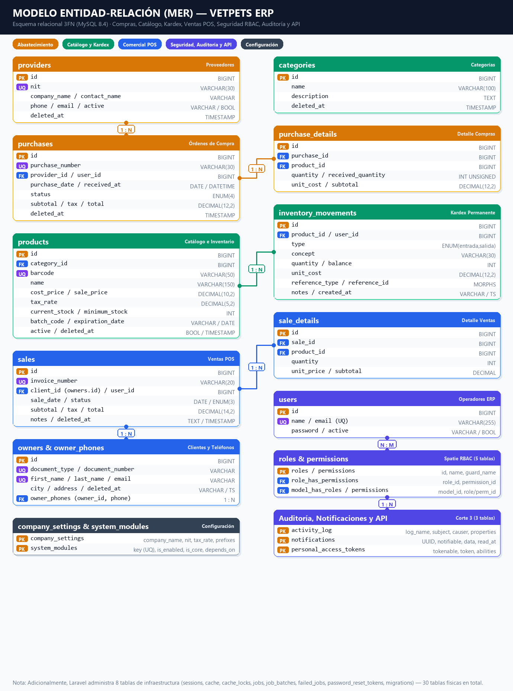
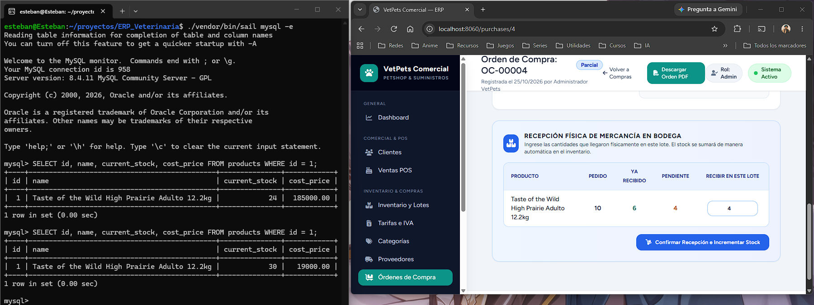
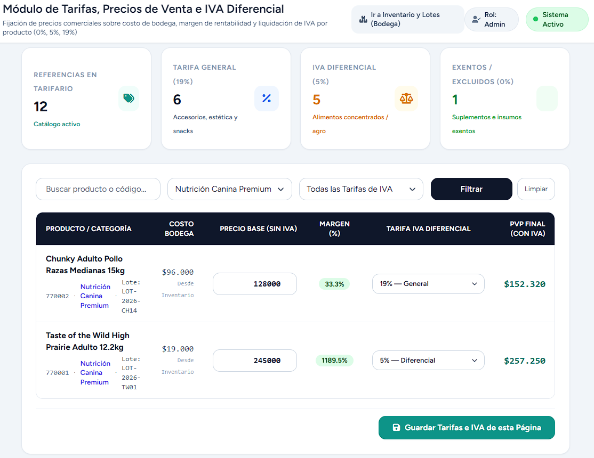
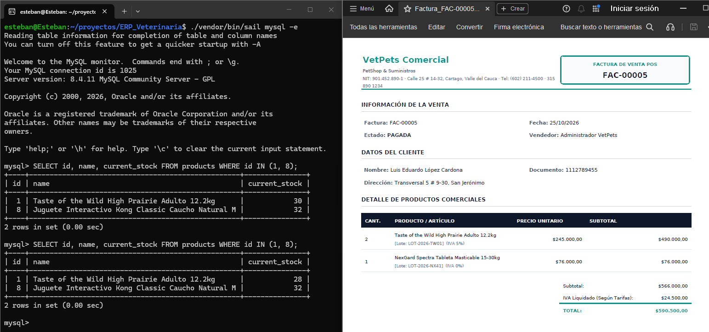
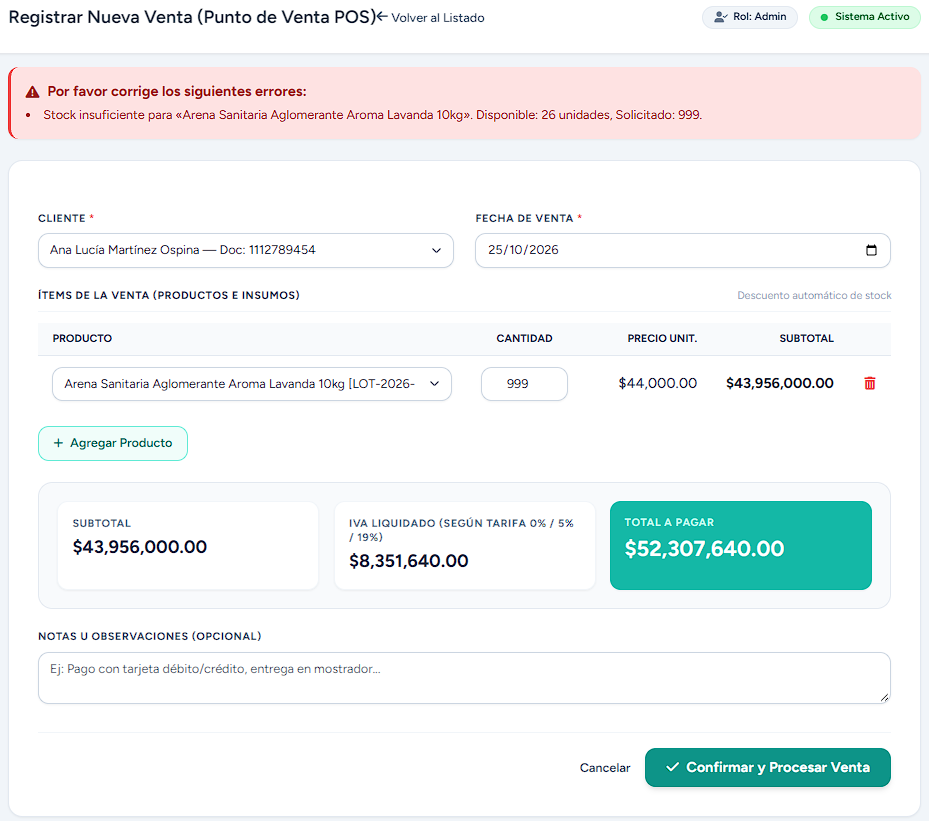
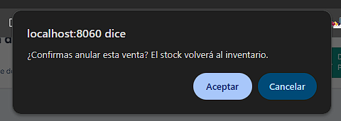
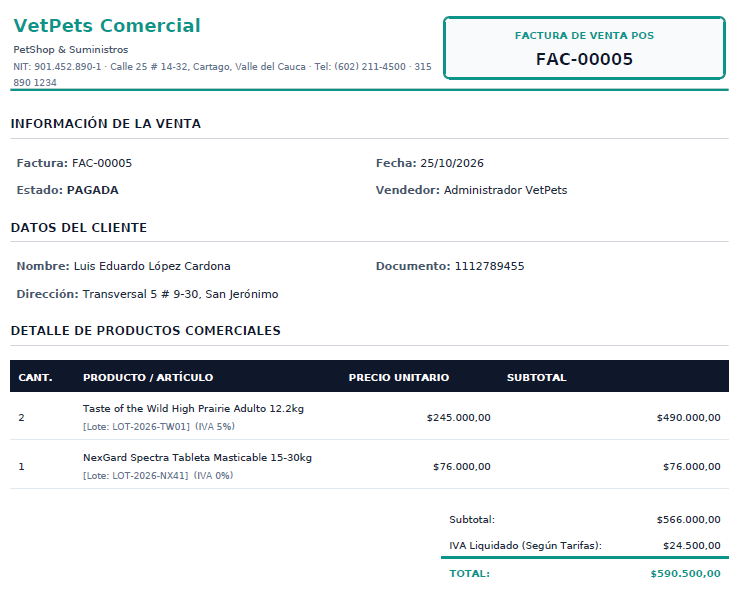
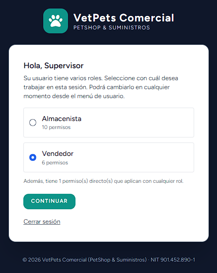
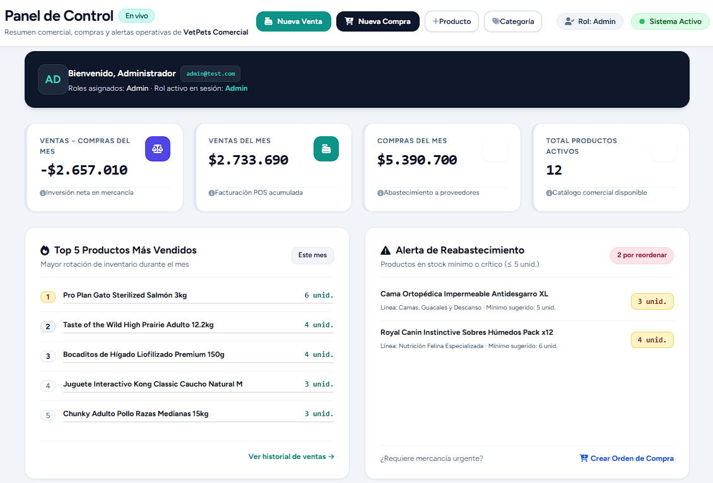

# INFORME FINAL — PROYECTO DE SOFTWARE DE GESTIÓN EMPRESARIAL (ERP)
## VetPets ERP: Sistema de Gestión Empresarial Modular y Parametrizable para Retail Comercial PetShop

---

## Portada

* **Título del Proyecto:** VetPets ERP — Sistema de Gestión Empresarial Modular y Parametrizable para Retail Comercial de Tiendas de Mascotas con Kardex Transaccional, Punto de Venta POS, Seguridad RBAC con Rol Activo y Automatización de Procesos
* **Empresa / Caso de Estudio:** VetPets Comercial S.A.S. (Comercio minorista de alimentos concentrados, suplementos, fármacos de venta libre y accesorios para mascotas)
* **Autores / Integrantes:**
  * **Jhon Esteban Molina Echavarría**
  * **Heiber Lozano Mercado**
* **Programa Académico:** Ingeniería de Sistemas / Tecnología en Gestión de Sistemas de Información
* **Institución:** Corporación de Estudios Tecnológicos del Norte del Valle (COTECNOVA)
* **Asignatura:** Software de Gestión Empresarial (Semestre VI — 2026)
* **Docente:** Ing. Jhon James Cano Sánchez
* **Fecha de Entrega:** 25 de noviembre de 2026
* **Fecha de Sustentación Presencial:** 26 de noviembre de 2026 (8:15 p. m.)
* **Enlaces de Entrega y Verificación:**
  * **Repositorio en GitHub:** [https://github.com/moliech/ERP_Veterinaria](https://github.com/moliech/ERP_Veterinaria)
  * **Etiqueta de Versión en Git (Tag):** `final`
  * **Video de Respaldo (Flujo Principal):** [https://drive.google.com/drive/folders/154DKFAKOyDlauuwDyoacq1mFkrTdBTYA?usp=sharing](https://drive.google.com/drive/folders/154DKFAKOyDlauuwDyoacq1mFkrTdBTYA?usp=sharing)

---

## Resumen

El presente informe documenta el análisis, diseño, implementación y validación de **VetPets ERP**, un sistema de planificación de recursos empresariales desarrollado para la gestión comercial de tiendas minoristas de mascotas (*PetShop*). El proyecto aborda problemáticas operativas frecuentes en pequeñas empresas del sector, tales como la desarticulación entre las compras y las existencias en bodega, el riesgo de comercializar productos con fechas de vencimiento expiradas, las inconsistencias en el cálculo manual del impuesto al valor agregado (IVA) y la falta de trazabilidad sobre las acciones de los usuarios. La solución se construyó con **Laravel 11, PHP 8.4, MySQL 8.4 y Docker Sail**, aplicando una arquitectura MVC extendida con servicios de dominio transaccionales (`DB::transaction`). El sistema integra seis procesos principales: (1) abastecimiento mediante órdenes de compra con recepción parcial o total, (2) control de inventario por movimientos en Kardex, (3) gestión de tarifas con IVA diferencial (0 %, 5 % y 19 %), (4) facturación en punto de venta (POS) con generación de comprobantes internos en PDF, (5) seguridad basada en roles (RBAC) con selección de Rol Activo en sesión y (6) automatización asíncrona de notificaciones y reportes. Adicionalmente, incorpora una API RESTful v1 autenticada con **Laravel Sanctum** (7 endpoints), exportación e importación masiva en Excel con validación por fila y auditoría de modelos y eventos de seguridad. Como resultado, los 11 componentes iniciales del segundo avance evolucionaron a 15 subsistemas funcionales respaldados por 41 pruebas automatizadas (245 aserciones en 13 clases de prueba), verificación de estilo PSR-12 con **Laravel Pint** sobre 169 archivos y un pipeline de integración continua en **GitHub Actions**.

**Palabras clave:** ERP, Laravel, Kardex, control de acceso basado en roles, integración continua.

---

## Tabla de Contenido

- [1. Introducción](#1-introducción)
- [2. Planteamiento del Problema](#2-planteamiento-del-problema)
  - [2.1. Situación Actual del Negocio](#21-situación-actual-del-negocio)
  - [2.2. Formulación de la Pregunta Problema](#22-formulación-de-la-pregunta-problema)
- [3. Objetivos](#3-objetivos)
  - [3.1. Objetivo General](#31-objetivo-general)
  - [3.2. Objetivos Específicos](#32-objetivos-específicos)
- [4. Marco Teórico](#4-marco-teórico)
  - [4.1. Sistemas de Planificación de Recursos Empresariales (ERP) en Pymes](#41-sistemas-de-planificación-de-recursos-empresariales-erp-en-pymes)
  - [4.2. Cadena de Abastecimiento, Control de Inventarios y Kardex (NIC 2)](#42-cadena-de-abastecimiento-control-de-inventarios-y-kardex-nic-2)
  - [4.3. Control de Acceso Basado en Roles (RBAC) y Segregación de Funciones](#43-control-de-acceso-basado-en-roles-rbac-y-segregación-de-funciones)
  - [4.4. Auditoría de Sistemas de Información y Trazabilidad de Cambios](#44-auditoría-de-sistemas-de-información-y-trazabilidad-de-cambios)
  - [4.5. Interoperabilidad mediante APIs RESTful y Procesamiento por Lotes](#45-interoperabilidad-mediante-apis-restful-y-procesamiento-por-lotes)
  - [4.6. Arquitecturas Orientadas a Eventos, Pruebas Automatizadas e Integración Continua](#46-arquitecturas-orientadas-a-eventos-pruebas-automatizadas-e-integración-continua)
- [5. Metodología](#5-metodología)
  - [5.1. Enfoque Metodológico y Desarrollo Incremental por Clases](#51-enfoque-metodológico-y-desarrollo-incremental-por-clases)
  - [5.2. Gestión de Ramas en Git y Entorno Tecnológico](#52-gestión-de-ramas-en-git-y-entorno-tecnológico)
  - [5.3. Declaración sobre el Uso de Herramientas de Inteligencia Artificial](#53-declaración-sobre-el-uso-de-herramientas-de-inteligencia-artificial)
- [6. Análisis y Diseño](#6-análisis-y-diseño)
  - [6.1. Evolución del Alcance, Atención a la Retroalimentación y Procesos de Negocio](#61-evolución-del-alcance-atención-a-la-retroalimentación-y-procesos-de-negocio)
  - [6.2. Catálogo de Reglas de Negocio](#62-catálogo-de-reglas-de-negocio)
  - [6.3. Modelo Entidad-Relación (MER)](#63-modelo-entidad-relación-mer)
  - [6.4. Diccionario de Datos de las Tablas Principales](#64-diccionario-de-datos-de-las-tablas-principales)
  - [6.5. Matriz de Seguridad, Rol Activo y Permisos Directos](#65-matriz-de-seguridad-rol-activo-y-permisos-directos)
  - [6.6. Arquitectura del Software (Patrón MVC + Capa de Servicios)](#66-arquitectura-del-software-patrón-mvc--capa-de-servicios)
- [7. Desarrollo e Implementación](#7-desarrollo-e-implementación)
  - [7.1. Consolidación de Módulos y Cumplimiento de Entidades Maestras](#71-consolidación-de-módulos-y-cumplimiento-de-entidades-maestras)
  - [7.2. Servicios Transaccionales: Compras, Kardex y Ventas POS](#72-servicios-transaccionales-compras-kardex-y-ventas-pos)
  - [7.3. Generación de Documentos PDF con Identidad Corporativa](#73-generación-de-documentos-pdf-con-identidad-corporativa)
  - [7.4. Auditoría de Modelos y Bitácora de Seguridad](#74-auditoría-de-modelos-y-bitácora-de-seguridad)
  - [7.5. API RESTful v1 con Laravel Sanctum y Habilidades por Rol](#75-api-restful-v1-con-laravel-sanctum-y-habilidades-por-rol)
  - [7.6. Exportación a Excel e Importación Masiva con Validación por Fila](#76-exportación-a-excel-e-importación-masiva-con-validación-por-fila)
  - [7.7. Automatización: Eventos, Listeners, Colas y Tareas Programadas](#77-automatización-eventos-listeners-colas-y-tareas-programadas)
  - [7.8. Datos Semilla (Seeders) y Usuarios de Prueba por Rol](#78-datos-semilla-seeders-y-usuarios-de-prueba-por-rol)
  - [7.9. Matriz de Verificación de los 17 Requisitos Funcionales](#79-matriz-de-verificación-de-los-17-requisitos-funcionales)
- [8. Pruebas y Aseguramiento de la Calidad](#8-pruebas-y-aseguramiento-de-la-calidad)
  - [8.1. Estrategia y Entorno de Pruebas](#81-estrategia-y-entorno-de-pruebas)
  - [8.2. Tabla Completa de Pruebas Automatizadas (41 Pruebas)](#82-tabla-completa-de-pruebas-automatizadas-41-pruebas)
  - [8.3. Pruebas con Recorrido Narrativo en Consola para Sustentación](#83-pruebas-con-recorrido-narrativo-en-consola-para-sustentación)
  - [8.4. Verificación de Estilo con Laravel Pint e Integración Continua en GitHub Actions](#84-verificación-de-estilo-con-laravel-pint-e-integración-continua-en-github-actions)
- [9. Resultados y Análisis de Impacto](#9-resultados-y-análisis-de-impacto)
  - [9.1. Resolución de la Problemática Operativa y Evidencias Funcionales](#91-resolución-de-la-problemática-operativa-y-evidencias-funcionales)
  - [9.2. Dashboard de Indicadores (KPIs), Tablas Accionables y Toma de Decisiones](#92-dashboard-de-indicadores-kpis-tablas-accionables-y-toma-de-decisiones)
- [10. Conclusiones y Trabajo Futuro](#10-conclusiones-y-trabajo-futuro)
  - [10.1. Conclusiones](#101-conclusiones)
  - [10.2. Trabajo Futuro](#102-trabajo-futuro)
- [Referencias](#referencias)
- [Anexos](#anexos)
  - [Anexo A: Manual de Usuario por Proceso Operativo](#anexo-a-manual-de-usuario-por-proceso-operativo)
  - [Anexo B: Manual de Instalación, Despliegue y Credenciales de Prueba](#anexo-b-manual-de-instalación-despliegue-y-credenciales-de-prueba)
  - [Anexo C: Diccionario de Datos Completo del Sistema](#anexo-c-diccionario-de-datos-completo-del-sistema)
  - [Anexo D: Matriz Completa de Seguridad (Roles, Módulos y Acciones)](#anexo-d-matriz-completa-de-seguridad-roles-módulos-y-acciones)
  - [Anexo E: Colección y Especificación de Pruebas de la API REST v1](#anexo-e-colección-y-especificación-de-pruebas-de-la-api-rest-v1)

---

## 1. Introducción

Las pequeñas y medianas empresas (pymes) dedicadas al comercio minorista de productos para mascotas (*PetShops*) experimentan una operación diaria caracterizada por la rotación constante de referencias con distintas naturalezas logísticas y tributarias: alimentos concentrados por peso o empaque, suplementos nutricionales y antiparasitarios sujetos a control de fecha de caducidad, así como accesorios e implementos de cuidado general. A pesar del volumen transaccional que manejan, numerosos establecimientos del sector continúan apoyando su operación en hojas de cálculo desconectadas o registros manuales que no vinculan el abastecimiento con la facturación en mostrador (Laudon y Laudon, 2020).

Como señalan Monk y Wagner (2013), la principal ventaja de un sistema de planificación de recursos empresariales (*Enterprise Resource Planning* — ERP) radica en reemplazar los silos de información por una base de datos relacional única donde cada evento de negocio desencadena actualizaciones consistentes en el resto de la organización. En un entorno minorista, esto implica que la recepción física de una orden de compra en bodega debe traducirse, dentro de una misma transacción atómica, en un asiento en el historial de movimientos (Kardex), en la actualización del saldo disponible para el punto de venta (POS) y en el refresco de los indicadores financieros de la gerencia.

El presente documento expone el proceso completo de ingeniería de software aplicado en la construcción de **VetPets ERP**, un sistema web modular desarrollado para la empresa **VetPets Comercial S.A.S.** A lo largo de diez capítulos se detallan el planteamiento del problema, los objetivos, el marco teórico, la metodología de desarrollo incremental, el modelo de datos, las reglas de negocio, la implementación de servicios transaccionales, la interoperabilidad mediante API REST y hojas de cálculo Excel, la automatización de eventos y la validación de calidad mediante pruebas automatizadas e integración continua.

---

## 2. Planteamiento del Problema

### 2.1. Situación Actual del Negocio

En el diagnóstico preliminar realizado sobre el flujo comercial de una tienda de mascotas tipo (*VetPets Comercial S.A.S.*), se identificaron cinco problemáticas operativas recurrentes que afectan el control interno y la rentabilidad del negocio:

1. **Desarticulación entre las órdenes de compra y las entregas reales de los proveedores:** Es habitual que un distribuidor mayorista entregue de forma fraccionada un pedido de alimentos o suministros. Al carecer de un sistema que controle recepciones parciales sobre una misma orden de compra, el personal de bodega suele sumar manualmente la totalidad del pedido antes de su llegada física o duplicar registros, generando diferencias entre el stock contable y el stock físico en estantería.
2. **Pérdidas por caducidad de productos perecederos y falta de trazabilidad en el inventario:** Cuando las existencias se modifican editando directamente un número en una tabla sin dejar registro del motivo, resulta imposible reconstruir por qué disminuyó el stock de un artículo (venta, anulación, ajuste por conteo físico o ingreso inicial). Asimismo, la falta de validación sobre la fecha de vencimiento del lote vigente expone al comercio a entregar productos expirados al cliente final.
3. **Errores en la liquidación manual del IVA y en la fijación de márgenes:** El catálogo de una tienda de mascotas combina bienes con distintas tarifas de IVA (0 %, 5 % y 19 %) conforme a su clasificación comercial. Cuando la tarifa no está parametrizada por producto y separada de la gestión física de bodega, el cajero comete errores de liquidación en mostrador y la administración pierde visibilidad sobre el margen bruto real entre el costo de adquisición y el precio base de venta.
4. **Ausencia de segregación de funciones en usuarios con múltiples responsabilidades:** En comercios pequeños es frecuente que un mismo empleado (por ejemplo, un supervisor de turno) cumpla funciones tanto de bodega como de caja. En los sistemas tradicionales que acumulan todos los permisos de los roles asignados al mismo tiempo, dicho usuario opera en una sesión sin restricciones donde puede alterar existencias y facturar simultáneamente, debilitando el control interno (Ferraiolo et al., 2003).
5. **Carencia de alertas tempranas y de mecanismos de interoperabilidad:** La revisión del agotamiento de existencias se realiza de forma visual cuando el estante ya está vacío, en lugar de apoyarse en notificaciones automáticas disparadas al cruzar el umbral de stock mínimo o en reportes diarios programados. De igual modo, la actualización masiva de catálogos de proveedores resulta lenta al no contar con herramientas de importación validada desde hojas de cálculo.

### 2.2. Formulación de la Pregunta Problema

> *¿Cómo diseñar, implementar y validar un sistema de gestión empresarial (ERP) modular y parametrizable en Laravel que integre los procesos de compras con recepción parcial, inventario por movimientos de Kardex, tarifas e IVA diferencial y ventas POS, garantizando la segregación de funciones mediante Rol Activo en sesión, la trazabilidad por auditoría y la automatización de alertas operativas para VetPets Comercial S.A.S.?*

---

## 3. Objetivos

### 3.1. Objetivo General

Desarrollar e implementar un sistema de planificación de recursos empresariales (ERP) web para **VetPets Comercial S.A.S.** utilizando **Laravel 11, MySQL 8.4 y Docker Sail**, que integre de forma transaccional los procesos de compras, inventario por Kardex, tarifas con IVA diferencial y ventas POS, incorporando control de acceso basado en roles con Rol Activo, auditoría de modelos y de seguridad, interoperabilidad vía API REST y Excel, automatización de notificaciones y aseguramiento de calidad mediante pruebas automatizadas e integración continua.

### 3.2. Objetivos Específicos

1. **Diseñar** el modelo de datos relacional normalizado, el catálogo de reglas de negocio y la arquitectura de seguridad RBAC con Rol Activo en sesión, asegurando la separación de responsabilidades entre los perfiles de administrador, almacenista, vendedor y supervisor.
2. **Construir** los módulos maestros y transaccionales del sistema mediante una capa de servicios de dominio (`PurchaseService`, `InventoryService`, `SaleService` y `AccessControlService`) protegida con transacciones atómicas (`DB::transaction`), generación de comprobantes internos en PDF con identidad corporativa y trazabilidad de inventario en Kardex.
3. **Implementar** los componentes de auditoría (`spatie/laravel-activitylog` sobre modelos de negocio y canal de seguridad), interoperabilidad (API RESTful v1 autenticada con Laravel Sanctum, exportación a Excel e importación masiva validada por fila) y automatización asíncrona (eventos, *listeners*, notificaciones por correo/campana y tarea programada diaria).
4. **Verificar y validar** el cumplimiento de los 17 requisitos funcionales mediante una suite de pruebas automatizadas en PHPUnit, el análisis estático de estilo con Laravel Pint, un flujo de integración continua en GitHub Actions y un conjunto de datos semilla (*seeders*) documentado para su despliegue reproducible.

---

## 4. Marco Teórico

### 4.1. Sistemas de Planificación de Recursos Empresariales (ERP) en Pymes

Un sistema ERP se define como un conjunto integrado de módulos de software que comparten una base de datos común para soportar los procesos transaccionales de una empresa desde una perspectiva interfuncional (Monk y Wagner, 2013). Según Laudon y Laudon (2020), cuando una organización carece de integración entre sus sistemas de compras, almacén y ventas, incurre en costos ocultos derivados de la conciliación manual de datos, retrasos en el reabastecimiento y decisiones gerenciales basadas en información desactualizada.

En el contexto de las pequeñas y medianas empresas comerciales, la literatura académica destaca que el éxito en la adopción de un ERP depende de su modularidad y de su capacidad de parametrización sin requerir la modificación del código fuente ante cambios en las tarifas impositivas o en los datos institucionales (Esteves y Pastor, 2001; Panorama Consulting Group, 2023). Por esta razón, **VetPets ERP** incorpora un esquema de parametrización de identidad corporativa (`company_settings`) y un gestor de módulos (`system_modules`) con validación de dependencias que permite adaptar el sistema al alcance operativo del comercio.

### 4.2. Cadena de Abastecimiento, Control de Inventarios y Kardex (NIC 2)

En las empresas comerciales minoristas, el inventario constituye uno de los activos corrientes de mayor relevancia financiera. De acuerdo con la Norma Internacional de Contabilidad 2 (NIC 2) emitida por el International Accounting Standards Board (IASB, 2021), el control contable y administrativo de las existencias exige registrar de manera sistemática todas las entradas por adquisición y las salidas por comercialización o merma, manteniendo la trazabilidad del costo de compra asociado a cada transacción.

El **Kardex** es el registro auxiliar permanente donde cada variación en las existencias de un artículo queda asentada como un movimiento histórico que especifica el tipo de flujo (`entrada` o `salida`), el concepto operativo (`inventario_inicial`, `compra`, `venta`, `anulacion_venta` o `ajuste`), la cantidad transada, el saldo físico resultante (`balance`), el costo unitario asociado (`unit_cost`) y la referencia polimórfica al documento soporte (orden de compra o factura de venta). Bajo el principio de control de inventario por movimientos aplicado en los sistemas ERP, la columna de existencias del producto (`current_stock`) no se edita de manera aislada desde un formulario administrativo, sino que se actualiza a través del servicio de Kardex dentro de una transacción con bloqueo pesimista (`SELECT ... FOR UPDATE`), reduciendo el riesgo de condiciones de carrera (*race conditions*) en entornos multiusuario (Silberschatz et al., 2019).

Desde la perspectiva financiera y contable de la NIC 2 (IASB, 2021), existen dos enfoques principales para reflejar el costo de reposición en sistemas de inventario permanente:
1. **Registro de costo histórico en Kardex con actualización al último costo de compra:** Cada movimiento en `inventory_movements` preserva el costo unitario exacto (`unit_cost`) al que ingresó o salió la partida, mientras que la ficha maestra del producto (`products.cost_price`) actualiza su costo de referencia al valor de la recepción más reciente para facilitar al área comercial el cálculo inmediato del margen de utilidad frente al precio actual del proveedor. Este es el mecanismo implementado en `PurchaseService::receive()` e `InventoryService::entry()` dentro de **VetPets ERP**.
2. **Fórmula de Costo Promedio Ponderado (CPP):** En escenarios donde se requiere promediar contablemente lotes adquiridos a distintos precios unitarios, el costo promedio se expresa matemáticamente como:

$$CPP_{\text{nuevo}} = \frac{(Q_a \times C_a) + (Q_n \times C_n)}{Q_a + Q_n}$$

Donde $Q_a$ representa la cantidad disponible antes de la recepción, $C_a$ el costo unitario anterior, $Q_n$ la cantidad recibida en la nueva entrega y $C_n$ el costo unitario de la orden recibida. El almacenamiento del `unit_cost` y del `balance` en cada fila de `inventory_movements` permite reconstruir tanto el último costo como la valoración histórica del inventario.

### 4.3. Control de Acceso Basado en Roles (RBAC) y Segregación de Funciones

El estándar *Role-Based Access Control* (RBAC), formalizado por Ferraiolo et al. (2001) para el Instituto Nacional de Estándares y Tecnología (NIST), establece que las autorizaciones de seguridad dentro de un sistema informático deben asociarse a roles organizacionales definidos según las funciones del puesto de trabajo, y no de manera dispersa a usuarios individuales. Un componente avanzado del modelo RBAC del NIST es la distinción entre el conjunto de roles asignados a un sujeto (*User Assignment*) y los roles efectivamente activados dentro de una sesión de trabajo (*Session Roles*).

Ferraiolo et al. (2003) denominan **Segregación Dinámica de Funciones** (*Dynamic Separation of Duty* — DSoD) a la restricción mediante la cual un usuario que posee dos roles mutuamente sensibles (por ejemplo, quien recibe mercancía en almacén y quien factura en caja) solo puede activar uno de ellos a la vez durante su sesión interactiva. En **VetPets ERP**, sobre la base del paquete `spatie/laravel-permission` (Spatie, 2024b), este principio se materializa mediante el mecanismo de **Rol Activo en sesión** (`EnsureActiveRoleSelected`) combinado con la capacidad de otorgar permisos directos puntuales (`model_has_permissions`), de modo que la autorización efectiva en cualquier petición web o token de API responda a la unión entre los permisos del rol activo seleccionado y los permisos directos asignados al usuario.

### 4.4. Auditoría de Sistemas de Información y Trazabilidad de Cambios

De acuerdo con los marcos de control interno y auditoría de sistemas de información (Romney y Steinbart, 2021), un ERP debe mantener pistas de auditoría (*audit trails*) que permitan responder cuatro preguntas fundamentales ante cualquier modificación de datos críticos: *quién* ejecutó la acción (`causer`), *sobre qué entidad* recayó (`subject`), *cuándo* ocurrió (`created_at`) y *cuál fue la variación exacta* entre el estado anterior (`old`) y el estado posterior (`attributes`). En el ecosistema de Laravel, la biblioteca `spatie/laravel-activitylog` (Spatie, 2024a) permite instrumentar tanto los eventos del ciclo de vida de los modelos de negocio como canales específicos para la **bitácora de seguridad**, donde se registran las alteraciones en la asignación de roles y privilegios de los usuarios.

### 4.5. Interoperabilidad mediante APIs RESTful y Procesamiento por Lotes

Los sistemas empresariales contemporáneos requieren mecanismos de interoperabilidad sincrónica y asincrónica con otros sistemas o herramientas ofimáticas (Fielding, 2000; Pressman y Maxim, 2020). La interoperabilidad sincrónica se resuelve mediante interfaces de programación de aplicaciones bajo el estilo arquitectónico REST (*Representational State Transfer*), utilizando tokens de acceso con alcance limitado (*scoped tokens*) gestionados en Laravel mediante **Sanctum** (Laravel, 2024). Por su parte, la interoperabilidad por lotes con hojas de cálculo (exportación de reportes gerenciales e importación masiva de catálogos) exige esquemas de validación declarativa fila por fila que procesen los registros válidos e informen detalladamente los errores de las filas rechazadas sin afectar la consistencia de la base de datos (Maatwebsite, 2024).

### 4.6. Arquitecturas Orientadas a Eventos, Pruebas Automatizadas e Integración Continua

El desacoplamiento entre la transacción principal y los efectos colaterales (como el envío de correos electrónicos con archivos PDF adjuntos o la verificación de umbrales de stock bajo) se logra mediante arquitecturas orientadas a eventos (*Event-Driven Architecture*) respaldadas por colas de trabajo asíncronas (Fowler, 2002; Laravel, 2024). Finalmente, la mantenibilidad del software en equipos colaborativos se fortalece mediante pruebas automatizadas repetibles (PHPUnit), herramientas de análisis estático de estilo de código (PSR-12 / Laravel Pint) y servidores de Integración Continua (GitHub Actions) que verifican cada confirmación de código en un entorno limpio (Pressman y Maxim, 2020).

---

## 5. Metodología

### 5.1. Enfoque Metodológico y Desarrollo Incremental por Clases

El proyecto se ejecutó bajo una metodología de desarrollo incremental e iterativo con enfoque RAD (*Rapid Application Development*), articulada directamente con las quince sesiones prácticas de la asignatura a lo largo del semestre:

* **Iteración 1 (Clases 1 a 7 — Fundamentos, Entidades Maestras y RBAC Base):** Configuración del entorno contenedorizado en Docker Sail, diseño del esquema inicial en MySQL, autenticación con Laravel Breeze, implementación de las cuatro entidades maestras con CRUD completo, validaciones mediante `FormRequest`, borrado lógico (`SoftDeletes`) con papelera y restauración, y configuración inicial de roles y permisos con `spatie/laravel-permission`.
* **Iteración 2 (Clases 8 a 10.5 — Transacciones Comerciales, PDF, Rol Activo y Parametrización):** Construcción de los servicios transaccionales de ventas POS (`SaleService`) y órdenes de compra con recepción parcial (`PurchaseService`), separación de los módulos de **Inventario y Lotes** y **Tarifas e IVA**, generación de comprobantes en PDF (`DomPDF`), implementación de **Rol Activo en sesión**, permisos directos, matriz interactiva de permisos, **Identidad Corporativa** y **Gestión de Módulos** con validación de dependencias (Entregable del Segundo Corte, etiqueta `avance-2`).
* **Iteración 3 (Clase 12 — Kardex Transaccional, Auditoría y Accesibilidad Visual):** Implementación de la tabla `inventory_movements` y del servicio centralizado `InventoryService`, conexión obligatoria de compras, ventas, anulaciones y ajustes al Kardex, comando de inicialización `kardex:inicializar`, auditoría de modelos y bitácora de seguridad con `spatie/laravel-activitylog` (comparación visual de cambios anteriores y posteriores) y validación algorítmica de contraste cromático WCAG 2.1 AA en `ThemeContrastService`.
* **Iteración 4 (Clase 13 — Interoperabilidad API REST v1 y Excel v4):** Desarrollo de la API RESTful versionada (`/api/v1`) autenticada con **Laravel Sanctum** e integrada con el Rol Activo mediante habilidades del token (`rol:<nombre>`), recursos JSON (`ProductResource`, `SaleResource`), colección Postman y módulo de exportación e importación masiva en Excel (`Maatwebsite Excel v4`) con validación por fila y registro automático de saldo inicial en Kardex.
* **Iteración 5 (Clases 14 y 15 — Automatización Asíncrona, Calidad y CI/CD):** Integración del contenedor `mailpit`, eventos `SaleRegistered` y `PurchaseReceived` con despacho post-transacción (`ShouldDispatchAfterCommit`), *listeners*, notificaciones en cola (`ShouldQueue`) por correo y base de datos, campana interactiva en la interfaz, comando programado `erp:resumen-diario` en el *Schedule*, ampliación de la suite a 41 pruebas automatizadas (incluyendo dos pruebas con traza narrativa en consola), formateo con **Laravel Pint** y pipeline de integración continua en **GitHub Actions** (etiqueta `final`).

### 5.2. Gestión de Ramas en Git y Entorno Tecnológico

El control de versiones se gestionó en Git y GitHub mediante una estrategia de ramas por integrante (`esteban` / `main` y `heiber`) diseñada para minimizar conflictos de fusión (*merge conflicts*):
1. **Rama `main` / `esteban` (Jhon Esteban Molina Echavarría):** Responsable de la arquitectura central, migraciones compartidas, servicios transaccionales (`SaleService`, `PurchaseService`, `AccessControlService`), integración de rutas en `routes/web.php` y `routes/api.php`, seguridad de Rol Activo, layout principal, pipeline de GitHub Actions y revisión de integración (`git merge`).
2. **Rama `heiber` (Heiber Lozano Mercado):** Responsable de la construcción modular de controladores especializados, `FormRequests`, vistas Blade de Kardex, auditoría, notificaciones, clases de exportación e importación de Excel (`ProductsExport`, `SalesExport`, `ProductsImport`) y servicio `InventoryService`.

#### Tabla 1. Stack Tecnológico y Herramientas del Proyecto

| Capa / Componente | Tecnología / Paquete | Versión | Función en VetPets ERP |
| :--- | :--- | :---: | :--- |
| **Contenedores y Entorno** | Docker Desktop + Laravel Sail (WSL 2 Ubuntu) | 24.04 | Orquestación de contenedores `laravel.test` (puerto 8060), `mysql` (3307) y `mailpit` (8025/1025). |
| **Lenguaje y Framework** | PHP + Laravel Framework | 8.4 / 11.x | Núcleo de la aplicación bajo arquitectura MVC + Servicios de Dominio. |
| **Motor de Base de Datos** | MySQL Community Server | 8.4 | Persistencia relacional transaccional (InnoDB) con soporte de bloqueo pesimista (`lockForUpdate`). |
| **Control de Acceso (RBAC)** | `spatie/laravel-permission` | 6.x | Gestión de roles, permisos por módulo/acción y permisos directos extendidos con Rol Activo. |
| **Auditoría y Bitácora** | `spatie/laravel-activitylog` | 4.x | Trazabilidad de cambios (`old` vs. `attributes`) en 6 modelos de negocio y canal `seguridad`. |
| **Autenticación API** | `laravel/sanctum` | 4.x | Emisión y revocación de tokens Bearer personales con habilidades de rol (`rol:<nombre>`). |
| **Documentos PDF** | `barryvdh/laravel-dompdf` | 3.x | Renderizado de comprobantes internos de venta, órdenes de compra y reporte de Kardex. |
| **Hojas de Cálculo** | `maatwebsite/excel` | 4.x | Exportación de catálogos/ventas e importación masiva de productos con validación por fila. |
| **Interfaz de Usuario (UI)** | Blade + Tailwind CSS + Alpine.js + Font Awesome | 3.x / 6.5 | Interfaz responsiva, reactividad en formularios POS/compras y tematización dinámica. |
| **Pruebas, Estilo y CI** | PHPUnit + Laravel Pint + GitHub Actions | 11.x / 1.x | Ejecución de 41 pruebas automatizadas, verificación PSR-12 y pipeline CI en la nube. |

*Nota.* Elaboración propia a partir de los archivos `composer.json`, `package.json` y `compose.yaml` del repositorio.

### 5.3. Declaración sobre el Uso de Herramientas de Inteligencia Artificial

En conformidad con las pautas de integridad académica establecidas en la sección 3.3 de los lineamientos del proyecto final, se declara explícitamente el uso de herramientas de inteligencia artificial generativa durante el desarrollo del proyecto en tres actividades de soporte:
1. **Asistencia en codificación y refactorización:** Consulta de patrones de implementación para consultas agregadas en Eloquent ORM, estructuración de pruebas funcionales en PHPUnit y configuración del archivo de flujo de trabajo `.github/workflows/pruebas.yml`.
2. **Diseño de datos semilla (*seeders*):** Generación de nombres comerciales realistas de productos de tienda de mascotas, proveedores y transacciones históricas en `CommercialTransactionsSeeder.php`.
3. **Revisión editorial y de estilo:** Apoyo en la organización estructural y revisión gramatical del presente informe técnico bajo las normas de publicación de la American Psychological Association (2020), séptima edición.

Todo fragmento de código, migración, regla de negocio, cálculo matemático y referencia bibliográfica fue verificado, probado e integrado manualmente por los autores del proyecto, comprobando su ejecución real en los contenedores de Docker Sail y en el servidor de integración continua.

---

## 6. Análisis y Diseño

### 6.1. Evolución del Alcance, Atención a la Retroalimentación y Procesos de Negocio

Durante el desarrollo del proyecto se realizó una evolución planificada desde el primer corte hasta la entrega final. En el segundo corte se redefinió el alcance del sistema para retirar los módulos clínicos veterinarios (pacientes e historias médicas) y especializar el ERP en la cadena comercial minorista (*PetShop*), incorporando además la parametrización de **Identidad Corporativa** y **Gestión de Módulos** (11 componentes funcionales iniciales). En el tercer corte, dichos componentes se ampliaron hasta conformar los **15 subsistemas técnicos** de la entrega final.

Asimismo, en atención al **Requisito 17** de la guía final, la Tabla 2 presenta la trazabilidad explícita entre los compromisos establecidos en la sección 11 del informe del Segundo Avance y las observaciones de retroalimentación recibidas, mostrando cómo fueron resueltos en la versión final del sistema.

#### Tabla 2. Trazabilidad de Compromisos y Retroalimentación del Segundo Avance frente al Informe Final

| Compromiso / Observación del Avance 2 | Estado en Avance 2 (Tag `avance-2`) | Resolución e Implementación en Entrega Final (Tag `final`) | Evidencia en Código / Informe |
| :--- | :--- | :--- | :--- |
| **1. Historial de movimientos de inventario (Kardex)** | Las compras y ventas actualizaban `current_stock`, pero no existía una tabla histórica de movimientos. | Se creó la tabla `inventory_movements`, el servicio `InventoryService`, la vista `/inventario/kardex`, el exportador PDF de Kardex y el comando `kardex:inicializar`. | `InventoryService.php`, `InventoryController.php`, Sección 7.2. |
| **2. Auditoría de modelos y bitácora de seguridad** | No existía registro histórico de quién editaba registros ni quién modificaba roles o permisos. | Se integró `spatie/laravel-activitylog` en 6 modelos de negocio (`Product`, `Category`, `Client`, `Provider`, `Sale`, `Purchase`) y se creó el canal `activity('seguridad')` en `AccessControlService`. | `AuditController.php`, `AccessControlService.php`, Sección 7.4. |
| **3. Interoperabilidad mediante API REST con Sanctum** | El sistema solo operaba mediante sesiones web tradicionales. | Se construyó la API REST `/api/v1` con **7 endpoints**, login con selección de rol encapsulado en el token Sanctum (`rol:<nombre>`) y colección Postman. | `app/Http/Controllers/Api/`, `routes/api.php`, Sección 7.5 y Anexo E. |
| **4. Exportación e importación masiva en Excel** | Los productos solo se podían registrar uno por uno en formulario web. | Se implementaron `ProductsExport`, `SalesExport`, `ProductsTemplateExport` y `ProductsImport` con validación por fila (`SkipsOnFailure`) y apertura en Kardex. | `ExcelController.php`, `ProductsImport.php`, Sección 7.6. |
| **5. Automatización de alertas y tareas programadas** | Las alertas de stock bajo solo se veían al entrar manualmente al Dashboard. | Se implementaron los eventos `SaleRegistered` y `PurchaseReceived`, notificaciones en cola por correo (Mailpit) y campana web, y el comando diario `erp:resumen-diario` a las 19:00. | `app/Events/`, `app/Notifications/`, `routes/console.php`, Sección 7.7. |
| **6. Ampliación de pruebas, estilo PSR-12 y CI/CD** | El proyecto contaba con 30 pruebas locales sin pipeline en la nube. | Se amplió la suite a **41 pruebas (245 aserciones en 13 clases de prueba)** incluyendo 2 pruebas narrativas en consola, se formatearon 169 archivos con Pint y se activó GitHub Actions. | `tests/Feature/`, `.github/workflows/pruebas.yml`, Capítulo 8. |
| **7. Formato documental APA 7 (Cero código Markdown/LaTeX sin compilar y numeración de figuras)** | Observación general de AVACO sobre higiene visual y formato de tablas y figuras. | Todas las fórmulas y diagramas se encuentran compilados gráficamente, las capturas están numeradas como Figuras con título y nota APA, y se incluyen los 5 anexos completos. | Figuras 1 a 10, Tablas 1 a 18 y Anexos A–E. |

*Nota.* Elaboración propia a partir del informe del segundo corte y el historial de confirmaciones del repositorio Git.

El flujo integral de los procesos de negocio del ERP se sintetiza en la Figura 1, donde se observa la secuencia operativa que conecta a los actores del sistema desde la orden de compra hasta la facturación POS y los reportes del Dashboard.

**Figura 1**  
*Diagrama de Flujo de los Procesos Comerciales Integrados en VetPets ERP*


*Nota.* El diagrama representa la interacción entre los procesos de abastecimiento (`PurchaseService`), control de existencias y Kardex (`InventoryService`), fijación de tarifas e IVA (`PricingController`) y facturación POS (`SaleService`). Fuente: Elaboración propia.

### 6.2. Catálogo de Reglas de Negocio

Para asegurar que las restricciones operativas del comercio se cumplan con independencia de si la petición proviene de un formulario web, de una importación de Excel o de un endpoint de la API REST, se implementaron **17 reglas de negocio** en la capa de servicios y modelos del sistema (superando el mínimo de 8 reglas exigido por el **Requisito 7** de la guía).

#### Tabla 3. Catálogo de las 17 Reglas de Negocio Implementadas y Probadas en VetPets ERP

| # | Regla de Negocio | Módulo | Clase y Método donde se Implementa | Cómo se Probó (Prueba Automatizada / Verificación) |
| :---: | :--- | :--- | :--- | :--- |
| **RN-01** | **Orden de compra pendiente no altera el inventario:** Al emitir una orden de compra, se registra en estado `pendiente` con `received_quantity = 0` sin sumar unidades al stock físico ni al Kardex. | Compras | `App\Services\PurchaseService::register()` | `FlujoComercialKardexTest`: verifica que tras registrar la orden `OC-00001`, `current_stock` permanece invariable antes de la recepción. |
| **RN-02** | **Prohibición de recibir más unidades de las pedidas:** En una recepción parcial o total, la cantidad recibida no puede superar el saldo pendiente (`quantity - received_quantity`) ni ser negativa. | Compras | `App\Services\PurchaseService::receive()` | Validación con `ValidationException` si `$qtyToReceive > $pending` o si la orden ya está `recibida` o `anulada`. |
| **RN-03** | **Transición automática de estado y actualización de costo en recepción:** Si quedan unidades pendientes, la orden pasa a `parcial`; si se completan todas las líneas, pasa a `recibida`, actualizando `cost_price` y asentando entrada en Kardex. | Compras / Kardex | `App\Services\PurchaseService::receive()` e `InventoryService::entry()` | `FlujoComercialKardexTest::test_recorrido_compra_recepcion_parcial_y_asentamiento_en_kardex()`. |
| **RN-04** | **Anulación de compra restringida a órdenes sin recepciones:** Solo se permite anular una orden de compra si ninguna de sus líneas tiene unidades recibidas (`received_quantity == 0`). | Compras | `App\Services\PurchaseService::cancel()` | Lanza `ValidationException` cuando existe mercancía ya ingresada a bodega. |
| **RN-05** | **Intocabilidad del stock e integridad por movimientos de Kardex:** Toda variación de existencias se procesa mediante `InventoryService` bajo bloqueo pesimista (`lockForUpdate`), registrando el saldo resultante (`balance`) en `inventory_movements`. | Inventario y Kardex | `App\Services\InventoryService::move()`, `entry()`, `exit()`, `adjust()`, `opening()` | `FlujoComercialKardexTest` y `ApiRestTest`: comprueban la creación del registro en `inventory_movements` en cada transacción. |
| **RN-06** | **Bloqueo de venta por stock insuficiente:** No se permite registrar una venta si la cantidad solicitada supera el `current_stock` disponible del producto, revirtiendo toda la transacción (`DB::transaction`). | Ventas POS | `App\Services\SaleService::register()` e `InventoryService::move()` | Intento de venta por encima del saldo disponible; lanza `ValidationException` y mantiene intacta la base de datos. |
| **RN-07** | **Bloqueo de venta de productos con fecha de vencimiento expirada:** Si el producto tiene `expiration_date` registrada y dicha fecha es anterior al día actual (`isPast()`), el sistema rechaza la venta indicando el código de lote vencido. | Ventas POS / Inventario | `App\Services\SaleService::register()` | `SecurityConfigTest::test_pricing_module_differential_tax_and_batch_expiration_control()`. |
| **RN-08** | **Bloqueo de venta de productos inactivos:** Un producto marcado con `active = false` no puede ser facturado en el punto de venta ni listado en el catálogo público de la API. | Ventas POS / API | `App\Services\SaleService::register()` y `Api\ProductController::index()` | Validación directa en `SaleService` y filtro `where('active', true)` en la API. |
| **RN-09** | **Liquidación de IVA diferencial por línea de producto:** Cada ítem de venta calcula su impuesto según la tarifa configurada en el producto (`0%`, `5%` o `19%`), acumulando subtotal, impuesto y total de la factura. | Tarifas e IVA / Ventas | `App\Services\SaleService::register()` y `PricingController::update()` | `SecurityConfigTest` y `FlujoComercialKardexTest::test_recorrido_venta_pos_api_rest_liquidacion_iva_y_descuento_kardex()`. |
| **RN-10** | **Reversión de inventario por anulación de venta:** Al anular una factura pagada, su estado pasa a `anulada`, se aplica `SoftDelete` y se reintegran las unidades exactas al Kardex bajo el concepto `anulacion_venta`. | Ventas POS / Kardex | `App\Services\SaleService::cancel()` | Verificación funcional de anulación y retorno de unidades en `inventory_movements` (Figura 7B). |
| **RN-11** | **Numeración secuencial con prefijo corporativo parametrizable:** Las facturas y órdenes de compra generan consecutivos únicos (`FAC-00001` / `FV-00001` y `OC-00001`) leyendo el prefijo configurado en `company_settings`. | Configuración / Ventas / Compras | `SaleService::generateNextInvoiceNumber()` y `PurchaseService::register()` | `FlujoComercialKardexTest`: verifica la generación automática de `OC-00001` y `FAC-00001`. |
| **RN-12** | **Segregación dinámica por Rol Activo en sesión y en token API:** Un usuario con múltiples roles solo ejerce los permisos del rol activo seleccionado para su sesión web (o incrustado como habilidad `rol:<nombre>` en su token Sanctum) más sus permisos directos. | Seguridad RBAC | `App\Models\User::hasEffectivePermission()`, `EnsureActiveRoleSelected` y `Api\AuthController::login()` | `SecurityConfigTest::test_supervisor_must_select_active_role_and_segregates_permissions()` y `ApiRestTest`. |
| **RN-13** | **Bloqueo inmediato de usuarios inactivos:** Un usuario con `active = false` no puede autenticarse por web ni por API; si es desactivado con sesión abierta, el middleware invalida su sesión en la siguiente petición. | Seguridad RBAC | `LoginRequest::authenticate()`, `EnsureUserIsActive` y `Api\AuthController::login()` | `SecurityConfigTest::test_inactive_user_cannot_login_or_keep_session()`. |
| **RN-14** | **Protección contra auto-desactivación y preservación del último administrador:** Ningún usuario puede desactivar su propia cuenta y el sistema impide retirar el rol `admin` o desactivar al último administrador activo. | Seguridad RBAC | `App\Services\AccessControlService::saveUser()`, `toggleActive()`, `ensureAnAdminRemains()` | `SecurityConfigTest::test_admin_can_view_all_settings_screens_and_manage_security()`. |
| **RN-15** | **Protección de roles y permisos en uso:** El rol `admin` conserva siempre todos los permisos y no es posible eliminar un permiso o rol que esté asignado a usuarios o perfiles activos. | Seguridad RBAC | `App\Services\AccessControlService::deletePermission()` y `RoleController::destroy()` | `SecurityConfigTest`: intento de eliminar permiso en uso retorna error de validación `302`. |
| **RN-16** | **Control de dependencias entre módulos del sistema:** No se permite desactivar un módulo base (ej. `products`) si existen módulos dependientes activos (ej. `sales`, `purchases` o `pricing`), ni desactivar módulos marcados como `is_core`. | Gestión de Módulos | `App\Models\SystemModule::getBlockingDependents()` y `EnsureModuleEnabled` | `SecurityConfigTest::test_corporate_identity_and_modular_dependencies_work()`. |
| **RN-17** | **Disparo de alerta asíncrona por umbral de stock bajo post-transacción:** Al confirmarse una venta (`ShouldDispatchAfterCommit`), si el stock resultante del producto es $\le 5$ o $\le \text{minimum\_stock}$, se encola una notificación por correo y campana a los usuarios autorizados. | Automatización | `App\Events\SaleRegistered`, `App\Listeners\CheckLowStock` y `LowStockNotification` | `Clase14Test::test_evento_sale_registered_dispara_alerta_stock_bajo_cuando_cruza_umbral()`. |

*Nota.* Todas las reglas están implementadas en clases del espacio de nombres `App\Services`, `App\Http\Middleware` o `App\Listeners` y cuentan con cobertura en la carpeta `tests/Feature/`.

### 6.3. Modelo Entidad-Relación (MER)

El esquema relacional de **VetPets ERP** se construye a partir de **23 archivos de migración** que generan **30 tablas físicas en MySQL 8.4**, diseñadas bajo la Tercera Forma Normal (3FN) y clasificadas en cuatro grupos:
1. **10 tablas principales de operación comercial y Kardex:** `categories`, `products`, `providers`, `owners`, `owner_phones`, `purchases`, `purchase_details`, `sales`, `sale_details` e `inventory_movements` (además de la tabla histórica `pets` conservada de la migración inicial).
2. **6 tablas complementarias de parametrización, trazabilidad, notificaciones y acceso:** `company_settings`, `system_modules`, `activity_log`, `notifications`, `personal_access_tokens` y `users`.
3. **5 tablas del modelo RBAC (`spatie/laravel-permission`):** 2 tablas de entidades (`roles` y `permissions`) y 3 tablas pivote (`role_has_permissions`, `model_has_roles` y `model_has_permissions`).
4. **8 tablas de infraestructura del framework Laravel:** `sessions`, `password_reset_tokens`, `cache`, `cache_locks`, `jobs`, `job_batches`, `failed_jobs` y `migrations`.

La Figura 2 presenta el Diagrama Entidad-Relación de las tablas de dominio, trazabilidad y control de acceso del sistema.

**Figura 2**  
*Diagrama Entidad-Relación (MER) de la Base de Datos de VetPets ERP*



*Nota.* El modelo refleja las relaciones entre catálogos maestros (`categories`, `products`, `providers`, `owners`, `owner_phones`), cabeceras y detalles transaccionales (`purchases`, `purchase_details`, `sales`, `sale_details`), trazabilidad (`inventory_movements`, `activity_log`, `notifications`), parametrización (`company_settings`, `system_modules`) y control de acceso (`users`, `roles`, `permissions`). Fuente: Elaboración propia.

### 6.4. Diccionario de Datos de las Tablas Principales

Con el propósito de garantizar una correspondencia exacta entre la documentación y el código fuente, las Tablas 4 a 7 detallan la estructura de las tablas nucleares del sistema construida directamente a partir de los archivos de migración definitivos ubicados en `database/migrations/` (el diccionario de las tablas restantes se incluye en el **Anexo C**).

Es importante precisar conceptualmente el alcance del control de caducidad en el modelo de datos: como se observa en la Tabla 4, los atributos `batch_code` (código de lote) y `expiration_date` (fecha de vencimiento) residen directamente en la tabla `products`. Esto significa que el sistema administra el **lote vigente y la fecha de caducidad activa por referencia del catálogo** para clasificar su estado (*Vigente*, *Próximo a vencer*, *Vencido* o *No perecedero*) y bloquear su facturación si ha expirado (RN-07), sin requerir una entidad maestro-detalle separada de múltiples lotes simultáneos por producto.

#### Tabla 4. Diccionario de Datos: Tabla `products` (Catálogo, Existencias, Tarifas y Caducidad)

| Columna | Tipo de Dato (MySQL) | Nulo | Clave / Índice | Valor por Defecto | Descripción Técnica |
| :--- | :--- | :---: | :---: | :---: | :--- |
| `id` | `BIGINT UNSIGNED` | No | `PK`, `AUTO_INCREMENT` | — | Identificador único del producto. |
| `category_id` | `BIGINT UNSIGNED` | No | `FK` (`categories.id`) | — | Categoría comercial a la que pertenece (`ON DELETE CASCADE`). |
| `barcode` | `VARCHAR(50)` | Sí | `UNIQUE` | `NULL` | Código de barras o referencia interna EAN/SKU del artículo. |
| `name` | `VARCHAR(150)` | No | — | — | Nombre comercial descriptivo del producto. |
| `cost_price` | `DECIMAL(10,2)` | No | — | `0.00` | Costo unitario de compra (actualizado en recepciones de mercancía). |
| `sale_price` | `DECIMAL(10,2)` | No | — | — | Precio base de venta al público antes de impuestos. |
| `tax_rate` | `DECIMAL(5,2)` | No | — | `19.00` | Tarifa porcentual de IVA aplicable al producto (`0.00`, `5.00` o `19.00`). |
| `current_stock` | `INT` | No | — | `0` | Saldo físico actual en bodega (modificado mediante `InventoryService`). |
| `minimum_stock` | `INT` | No | — | `5` | Umbral mínimo de existencias para alertas de reabastecimiento. |
| `batch_code` | `VARCHAR(50)` | Sí | — | `NULL` | Código del lote vigente para productos perecederos o farmacéuticos. |
| `expiration_date` | `DATE` | Sí | — | `NULL` | Fecha de vencimiento del lote vigente (`NULL` si es artículo no perecedero). |
| `active` | `TINYINT(1)` | No | — | `1` | Estado comercial del producto (`1` = Activo, `0` = Inactivo). |
| `created_at` / `updated_at` | `TIMESTAMP` | Sí | — | `NULL` | Marcas de tiempo de creación y última modificación. |
| `deleted_at` | `TIMESTAMP` | Sí | — | `NULL` | Marca de borrado lógico (`SoftDeletes`) para envío a papelera. |

*Nota.* Fuente: Migraciones `2026_09_16_000002_create_products_table.php`, `2026_10_03_015843_add_soft_deletes_to_products_table.php` y `2026_10_24_180000_create_company_settings_and_system_modules_tables.php`.

#### Tabla 5. Diccionario de Datos: Tabla `inventory_movements` (Kardex de Inventario)

| Columna | Tipo de Dato (MySQL) | Nulo | Clave / Índice | Descripción Técnica |
| :--- | :--- | :---: | :---: | :--- |
| `id` | `BIGINT UNSIGNED` | No | `PK`, `AUTO_INCREMENT` | Identificador secuencial del movimiento en el Kardex. |
| `product_id` | `BIGINT UNSIGNED` | No | `FK` (`products.id`), `INDEX` | Producto cuyo saldo físico varía (`ON DELETE RESTRICT`). |
| `type` | `ENUM('entrada','salida')` | No | — | Sentido físico del movimiento de mercancía en bodega. |
| `concept` | `VARCHAR(30)` | No | — | Origen operativo: `inventario_inicial`, `compra`, `venta`, `anulacion_venta` o `ajuste`. |
| `quantity` | `INT UNSIGNED` | No | — | Cantidad de unidades involucradas en la operación ($> 0$). |
| `balance` | `INT` | No | — | Saldo físico acumulado del producto inmediatamente después del movimiento. |
| `unit_cost` | `DECIMAL(12,2)` | Sí | — | Costo o precio unitario de referencia asociado a la transacción. |
| `reference_type` | `VARCHAR(255)` | Sí | `INDEX` (Polimórfico) | Clase del modelo origen (`App\Models\Purchase`, `App\Models\Sale` o `NULL`). |
| `reference_id` | `BIGINT UNSIGNED` | Sí | `INDEX` (Polimórfico) | Identificador primario del documento origen que respalda el movimiento. |
| `user_id` | `BIGINT UNSIGNED` | Sí | `FK` (`users.id`) | Usuario autenticado que ejecutó la operación (`ON DELETE SET NULL`). |
| `notes` | `VARCHAR(255)` | Sí | — | Justificación de la operación (obligatoria en ajustes manuales de inventario). |
| `created_at` / `updated_at` | `TIMESTAMP` | Sí | `INDEX` | Fecha y hora exacta en que se asentó el movimiento en el Kardex. |

*Nota.* Fuente: Migración `2026_11_04_053824_create_inventory_movements_table.php`.

#### Tabla 6. Diccionario de Datos: Tablas `purchases` y `purchase_details` (Proceso de Entrada)

| Tabla | Columna | Tipo de Dato (MySQL) | Nulo | Clave | Descripción Técnica |
| :--- | :--- | :--- | :---: | :---: | :--- |
| **`purchases`** | `id` | `BIGINT UNSIGNED` | No | `PK` | Identificador único de la orden de compra. |
| | `purchase_number` | `VARCHAR(30)` | No | `UNIQUE` | Número consecutivo de la orden (ej. `OC-00001`). |
| | `provider_id` | `BIGINT UNSIGNED` | No | `FK` | Proveedor mayorista (`providers.id`, `ON DELETE RESTRICT`). |
| | `user_id` | `BIGINT UNSIGNED` | No | `FK` | Usuario que emitió la orden (`users.id`). |
| | `purchase_date` | `DATE` | No | — | Fecha de emisión de la orden de compra. |
| | `status` | `ENUM('pendiente','parcial','recibida','anulada')` | No | — | Estado del ciclo de vida del abastecimiento (por defecto `pendiente`). |
| | `subtotal` / `tax` / `total` | `DECIMAL(12,2)` | No | — | Valores monetarios antes de impuestos, IVA calculado y total de la orden. |
| | `received_at` | `DATETIME` | Sí | — | Fecha y hora de la última recepción física de mercancía en bodega. |
| | `notes` / `deleted_at` | `TEXT` / `TIMESTAMP` | Sí | — | Observaciones de la compra y marca de borrado lógico (`SoftDeletes`). |
| **`purchase_details`** | `id` | `BIGINT UNSIGNED` | No | `PK` | Identificador del renglón de detalle de la compra. |
| | `purchase_id` | `BIGINT UNSIGNED` | No | `FK` | Orden de compra padre (`purchases.id`, `ON DELETE CASCADE`). |
| | `product_id` | `BIGINT UNSIGNED` | No | `FK` | Producto solicitado (`products.id`). |
| | `quantity` | `INT UNSIGNED` | No | — | Cantidad total de unidades solicitadas al proveedor. |
| | `received_quantity` | `INT UNSIGNED` | No | — | Cantidad acumulada de unidades físicamente recibidas en bodega. |
| | `unit_cost` / `subtotal` | `DECIMAL(12,2)` | No | — | Costo unitario pactado y subtotal de la línea (`quantity * unit_cost`). |

*Nota.* Fuente: Migraciones `2026_10_20_000002_create_purchases_table.php` y `2026_10_20_000003_create_purchase_details_table.php`.

#### Tabla 7. Diccionario de Datos: Tablas `sales` y `sale_details` (Proceso de Salida POS)

| Tabla | Columna | Tipo de Dato (MySQL) | Nulo | Clave | Descripción Técnica |
| :--- | :--- | :--- | :---: | :---: | :--- |
| **`sales`** | `id` | `BIGINT UNSIGNED` | No | `PK` | Identificador único de la venta. |
| | `invoice_number` | `VARCHAR(20)` | No | `UNIQUE` | Consecutivo único de facturación interna (ej. `FAC-00001` o `FV-00001`). |
| | `client_id` | `BIGINT UNSIGNED` | No | `FK` | Cliente comprador (`owners.id`, `ON DELETE RESTRICT`). |
| | `user_id` | `BIGINT UNSIGNED` | No | `FK` | Cajero o vendedor que registró la transacción (`users.id`). |
| | `sale_date` | `DATE` | No | — | Fecha de realización de la venta. |
| | `subtotal` / `tax` / `total` | `DECIMAL(14,2)` | No | — | Subtotal base acumulado, IVA diferencial totalizado y valor total a pagar. |
| | `status` | `ENUM('pendiente','pagada','anulada')` | No | — | Estado de la factura (por defecto `pagada`; cambia a `anulada` al revertir). |
| | `notes` / `deleted_at` | `TEXT` / `TIMESTAMP` | Sí | — | Notas de la factura y marca de borrado lógico al anular (`SoftDeletes`). |
| **`sale_details`** | `id` | `BIGINT UNSIGNED` | No | `PK` | Identificador del renglón de la factura. |
| | `sale_id` | `BIGINT UNSIGNED` | No | `FK` | Cabecera de venta asociada (`sales.id`, `ON DELETE CASCADE`). |
| | `product_id` | `BIGINT UNSIGNED` | No | `FK` | Producto vendido (`products.id`, `ON DELETE RESTRICT`). |
| | `quantity` | `INT` | No | — | Cantidad de unidades vendidas del artículo. |
| | `unit_price` / `subtotal` | `DECIMAL(12,2)` / `DECIMAL(14,2)` | No | — | Precio unitario de venta aplicado y subtotal de la línea. |

*Nota.* Fuente: Migraciones `2026_10_09_023702_create_sales_table.php` y `2026_10_09_023714_create_sale_details_table.php`.

### 6.5. Matriz de Seguridad, Rol Activo y Permisos Directos

En cumplimiento de los **Requisitos 3 y 4** de la guía final y de la *Guía de Roles, Permisos y Configuración (Clase 10.5)*, el esquema de control de acceso organiza **33 permisos** bajo la convención `accion-modulo` (`PermissionCatalog.php`). Para una interpretación técnicamente precisa del modelo RBAC implementado, es necesario distinguir entre dos conceptos:
1. **Roles base persistidos en la tabla `roles` (3 registros):** El seeder `RolePermissionSeeder` registra en la base de datos tres roles funcionales puros: **Administrador** (`admin`), **Almacenista** (`almacenista`) y **Vendedor** (`vendedor`).
2. **Perfiles operativos de puesto de trabajo (4 puestos evaluados):** Además de los tres puestos que operan con un único rol base, el sistema modela el cuarto puesto de trabajo correspondiente al **Supervisor de Turno** (`supervisor@test.com`). Técnicamente, este perfil no se crea como un cuarto registro estático en la tabla `roles`, sino que se construye mediante la asignación simultánea de dos roles base (`almacenista` y `vendedor` en `model_has_roles`, sujetos a la selección de un único **Rol Activo en sesión**) combinada con la asignación del permiso directo `ver-reportes` en la tabla `model_has_permissions`. De esta manera se demuestra en la práctica la composición de roles múltiples y permisos directos exigida en el módulo de configuración.

#### Tabla 8. Matriz Consolidada de Permisos por Rol y Comportamiento del Rol Activo en Sesión

| Módulo del ERP | Permiso (`accion-modulo`) | Admin (`admin`) | Almacenista (`almacenista`) | Vendedor (`vendedor`) | Supervisor (Rol Activo: `vendedor` + Directo) | Supervisor (Rol Activo: `almacenista` + Directo) |
| :--- | :--- | :---: | :---: | :---: | :---: | :---: |
| **Productos / Tarifas** | `ver-productos` | Sí | Sí | Sí | Sí (Por Rol) | Sí (Por Rol) |
| | `crear-productos` / `editar-productos` | Sí | Sí | No | No | Sí (Por Rol) |
| | `eliminar-productos` | Sí | No | No | No | No |
| **Excel Productos** | `exportar-productos` / `importar-productos` | Sí | Sí | No | No | Sí (Por Rol) |
| **Categorías** | `ver-categorias` | Sí | Sí | No | No | Sí (Por Rol) |
| | `crear` / `editar` / `eliminar-categorias` | Sí | No | No | No | No |
| **Kardex e Inventario** | `ver-inventario` / `ajustar-inventario` | Sí | Sí | No | No | Sí (Por Rol) |
| **Proveedores** | `ver` / `crear` / `editar-proveedores` | Sí | Sí | No | No | Sí (Por Rol) |
| | `eliminar-proveedores` | Sí | No | No | No | No |
| **Órdenes de Compra** | `ver` / `crear` / `recibir-compras` | Sí | Sí | No | No | Sí (Por Rol) |
| | `editar` / `eliminar-compras` | Sí | No | No | No | No |
| **Clientes** | `ver` / `crear` / `editar-clientes` | Sí | No | Sí | Sí (Por Rol) | No |
| | `eliminar-clientes` | Sí | No | No | No | No |
| **Ventas POS** | `ver-ventas` / `crear-ventas` | Sí | No | Sí | Sí (Por Rol) | No |
| | `exportar-ventas` | Sí | No | Sí | Sí (Por Rol) | No |
| | `editar-ventas` / `eliminar-ventas` (Anular) | Sí | No | No | No | No |
| **Reportes Gerenciales** | `ver-reportes` | Sí | No | No | **Sí (Permiso Directo)** | **Sí (Permiso Directo)** |
| **Auditoría Forense** | `ver-auditoria` | Sí | No | No | No | No |
| **Configuración RBAC** | `ver/crear/editar-usuarios` | Sí | No | No | No | No |
| | `ver/crear/editar/eliminar-roles` | Sí | No | No | No | No |
| | `ver/crear/eliminar-permisos` | Sí | No | No | No | No |

*Nota.* Fuente: `database/seeders/RolePermissionSeeder.php` y `DatabaseSeeder.php`. La matriz detallada acción por acción se presenta en el **Anexo D**.

#### Aplicación en Dos Capas: Middleware en Controladores y Directivas `@can` en Vistas

Para evitar que la seguridad dependa únicamente de ocultar enlaces en la interfaz gráfica, la autorización se aplica obligatoriamente en dos niveles complementarios:

1. **Capa de Servidor (Rutas y Controladores):** Todos los controladores implementan la interfaz `HasMiddleware` de Laravel 11 o protegen sus rutas en `routes/web.php` y `routes/api.php` mediante el middleware `permission:<nombre>`. Si un usuario con rol activo `vendedor` digita manualmente en el navegador la URL `/purchases` o `/auditoria`, el servidor intercepta la solicitud antes de ejecutar el controlador y devuelve una respuesta `403 Forbidden`:

```php
// Ejemplo real en app/Http/Controllers/AuditController.php y routes/web.php
class AuditController extends Controller implements HasMiddleware
{
    public static function middleware(): array
    {
        return [new Middleware('permission:ver-auditoria')];
    }
}
```

2. **Capa de Presentación (Vistas Blade):** El menú lateral en `resources/views/layouts/app.blade.php` y los botones de acción en las tablas utilizan las directivas `@can` y `@canany` para renderizar únicamente las opciones permitidas para el rol activo vigente:

```blade
{{-- Ejemplo real en resources/views/products/index.blade.php --}}
@can('exportar-productos')
    <a href="{{ route('products.export') }}" class="btn-export">Exportar Excel</a>
@endcan
@can('importar-productos')
    <a href="{{ route('products.import.form') }}" class="btn-import">Importar Excel</a>
@endcan
```

#### Funcionamiento del Rol Activo y de los Permisos Directos (`User::hasEffectivePermission`)

Por defecto, `spatie/laravel-permission` une todos los roles asignados a un usuario simultáneamente. Para implementar la segregación dinámica de funciones, en `config/permission.php` se desactivó el registro automático del gate de Spatie (`'register_permission_check_method' => false`) y se registró en `AppServiceProvider::boot()` una regla `Gate::before` que delega toda verificación en el método `User::hasEffectivePermission()`:

$$\text{Permisos Efectivos}(u) = \text{Permisos}(\text{RolActivo}(u)) \cup \text{PermisosDirectos}(u)$$

Cuando `supervisor@test.com` inicia sesión, el middleware `EnsureActiveRoleSelected` detecta que posee dos roles (`vendedor` y `almacenista`) y lo redirige a `/rol-activo`. Si selecciona **`vendedor`**, puede facturar en el POS y gestionar clientes, pero tiene bloqueado el acceso a compras y proveedores; sin embargo, gracias a su **permiso directo** `ver-reportes` (almacenado en `model_has_permissions`), puede visualizar el balance financiero mensual y el ranking de productos en el Dashboard bajo cualquiera de sus dos roles activos.

### 6.6. Arquitectura del Software (Patrón MVC + Capa de Servicios)

La arquitectura de **VetPets ERP** separa las responsabilidades en cuatro capas bien delimitadas para evitar controladores sobrecargados y facilitar las pruebas automatizadas:

1. **Capa de Entrada y Validación HTTP (`FormRequests` y `Middleware`):** Las peticiones entrantes atraviesan primero los middlewares de seguridad (`EnsureUserIsActive`, `EnsureActiveRoleSelected`, `EnsureModuleEnabled` y `permission:*`). Posteriormente, los objetos `FormRequest` (`StoreProductRequest`, `StoreSaleRequest`, `StorePurchaseRequest`, `ReceivePurchaseRequest`, `AdjustInventoryRequest`, `ImportProductsRequest`) validan tipos de datos, integridad referencial y reglas de formato antes de llegar al controlador.
2. **Capa de Controladores (`App\Http\Controllers`):** Actúan exclusivamente como coordinadores livianos que reciben los datos ya validados, invocan al servicio de dominio correspondiente y retornan la respuesta adecuada (una vista Blade, un archivo PDF/Excel o un recurso JSON `SaleResource`/`ProductResource` en la API REST).
3. **Capa de Servicios de Dominio (`App\Services`):** Concentra la lógica transaccional del negocio en cinco clases con responsabilidades únicas y separadas:
   * **`PurchaseService`:** Gestiona la creación de órdenes de compra, el procesamiento atómico de recepciones parciales o totales, la transición de estados (`pendiente` $\to$ `parcial` $\to$ `recibida`), la actualización del costo de compra y el disparo del evento `PurchaseReceived`.
   * **`SaleService`:** Orquesta la validación de stock y de vigencia del lote, la liquidación del IVA diferencial por tarifa de producto, la creación de la factura con numeración secuencial, la reversión por anulación y el disparo del evento `SaleRegistered`.
   * **`InventoryService`:** Servicio encargado de centralizar las modificaciones sobre las existencias físicas de los productos y asentar entradas, salidas, aperturas y ajustes en la tabla `inventory_movements` (Kardex) con bloqueo de fila (`lockForUpdate`).
   * **`AccessControlService`:** Aplica las reglas de protección de seguridad sobre usuarios, roles y permisos (prevención de auto-desactivación, preservación del último administrador activo, validación de permisos en uso) y escribe en la bitácora bajo el canal `activity('seguridad')`.
   * **`Theme\ThemeContrastService`:** Servicio independiente de ergonomía visual que evalúa la luminancia relativa en el espacio de color sRGB según la recomendación **WCAG 2.1 Nivel AA** del World Wide Web Consortium (2018) (relación de contraste mínima de $4.5:1$), verificando que el color institucional elegido en el módulo de **Identidad Corporativa** conserve legibilidad adecuada en botones, encabezados y documentos PDF.
4. **Capa de Persistencia y Eventos Asíncronos (`App\Models`, `App\Events`, `App\Listeners`):** Modelos Eloquent con relaciones tipadas, `SoftDeletes`, trait `LogsActivity` para auditoría automática y eventos con la interfaz `ShouldDispatchAfterCommit` para que las notificaciones en cola se despachen una vez confirmada la transacción en MySQL.

---

## 7. Desarrollo e Implementación

### 7.1. Consolidación de Módulos y Cumplimiento de Entidades Maestras

Para mantener una trazabilidad clara con el informe del segundo corte (donde se listaban 11 componentes funcionales), la Tabla 9 muestra cómo dichos componentes se integraron y ampliaron en los **15 módulos y subsistemas** que conforman la versión final del ERP.

#### Tabla 9. Mapa de Módulos y Componentes Funcionales de VetPets ERP (Avance 2 vs. Entrega Final)

| # | Componente / Módulo | Tablas Asociadas | Controlador y Servicio Principal | Etapa de Implementación |
| :---: | :--- | :--- | :--- | :--- |
| **1** | **Categorías Comerciales** | `categories` | `CategoryController` | Corte 1 – 2 (Consolidado) |
| **2** | **Inventario y Lotes** | `products` | `ProductController` | Corte 1 – 2 (Consolidado) |
| **3** | **Tarifas e IVA Diferencial** | `products` (`cost_price`, `sale_price`, `tax_rate`) | `PricingController` | Corte 2 (Consolidado) |
| **4** | **Directorio de Clientes** | `owners`, `owner_phones` | `ClientController` | Corte 1 – 2 (Consolidado) |
| **5** | **Proveedores Mayoristas** | `providers` | `ProviderController` | Corte 2 (Consolidado) |
| **6** | **Órdenes de Compra y Recepciones** | `purchases`, `purchase_details` | `PurchaseController`, `PurchaseService` | Corte 2 – 3 (Conectado a Kardex) |
| **7** | **Punto de Venta (Ventas POS)** | `sales`, `sale_details` | `SaleController`, `SaleService` | Corte 2 – 3 (Conectado a Kardex) |
| **8** | **Documentos PDF Institucionales** | `company_settings`, `sales`, `purchases`, `inventory_movements` | `SaleController::pdf()`, `PurchaseController::pdf()`, `InventoryController::pdf()` | Corte 2 – 3 (3 documentos PDF) |
| **9** | **Dashboard y Analítica de KPIs** | Consultas agregadas sobre ventas, compras y productos | `DashboardController` | Corte 2 (Consolidado) |
| **10** | **Seguridad RBAC y Rol Activo** | `users`, `roles`, `permissions`, `model_has_*` | `ActiveRoleController`, `UserController`, `RoleController`, `PermissionController`, `AccessControlService` | Corte 2 – 3 (Con bitácora de seguridad) |
| **11** | **Identidad Corporativa y Módulos** | `company_settings`, `system_modules` | `CompanySettingController`, `SystemModuleController`, `ThemeContrastService` | Corte 2 – 3 (Con validación WCAG 2.1) |
| **12** | **Kardex y Ajustes de Inventario** | `inventory_movements`, `products` | `InventoryController`, `InventoryService`, comando `InitializeKardex` | **Corte 3 (Clase 12)** |
| **13** | **Auditoría y Bitácora de Seguridad** | `activity_log` | `AuditController`, `LogsActivity`, canal `activity('seguridad')` | **Corte 3 (Clase 12)** |
| **14** | **API REST v1 (Sanctum) y Excel v4** | `personal_access_tokens`, `products`, `sales` | `Api\AuthController`, `Api\ProductController`, `Api\SaleController`, `ExcelController`, `ProductsImport` | **Corte 3 (Clase 13)** |
| **15** | **Automatización, Colas y Schedule** | `notifications`, `jobs` | `NotificationController`, `SendDailySummary`, `CheckLowStock`, `NotifyPurchaseReceived` | **Corte 3 (Clase 14)** |

*Nota.* En la navegación del menú lateral (`layouts/app.blade.php`), estos 15 componentes se agrupan ergonómicamente en cinco áreas funcionales: *Catálogo e Inventario*, *Abastecimiento*, *Comercial y POS*, *Control y Auditoría* y *Configuración del Sistema*.

#### Verificación Explícita del Requisito 2 (Cuatro Entidades Maestras con CRUD, Form Requests, SoftDeletes, Papelera y Restauración)

Para demostrar documentalmente el cumplimiento íntegro del **Requisito 2**, la Tabla 10 detalla los cinco elementos exigidos por la guía para cada una de las cuatro entidades maestras del sistema.

#### Tabla 10. Verificación de CRUD, Form Requests, SoftDeletes, Papelera y Restauración en las 4 Entidades Maestras

| Entidad Maestra (Modelo) | Controlador CRUD Completo (`index`, `create`, `store`, `show`, `edit`, `update`, `destroy`) | Clases `FormRequest` de Validación | Trait de Borrado Lógico y Columna en BD | Vista y Ruta de Papelera (`onlyTrashed`) | Método y Ruta de Restauración (`restore`) |
| :--- | :--- | :--- | :--- | :--- | :--- |
| **1. Productos** (`App\Models\Product`) | `ProductController` (`/products`) | `StoreProductRequest` y `UpdateProductRequest` | `use SoftDeletes;` (`products.deleted_at`) | Filtro `trashed=1` en `ProductController::index()` (`products/index.blade.php`) | `ProductController::restore()` (`PATCH /products/{id}/restore`) |
| **2. Categorías** (`App\Models\Category`) | `CategoryController` (`/categories`) | `StoreCategoryRequest` y `UpdateCategoryRequest` | `use SoftDeletes;` (`categories.deleted_at`) | Filtro `trashed=1` en `CategoryController::index()` (`categories/index.blade.php`) | `CategoryController::restore()` (`PATCH /categories/{id}/restore`) |
| **3. Proveedores** (`App\Models\Provider`) | `ProviderController` (`/providers`) | `StoreProviderRequest` y `UpdateProviderRequest` | `use SoftDeletes;` (`providers.deleted_at`) | Filtro `trashed=1` en `ProviderController::index()` (`providers/index.blade.php`) | `ProviderController::restore()` (`PATCH /providers/{id}/restore`) |
| **4. Clientes** (`App\Models\Owner` / `Client`) | `ClientController` (`/clients`) | `StoreClientRequest` y `UpdateClientRequest` | `use SoftDeletes;` (`owners.deleted_at`) | Filtro `trashed=1` en `ClientController::index()` (`clients/index.blade.php`) | `ClientController::restore()` (`PATCH /clients/{id}/restore`) |

*Nota.* Fuente: Archivos en `app/Models/`, `app/Http/Controllers/`, `app/Http/Requests/` y `routes/web.php`.

### 7.2. Servicios Transaccionales: Compras, Kardex y Ventas POS

La consistencia entre las entradas de almacén, el libro mayor de Kardex y las salidas por facturación POS se sustenta en tres servicios cuyos fragmentos principales (tomados del repositorio) se detallan a continuación.

#### A. Servicio de Kardex (`app/Services/InventoryService.php`) y Correspondencia `stock` / `current_stock`
El método privado `move()` encapsula dentro de `DB::transaction` el bloqueo pesimista del producto (`lockForUpdate()`), el cálculo del nuevo saldo (`$balance`), la validación para impedir existencias negativas, la actualización del stock en la tabla `products` y la inserción del movimiento en `inventory_movements`.

Para comprender la correspondencia exacta entre el código de `InventoryService` (que lee y actualiza el atributo `$product->stock`) y el diccionario de datos de la Tabla 4 (donde la columna física en MySQL se denomina `current_stock`), el modelo `App\Models\Product` define un accesor y un mutador que vinculan ambos nombres de forma transparente:

```php
// Extracto real de app/Models/Product.php (Mapeo entre atributo 'stock' y columna 'current_stock')
public function getStockAttribute(): int
{
    return (int) $this->current_stock;
}

public function setStockAttribute($value): void
{
    $this->attributes['current_stock'] = (int) $value;
}
```

Sobre dicho mapeo, `InventoryService::move()` ejecuta la operación atómica de Kardex:

```php
// Extracto real de app/Services/InventoryService.php
private function move(Product $product, string $type, int $quantity, string $concept, ?Model $reference, ?float $unitCost, ?string $notes): InventoryMovement
{
    if ($quantity <= 0) {
        throw ValidationException::withMessages(['quantity' => 'La cantidad debe ser mayor que cero.']);
    }

    return DB::transaction(function () use ($product, $type, $quantity, $concept, $reference, $unitCost, $notes) {
        $product = Product::withTrashed()->lockForUpdate()->findOrFail($product->id);
        $balance = $type === 'entrada' ? $product->stock + $quantity : $product->stock - $quantity;

        if ($balance < 0) {
            throw ValidationException::withMessages([
                'items' => "Stock insuficiente para «{$product->name}». Disponible: {$product->stock}, solicitado: {$quantity}.",
            ]);
        }

        $product->update(['stock' => $balance]); // Actualiza 'current_stock' vía setStockAttribute()

        return InventoryMovement::create([
            'product_id'     => $product->id,
            'type'           => $type,
            'concept'        => $concept,
            'quantity'       => $quantity,
            'balance'        => $balance,
            'unit_cost'      => $unitCost,
            'reference_type' => $reference?->getMorphClass(),
            'reference_id'   => $reference?->getKey(),
            'user_id'        => auth()->id(),
            'notes'          => $notes,
        ]);
    });
}
```

#### B. Recepción Parcial o Total de Compras (`app/Services/PurchaseService.php`)
Al recibir mercancía en bodega, `PurchaseService::receive()` envuelve toda la operación en `DB::transaction`. Verifica que la orden no esté cerrada (`recibida` o `anulada`), comprueba que la cantidad recibida por renglón no supere las unidades pendientes (`$detail->quantity - $detail->received_quantity`), delega en `$this->inventory->entry(...)` el registro de la entrada en el Kardex con su costo unitario (`unit_cost`), actualiza `cost_price` en el producto, recalcula si el estado de la orden pasa a `parcial` o `recibida` y despacha el evento `PurchaseReceived`.

Cabe aclarar que la condición `if ($this->inventory)` presente en `PurchaseService` y `SaleService` se incorporó como un mecanismo de desacoplamiento durante el desarrollo en ramas paralelas (`main` y `heiber`), permitiendo que ambos servicios compilaran de forma autónoma antes de que se fusionara `InventoryService` en la Clase 12. En el sistema integrado, el constructor resuelve siempre la instancia de `InventoryService` a través del contenedor de Laravel (`app(InventoryService::class)`), por lo que todas las recepciones y ventas se canalizan por el Kardex:

```php
// Extracto real de app/Services/PurchaseService.php
public function receive(Purchase $purchase, array $receivedQuantities): Purchase
{
    return DB::transaction(function () use ($purchase, $receivedQuantities) {
        if (in_array($purchase->status, ['recibida', 'anulada'])) {
            throw ValidationException::withMessages([
                'error' => "Esta orden ya se encuentra {$purchase->status} y no admite más recepciones.",
            ]);
        }

        foreach ($purchase->details as $detail) {
            $qtyToReceive = (int) ($receivedQuantities[$detail->id] ?? 0);
            if ($qtyToReceive > 0) {
                $pending = $detail->quantity - $detail->received_quantity;
                if ($qtyToReceive > $pending) {
                    throw ValidationException::withMessages([
                        'error' => "No se puede recibir más de lo pedido para el producto: {$detail->product->name}. Pendientes: {$pending}.",
                    ]);
                }

                $detail->increment('received_quantity', $qtyToReceive);

                if ($this->inventory) {
                    $this->inventory->entry(
                        Product::withTrashed()->findOrFail($detail->product_id),
                        $qtyToReceive,
                        'compra',
                        $purchase,
                        (float) $detail->unit_cost
                    );
                } else {
                    $detail->product->increment('current_stock', $qtyToReceive);
                }

                if ((float) $detail->unit_cost > 0) {
                    $detail->product->update(['cost_price' => $detail->unit_cost]);
                }
            }
        }
        // Evalúa si todas las líneas completaron su cantidad pedida ('recibida') o si queda saldo ('parcial')
        // y despacha PurchaseReceived::dispatch($purchase)
        return $purchase;
    });
}
```

#### C. Facturación POS y Anulación con Reversión en Kardex (`app/Services/SaleService.php`)
De manera análoga, `SaleService::register()` ejecuta dentro de `DB::transaction` el bloqueo de cada producto (`Product::lockForUpdate()`), valida que el artículo esté activo (`RN-08`), que su fecha de vencimiento no haya expirado (`RN-07`) y que exista stock suficiente (`RN-06`). A continuación, liquida el IVA según la tarifa individual del producto (`tax_rate`), inserta la cabecera en `sales` con el consecutivo `invoice_number` (`FAC-#####`) y estado `pagada`, registra cada línea en `sale_details`, invoca a `$this->inventory->exit($item['product'], $item['quantity'], 'venta', $sale, ...)` y despacha `SaleRegistered::dispatch($sale)`. Cuando una factura se anula mediante `SaleService::cancel()`, otra transacción `DB::transaction` recorre los renglones, invoca a `$this->inventory->entry($detail->product, $detail->quantity, 'anulacion_venta', $sale, ...)` para restituir las unidades al Kardex y actualiza el estado de la venta a `anulada` aplicando `SoftDelete`.

### 7.3. Generación de Documentos PDF con Identidad Corporativa

En cumplimiento del **Requisito 9**, el sistema genera **tres documentos en formato PDF** mediante `barryvdh/laravel-dompdf`, todos conectados dinámicamente al modelo `CompanySetting::current()`:
1. **Comprobante Interno de Venta en PDF (`GET /sales/{sale}/pdf` — vista `resources/views/pdf/sale.blade.php`):** Incluye el nombre comercial, subtítulo, NIT, dirección, teléfono, correo institucional, color corporativo, número secuencial de factura (`invoice_number`), datos del cliente, detalle de productos con su código de lote, desglose del subtotal base, IVA liquidado, total pagado y pie de página configurable.
2. **Orden de Compra y Acta de Recepción en PDF (`GET /purchases/{purchase}/pdf` — vista `resources/views/pdf/purchase.blade.php`):** Presenta los datos del proveedor, el número de orden (`OC-#####`), el estado actual (`pendiente`, `parcial`, `recibida` o `anulada`), la tabla comparativa entre unidades pedidas (`quantity`) y unidades recibidas (`received_quantity`), costos unitarios y totales. Este mismo PDF es adjuntado automáticamente en segundo plano por la notificación `PurchaseReceivedNotification`.
3. **Reporte Oficial de Kardex en PDF (`GET /inventario/kardex/pdf` — vista `resources/views/inventory/pdf.blade.php`):** Exporta el libro mayor de movimientos de inventario aplicando los filtros de producto, tipo de movimiento y rango de fechas seleccionados por el usuario.

Cabe precisar que los comprobantes de venta emitidos en PDF constituyen soportes internos de operación comercial con discriminación de tarifas de IVA configuradas, y no reemplazan la facturación electrónica con validación previa de la DIAN (cuya integración con proveedor tecnológico y código CUFE se proyecta en la sección 10.2 de Trabajo Futuro).

### 7.4. Auditoría de Modelos y Bitácora de Seguridad

Para satisfacer de forma completa las dos partes exigidas por el **Requisito 10** de la guía final, el sistema de auditoría se implementó sobre la tabla `activity_log` (`spatie/laravel-activitylog`) dividiendo los registros en dos componentes claramente diferenciados:

1. **Auditoría Automática de 6 Modelos de Negocio:** Los modelos `Category`, `Product`, `Client` (`Owner`), `Provider`, `Sale` y `Purchase` implementan el trait `LogsActivity` configurando `logOnlyDirty()` y `dontSubmitEmptyLogs()`. Cada vez que un registro es creado (`created`), actualizado (`updated`), enviado a la papelera (`deleted`) o restaurado (`restored`), el sistema guarda automáticamente en el campo JSON `properties` los valores anteriores (`old`) y los valores nuevos (`attributes`), junto con el usuario autenticado (`causer_id`).
2. **Bitácora de Seguridad (`log_name = 'seguridad'`):** En `app/Services/AccessControlService.php` (líneas 66–86), cada vez que un administrador asigna o modifica los roles o los permisos directos de un usuario del sistema, se registra un asiento explícito en el canal `seguridad` especificando el evento (`roles_asignados` o `roles_modificados`), el administrador que ejecutó el cambio (`causedBy`), la cuenta de usuario afectada (`performedOn`) y la comparación exacta entre los roles y permisos previos y los nuevos:

```php
// Extracto real de app/Services/AccessControlService.php (Bitácora de Seguridad)
if ($oldRoles !== $newRoles || $oldDirect !== $newDirect) {
    activity('seguridad')
        ->performedOn($user)
        ->causedBy($actor)
        ->event($isNew ? 'roles_asignados' : 'roles_modificados')
        ->withProperties([
            'old'        => ['roles' => $oldRoles, 'permissions' => $oldDirect],
            'attributes' => ['roles' => $newRoles, 'permissions' => $newDirect],
        ])
        ->log(sprintf('Actualización de privilegios para el usuario %s (%s)', $user->name, $user->email));
}
```

En la interfaz web (`/auditoria`, gestionada por `AuditController::index()`), el administrador puede filtrar los registros tanto por módulo o canal (incluyendo el canal `seguridad`), como por tipo de evento, usuario responsable y rango de fechas. La vista `resources/views/audit/index.blade.php` incorpora una comparación visual de los atributos modificados (*Visual Diffs*), presentando el valor anterior resaltado en tono rojizo y el valor nuevo en tono verde para facilitar la inspección de cambios.

### 7.5. API RESTful v1 con Laravel Sanctum y Habilidades por Rol

En cumplimiento del **Requisito 12**, se desarrolló una API RESTful versionada bajo el prefijo `/api/v1` (`routes/api.php`), protegida mediante tokens personales de **Laravel Sanctum** (`personal_access_tokens`).

#### Integración del Rol Activo dentro del Token de Sanctum

Dado que las peticiones a una API REST son sin estado (*stateless*) y no utilizan la sesión web donde normalmente se guarda el rol activo, se diseñó un mecanismo específico en `App\Http\Controllers\Api\AuthController::login()` y `App\Models\User::activeRole()`:
* Al autenticarse en `POST /api/v1/login`, el controlador verifica las credenciales y comprueba que el usuario esté activo (`$user->active`).
* Si el usuario tiene un solo rol asignado, lo selecciona automáticamente; si tiene múltiples roles (como `supervisor@test.com`), exige el parámetro `role` en el cuerpo JSON (de lo contrario devuelve un código `422 Unprocessable Entity` indicando los roles disponibles).
* El rol elegido se incrusta dentro de las habilidades (*abilities*) del token de Sanctum bajo el formato `["rol:{$role}"]`:

```php
// Extracto real de app/Http/Controllers/Api/AuthController.php
$token = $user->createToken($deviceName, $role ? ["rol:{$role}"] : []);

return response()->json([
    'token'      => $token->plainTextToken,
    'token_type' => 'Bearer',
    'rol_activo' => $role,
], 201);
```

* En cada petición subsecuente autenticada con `Authorization: Bearer <token>`, el método `User::activeRole()` inspecciona las habilidades del `currentAccessToken()`, extrae el rol `rol:<nombre>` y calcula los permisos efectivos del usuario. Así, cuando un token generado con `rol:almacenista` intenta registrar una venta en `POST /api/v1/sales`, el middleware `permission:crear-ventas` rechaza la petición con estado **`403 Forbidden`**, y si se envía sin token devuelve **`401 Unauthorized`**.

#### Tabla 11. Catálogo de Endpoints Implementados en la API REST v1

| Método y Ruta | Controlador y Acción | Middleware / Permiso | Descripción y Códigos de Respuesta HTTP |
| :--- | :--- | :--- | :--- |
| `POST /api/v1/login` | `Api\AuthController@login` | Público | Valida credenciales y rol; emite token Bearer con habilidad `rol:<nombre>`. (`201 Created`, `422 Validation Error`). |
| `GET /api/v1/me` | `Api\AuthController@me` | `auth:sanctum`, `active_user` | Retorna el perfil del usuario autenticado, su `rol_activo` en el token y la lista de `permisos` efectivos. (`200 OK`, `401`). |
| `POST /api/v1/logout` | `Api\AuthController@logout` | `auth:sanctum`, `active_user` | Revoca y elimina de la base de datos el token Bearer utilizado en la petición actual. (`200 OK`, `401`). |
| `GET /api/v1/products` | `Api\ProductController@index` | `auth:sanctum`, `permission:ver-productos` | Lista paginada de productos activos (`ProductResource`) con filtros `search` y `category`. (`200 OK`, `401`, `403`). |
| `GET /api/v1/products/{product}` | `Api\ProductController@show` | `auth:sanctum`, `permission:ver-productos` | Retorna el detalle JSON de un producto específico con su categoría y estado de stock. (`200 OK`, `404`). |
| `POST /api/v1/sales` | `Api\SaleController@store` | `auth:sanctum`, `permission:crear-ventas` | **Endpoint de escritura transaccional:** Registra una venta POS reutilizando `StoreSaleRequest` y `SaleService::register()`, descontando del Kardex. (`201 Created`, `403`, `422`). |
| `GET /api/v1/sales/{sale}` | `Api\SaleController@show` | `auth:sanctum`, `permission:ver-ventas` | Retorna la factura completa (`SaleResource`) con cliente, cajero y renglones de detalle. (`200 OK`, `403`, `404`). |

*Nota.* La colección completa de pruebas de la API con ejemplos de peticiones y respuestas JSON se encuentra en el archivo `ERP_API.postman_collection.json` y se documenta detalladamente en el **Anexo E**.

### 7.6. Exportación a Excel e Importación Masiva con Validación por Fila

Para dar cumplimiento íntegro al **Requisito 13** de la guía final, se implementó el módulo de interoperabilidad con hojas de cálculo utilizando `maatwebsite/excel` v4, coordinado por `App\Http\Controllers\ExcelController` bajo rutas protegidas por permisos específicos:

1. **Exportación de Catálogo de Productos (`GET /productos-excel/exportar` — permiso `exportar-productos`):** La clase `App\Exports\ProductsExport` genera un libro `.xlsx` con encabezados estilizados (`WithHeadings`, `WithMapping`, `WithStyles`, `ShouldAutoSize`) que incluye código de barras, nombre, categoría, costo de compra, precio de venta, tarifa de IVA, stock actual, stock mínimo, lote, fecha de vencimiento y estado.
2. **Exportación de Historial de Ventas (`GET /ventas-excel/exportar` — permiso `exportar-ventas`):** La clase `App\Exports\SalesExport` exporta las facturas registradas con su número consecutivo, fecha, documento y nombre del cliente, cajero responsable, subtotal, impuesto, total y estado.
3. **Descarga de Plantilla de Importación (`GET /productos-excel/plantilla` — permiso `importar-productos`):** La clase `App\Exports\ProductsTemplateExport` descarga el archivo modelo `plantilla_importacion_productos.xlsx` con las columnas exactas requeridas y filas de ejemplo.
4. **Importación Masiva con Validación por Fila y Apertura en Kardex (`GET` y `POST /productos-excel/importar` — permiso `importar-productos`):**
   * En primer lugar, `ImportProductsRequest` valida que el archivo subido sea de tipo `.xlsx`, `.xls` o `.csv` y no supere el tamaño máximo permitido (5 MB).
   * En segundo lugar, la clase `App\Imports\ProductsImport` implementa las interfaces `ToModel`, `WithHeadingRow`, `WithValidation` y `SkipsOnFailure` (con el trait `SkipsFailures`). Esto permite que el importador evalúe las reglas de validación sobre cada fila del archivo de manera individual: si una fila contiene un código de barras duplicado o un precio negativo, **`SkipsOnFailure` captura la falla de esa fila específica sin abortar la importación de las demás filas válidas**.
   * Por cada fila válida creada, si la columna `stock_inicial` es mayor que cero, el importador invoca automáticamente a `InventoryService` para registrar el movimiento de entrada por concepto de `inventario_inicial` en el Kardex:

```php
// Extracto real de app/Imports/ProductsImport.php
class ProductsImport implements SkipsOnFailure, ToModel, WithHeadingRow, WithValidation
{
    use SkipsFailures;

    public function rules(): array
    {
        return [
            'nombre'        => 'required|string|max:255',
            'categoria'     => 'required|string|max:100',
            'precio_costo'  => 'required|numeric|min:0',
            'precio_venta'  => 'required|numeric|min:0',
            'stock_inicial' => 'nullable|integer|min:0',
            'stock_minimo'  => 'nullable|integer|min:0',
            'codigo_barras' => 'nullable|string|max:100|unique:products,barcode',
        ];
    }
}
```

   * Al finalizar el procesamiento en `ExcelController::importProducts()`, si `$import->failures()->isNotEmpty()` detecta filas rechazadas, redirige a la vista `resources/views/products/import.blade.php` enviando la colección `failures`. La vista muestra una tabla de retroalimentación al usuario detallando el **número exacto de fila en el Excel** (`$failure->row()`), la **columna que falló** (`$failure->attribute()`) y los **mensajes de error de validación** (`$failure->errors()`).

### 7.7. Automatización: Eventos, Listeners, Colas y Tareas Programadas

En cumplimiento del **Requisito 14**, se implementaron dos flujos reactivos basados en eventos de dominio, tres notificaciones multicanal encolables (`ShouldQueue`) y dos tareas programadas en el planificador de Laravel:

1. **Flujo 1 — Alerta de Stock Bajo tras una Venta (`SaleRegistered` $\to$ `CheckLowStock` $\to$ `LowStockNotification`):**
   * Cuando `SaleService::register()` confirma una factura, emite el evento `App\Events\SaleRegistered` (que implementa `ShouldDispatchAfterCommit`).
   * El listener `App\Listeners\CheckLowStock` recorre los productos vendidos y compara su `current_stock` contra el umbral configurado en `config('erp.low_stock_threshold', 5)` y contra el `minimum_stock` de cada artículo.
   * Si algún producto quedó en nivel crítico, busca a los usuarios activos con permiso `ver-compras` o `ver-inventario` y les envía la notificación `LowStockNotification` a través de los canales `['mail', 'database']`, generando tanto un correo electrónico en **Mailpit** (puerto `8025`) como una alerta en la campana interactiva de la barra superior (`layouts/app.blade.php` y `NotificationController`).
2. **Flujo 2 — Confirmación de Recepción de Compra con PDF Adjunto (`PurchaseReceived` $\to$ `NotifyPurchaseReceived` $\to$ `PurchaseReceivedNotification`):**
   * Cuando `PurchaseService::receive()` completa una recepción de mercancía en bodega, despacha el evento `App\Events\PurchaseReceived`.
   * El listener `App\Listeners\NotifyPurchaseReceived` notifica al usuario creador de la orden mediante `PurchaseReceivedNotification` por los canales `['mail', 'database']`. En el canal de correo, la notificación renderiza en memoria el comprobante PDF de la orden (`Pdf::loadView('pdf.purchase', ...)`) y lo adjunta automáticamente al mensaje (`Attachment::fromData(...)`).
3. **Tarea Programada Diaria (`erp:resumen-diario` y Limpieza de Auditoría en `routes/console.php`):**
   * Se creó el comando Artisan `App\Console\Commands\SendDailySummary` (`signature: 'erp:resumen-diario'`), el cual calcula las ventas válidas del día, el monto total facturado, las compras emitidas y el conteo de productos con stock bajo, enviando el reporte ejecutivo `DailySummaryNotification` a los usuarios con permiso `ver-reportes`.
   * En `routes/console.php`, el comando quedó programado para ejecutarse diariamente a las 19:00 (`config('erp.daily_summary_at')`), acompañado de una segunda tarea programada a las 00:00 (`activitylog:clean --days=180`) para el mantenimiento preventivo de la bitácora:

```php
// Código real de routes/console.php
Schedule::command('erp:resumen-diario')
    ->dailyAt(config('erp.daily_summary_at', '19:00'))
    ->timezone('America/Bogota')
    ->withoutOverlapping()
    ->onOneServer();

Schedule::command('activitylog:clean --days=180')->dailyAt('00:00');
```

### 7.8. Datos Semilla (Seeders) y Usuarios de Prueba por Rol

Para cumplir con el **Requisito 16** de la guía final y asegurar que el docente o cualquier evaluador pueda probar inmediatamente todos los módulos tras ejecutar `./vendor/bin/sail artisan migrate:fresh --seed`, el archivo `DatabaseSeeder.php` orquesta ocho *seeders* encadenados que cargan datos realistas del dominio PetShop:

1. **`RolePermissionSeeder`:** Crea los 33 permisos del catálogo y los roles `admin`, `almacenista` y `vendedor`.
2. **`CompanySettingSeeder` y `SystemModuleSeeder`:** Inicializan la identidad corporativa de *VetPets Comercial S.A.S.* (NIT `901.452.890-1`, prefijos `FAC` y `OC`, IVA base 19 %) y los 8 módulos configurables con su árbol de dependencias (`depends_on`).
3. **`UserSeeder` (en `DatabaseSeeder`):** Crea las **5 cuentas de usuario de demostración** detalladas en la Tabla 12 (cuatro usuarios activos que cubren todos los perfiles de puesto de trabajo más un quinto usuario inactivo para verificar el bloqueo de acceso de la regla RN-13).
4. **`CategorySeeder` y `ProviderSeeder`:** Crean 10 categorías comerciales de tienda de mascotas (alimentos secos, húmedos, snacks, antiparasitarios, higiene, juguetes, etc.) y 10 proveedores mayoristas con NIT, contacto y correo.
5. **`ProductSeeder` y `OwnerSeeder`:** Crean 12 productos con códigos de barras EAN, precios de costo y venta, tarifas de IVA diferenciadas (0 %, 5 % y 19 %) y lotes con fechas de vencimiento vigentes y próximas a vencer, junto con 10 clientes registrados con sus teléfonos.
6. **`CommercialTransactionsSeeder`:** Registra el movimiento de `inventario_inicial` en el Kardex para todo el catálogo (fechado 30 días atrás), genera **8 órdenes de compra** en estados `recibida`, `parcial`, `pendiente` y `anulada` (con sus respectivas entradas en `inventory_movements`), y **20 facturas de venta POS** distribuidas en los últimos 25 días (con sus salidas en `inventory_movements` y una venta anulada con su reversión en Kardex).

#### Tabla 12. Usuarios de Prueba por Rol y Credenciales Cargadas por `DatabaseSeeder` (Documentadas en `README.md`)

| Perfil / Puesto de Trabajo | Correo Electrónico (Usuario) | Contraseña | Roles Asignados (Spatie) | Permisos Directos | Estado (`active`) | Propósito de Demostración en Sustentación |
| :--- | :--- | :--- | :--- | :---: | :---: | :--- |
| **1. Administrador General** | `admin@test.com` | `password` | `admin` | Ninguno (Posee los 33 permisos por rol) | Activo (`true`) | Acceso total al ERP, Configuración, Matriz de Permisos, Identidad Corporativa, Módulos y Auditoría. |
| **2. Vendedor de Mostrador** | `vendedor@test.com` | `password` | `vendedor` | Ninguno | Activo (`true`) | Acceso a Clientes, consulta de Productos y facturación en Ventas POS (bloqueado en Compras/Kardex). |
| **3. Almacenista de Bodega** | `almacenista@test.com` | `password` | `almacenista` | Ninguno | Activo (`true`) | Acceso a Productos, Categorías, Excel, Kardex, Proveedores y Compras con recepción (bloqueado en Ventas POS). |
| **4. Supervisor Multi-Rol** | `supervisor@test.com` | `password` | `vendedor` y `almacenista` | `ver-reportes` | Activo (`true`) | **Demostración de Rol Activo y Permiso Directo:** Al iniciar sesión debe elegir con cuál rol operar y siempre ve los KPIs gerenciales. |
| **5. Usuario Ex-Empleado** | `inactivo@test.com` | `password` | `vendedor` | Ninguno | **Inactivo (`false`)** | **Demostración de Bloqueo (RN-13):** Verifica que una cuenta desactivada es rechazada en el login web y en la API. |

*Nota.* Fuente: `database/seeders/DatabaseSeeder.php` y sección de credenciales del archivo `README.md` en la raíz del repositorio.

### 7.9. Matriz de Verificación de los 17 Requisitos Funcionales

La Tabla 13 consolida la verificación de los **17 requisitos funcionales mínimos** exigidos en la sección 2 de los lineamientos del proyecto final, vinculando cada requisito con su implementación en el código y con la sección del presente informe donde se documenta su evidencia.

#### Tabla 13. Matriz de Cumplimiento y Trazabilidad de los 17 Requisitos Funcionales de la Guía Final

| # | Requisito Funcional Mínimo (Según Guía Oficial) | Clase | Estado | Ubicación en el Código Fuente (`ERP_Veterinaria`) | Evidencia en este Informe |
| :---: | :--- | :---: | :---: | :--- | :--- |
| **1** | Autenticación (Breeze) y usuarios activos/inactivos. | 6 / Roles | **Cumplido** | `LoginRequest`, `EnsureUserIsActive`, `AccessControlService::toggleActive()`. | Secciones 6.2 (RN-13), 7.8 (Tabla 12) y 8.2. |
| **2** | Mínimo 4 entidades maestras con CRUD completo, Form Requests, Soft Delete, papelera y restauración. | 5 – 7 | **Cumplido** | `ProductController`, `CategoryController`, `ProviderController`, `ClientController` y sus 8 `FormRequests`. | Sección 7.1 (**Tabla 10** detallada con los 5 aspectos). |
| **3** | Roles por puesto de trabajo (mínimo 4), permisos por módulo y acción, middleware en controladores y `@can` en vistas. | 7 | **Cumplido** | `RolePermissionSeeder`, `PermissionCatalog`, `HasMiddleware` en controladores y `@can` en vistas Blade. | Sección 6.5 (**Tabla 8** y ejemplos de código) y Anexo D. |
| **4** | Módulo de Configuración: usuarios con varios roles, permisos directos, rol activo al iniciar sesión, matriz de permisos y reglas de protección. | Guía de roles | **Cumplido** | `ActiveRoleController`, `EnsureActiveRoleSelected`, `User::hasEffectivePermission()`, `AccessControlService`. | Secciones 6.2 (RN-12 a RN-15), 6.5 y Figura 9. |
| **5** | Proceso de salida (venta POS) con cabecera y detalle, transacción, número secuencial y anulación. | 8 | **Cumplido** | `SaleController`, `SaleService::register()` y `cancel()` (`DB::transaction`, `invoice_number`). | Secciones 6.4 (Tabla 7), 7.2.C y Figuras 5 y 7. |
| **6** | Proceso de entrada (compra/abastecimiento) con recepción total o parcial. | 10 | **Cumplido** | `PurchaseController`, `PurchaseService::register()` y `receive()` (`DB::transaction`, `purchase_number`). | Secciones 6.4 (Tabla 6), 7.2.B y Figura 3. |
| **7** | Mínimo 8 reglas de negocio implementadas en servicios y probadas. | 8 – 15 | **Cumplido** | 17 reglas distribuidas en `SaleService`, `PurchaseService`, `InventoryService` y `AccessControlService`. | Sección 6.2 (**Tabla 3** con 17 reglas probadas). |
| **8** | Dashboard con mínimo 6 KPIs filtrados por permisos y una tabla accionable. | 9 – 10 | **Cumplido** | `DashboardController::__invoke()` y `resources/views/dashboard.blade.php`. | Sección 9.2 (**Tabla 16** de 6 KPIs y tablas accionables) y Figura 10. |
| **9** | Mínimo 2 documentos PDF con la identidad de su empresa. | 10 | **Cumplido** | `resources/views/pdf/sale.blade.php`, `pdf/purchase.blade.php` e `inventory/pdf.blade.php` (`DomPDF`). | Sección 7.3 y Figura 8. |
| **10** | Auditoría (`activitylog`) de mínimo 5 modelos + bitácora de seguridad. | 12 | **Cumplido** | Trait `LogsActivity` en 6 modelos + canal `activity('seguridad')` en `AccessControlService` y `AuditController`. | Sección 7.4 (con extracto de código de bitácora de seguridad). |
| **11** | Kardex o historial equivalente; el recurso controlado solo cambia por movimientos. | 12 | **Cumplido** | `InventoryMovement`, `InventoryService` (`entry`, `exit`, `adjust`, `opening`), `InventoryController`. | Secciones 4.2, 6.4 (Tabla 5) y 7.2.A. |
| **12** | API REST v1 con Sanctum: login con rol, mínimo 4 endpoints (1 de escritura) y colección de pruebas. | 13 | **Cumplido** | `Api\AuthController`, `Api\ProductController`, `Api\SaleController` (7 rutas) y `ERP_API.postman_collection.json`. | Sección 7.5 (**Tabla 11**) y Anexo E. |
| **13** | Exportación a Excel y una importación masiva con validación por fila. | 13 | **Cumplido** | `ExcelController`, `ProductsExport`, `SalesExport`, `ProductsTemplateExport` y `ProductsImport` (`SkipsOnFailure`). | Sección 7.6 (código y explicación de validación por fila). |
| **14** | Mínimo 2 eventos con listeners, 2 notificaciones (correo + campana) y 1 tarea programada. | 14 | **Cumplido** | `SaleRegistered`, `PurchaseReceived`, `CheckLowStock`, `NotifyPurchaseReceived`, `SendDailySummary` (`routes/console.php`). | Sección 7.7 y pruebas en `Clase14Test.php`. |
| **15** | Mínimo 10 pruebas automatizadas en verde, Pint sin errores y GitHub Actions funcionando. | 15 | **Cumplido** | **41 pruebas (245 aserciones)**, Pint en 0 errores (169 archivos) y `.github/workflows/pruebas.yml`. | Capítulo 8 (**Tablas 14 y 15**) y Figura 3. |
| **16** | Seeders con datos realistas y un usuario de prueba por rol (documentados en el README). | Todas | **Cumplido** | `DatabaseSeeder`, `CommercialTransactionsSeeder` y tabla de credenciales en `README.md`. | Sección 7.8 (**Tabla 12**) y Anexo B. |
| **17** | Atención de la retroalimentación escrita del avance 2. | Avance 2 | **Cumplido** | Integración de todos los compromisos del corte 2 y depuración de formato APA 7. | Sección 6.1 (**Tabla 2** de trazabilidad). |

*Nota.* Elaboración propia con base en la tabla de requisitos mínimos de `Lineamientos_Proyecto_Final.pdf` (pág. 2).

---

## 8. Pruebas y Aseguramiento de la Calidad

### 8.1. Estrategia y Entorno de Pruebas

La verificación funcional y de regresión del ERP se implementó mediante el framework **PHPUnit 11** integrado en Laravel. Es importante precisar cómo opera la base de datos durante la ejecución de las pruebas en los dos entornos del proyecto:
* **En el contenedor local de desarrollo (Docker Sail):** El comando `./vendor/bin/sail test` ejecuta la suite utilizando el motor **MySQL 8.4** sobre una base de datos de pruebas aislada, aplicando el trait `RefreshDatabase` en cada clase para ejecutar las migraciones limpias antes de cada caso y revertir el estado al finalizar.
* **En el servidor de Integración Continua (GitHub Actions):** El flujo `.github/workflows/pruebas.yml` levanta un contenedor de servicio oficial `mysql:8.4` (`database: erp_test`), ejecuta las migraciones reales con `php artisan migrate --force` y corre la suite completa contra MySQL 8.4, garantizando que las pruebas verifiquen exactamente el mismo motor relacional utilizado en el entorno principal.

### 8.2. Tabla Completa de Pruebas Automatizadas (41 Pruebas)

El proyecto cuenta con **41 pruebas automatizadas** distribuidas en **13 clases de prueba** (1 clase unitaria y 12 clases funcionales) que ejecutan un total verificado de **245 aserciones** (superando el mínimo de 10 pruebas exigido por el **Requisito 15**). La Tabla 14 presenta el consolidado exacto por archivo obtenido al ejecutar `./vendor/bin/sail test` y la Tabla 15 detalla las pruebas específicas de dominio empresarial, relacionando cada prueba con la regla de negocio y el requisito funcional que protege.

#### Tabla 14. Resumen Consolidado por Suite y Archivo de Prueba

| Archivo de Prueba (`tests/`) | Clases | Tipo | N.° de Pruebas | N.° de Aserciones | Requisitos de la Guía que Valida | Resultado |
| :--- | :---: | :---: | :---: | :---: | :--- | :---: |
| `tests/Unit/ExampleTest.php` y `Feature/ExampleTest.php` | 2 | Unit / Feature | 2 | 3 | Arranque del contenedor de aplicación y respuesta HTTP base. | **PASS (Verde)** |
| `tests/Feature/Auth/*.php` (6 clases de Breeze) | 6 | Feature | 18 | 38 | **Req. 1:** Login, cierre de sesión, confirmación y restablecimiento de contraseñas, verificación de correo y registro. | **PASS (Verde)** |
| `tests/Feature/ProfileTest.php` | 1 | Feature | 5 | 21 | **Req. 1:** Gestión de perfil de usuario autenticado y actualización de credenciales. | **PASS (Verde)** |
| `tests/Feature/SecurityConfigTest.php` | 1 | Feature | 5 | 60 | **Req. 3, 4, 7, 10, 11:** Rol Activo del supervisor, bloqueo de usuario inactivo, reglas de protección RBAC, Identidad Corporativa, dependencias de módulos, tarifas de IVA y bloqueo de lote vencido. | **PASS (Verde)** |
| `tests/Feature/ApiRestTest.php` | 1 | Feature | 5 | 106 | **Req. 5, 11, 12:** Login API con rol en token Sanctum, catálogo JSON, venta transaccional con Kardex, bloqueo `403` por rol y revocación de token en logout. | **PASS (Verde)** |
| `tests/Feature/Clase14Test.php` | 1 | Feature | 4 | 11 | **Req. 14:** Evento `SaleRegistered` y alerta de stock bajo, evento `PurchaseReceived` con notificación PDF, comando `erp:resumen-diario` y centro de notificaciones web. | **PASS (Verde)** |
| `tests/Feature/FlujoComercialKardexTest.php` | 1 | Feature | 2 | 6 | **Req. 5, 6, 7, 11, 12, 15:** Pruebas integrales con traza narrativa en consola de compra con recepción parcial y venta POS por API con IVA 19 % y Kardex. | **PASS (Verde)** |
| **Total Verificado en PHPUnit** | **13** | — | **41** | **245** | **Cobertura de los requisitos funcionales y transaccionales del ERP** | **41 PASS (0 Fallos)** |

*Nota.* Fuente: Salida directa de `./vendor/bin/sail test` ejecutada sobre el repositorio `ERP_Veterinaria`.

#### Tabla 15. Detalle Individual de las Pruebas de Dominio Empresarial y Reglas de Negocio Protegidas

| Clase de Prueba | Nombre del Método de Prueba | Regla de Negocio / Requisito que Protege | Resultado |
| :--- | :--- | :--- | :---: |
| **`SecurityConfigTest`** | `test_supervisor_must_select_active_role_and_segregates_permissions` | **RN-12 (Req. 3 y 4):** Obliga al usuario multi-rol a elegir Rol Activo; con `vendedor` bloquea `/purchases` (`403`) y con `almacenista` bloquea `/sales` (`403`), conservando el permiso directo `ver-reportes`. | **PASS** |
| | `test_inactive_user_cannot_login_or_keep_session` | **RN-13 (Req. 1):** Impide el inicio de sesión de cuentas con `active = false` y cierra la sesión activa si el usuario es desactivado en caliente. | **PASS** |
| | `test_admin_can_view_all_settings_screens_and_manage_security` | **RN-14 y RN-15 (Req. 4 y 10):** Verifica las pantallas de configuración, creación de permisos, bloqueo de eliminación de permisos en uso y prohibición de auto-desactivación del administrador. | **PASS** |
| | `test_corporate_identity_and_modular_dependencies_work` | **RN-16 (Req. 4 y 9):** Comprueba la actualización de Identidad Corporativa (`company_settings`), el bloqueo de desactivación de módulos con dependientes activos y el bloqueo `403` al apagar un módulo hoja. | **PASS** |
| | `test_pricing_module_differential_tax_and_batch_expiration_control` | **RN-07 y RN-09 (Req. 5 y 7):** Verifica la actualización de tarifas e IVA diferencial (`0%`, `5%`, `19%`), la liquidación combinada en una factura POS y el rechazo de venta cuando el lote está vencido. | **PASS** |
| **`ApiRestTest`** | `test_login_y_deteccion_de_rol_activo_por_token` | **RN-12 (Req. 12):** Verifica que `POST /api/v1/login` exige especificar el rol en usuarios multi-rol (`422`) y retorna en `GET /api/v1/me` los permisos efectivos del rol incrustado en el token. | **PASS** |
| | `test_catalogo_de_productos_por_api` | **RN-08 (Req. 12):** Comprueba la respuesta paginada y filtrada de `GET /api/v1/products` mediante `ProductResource`. | **PASS** |
| | `test_vendedor_puede_registrar_venta_transaccional_con_kardex` | **RN-05, RN-06 y RN-09 (Req. 5, 11 y 12):** Valida que `POST /api/v1/sales` crea la factura, descuenta `current_stock` y registra el movimiento de salida en `inventory_movements`. | **PASS** |
| | `test_almacenista_no_puede_crear_ventas_en_api` | **RN-12 (Req. 3 y 12):** Comprueba que un token con habilidad `rol:almacenista` recibe `403 Forbidden` al intentar facturar en `POST /api/v1/sales`. | **PASS** |
| | `test_logout_revoca_el_token` | **Req. 12:** Verifica que `POST /api/v1/logout` elimina el registro de `personal_access_tokens`. | **PASS** |
| **`Clase14Test`** | `test_evento_sale_registered_dispara_alerta_stock_bajo_cuando_cruza_umbral` | **RN-17 (Req. 14):** Verifica que al vender unidades y dejar el stock en $\le 5$, el evento `SaleRegistered` encola `LowStockNotification` para el almacenista y el administrador. | **PASS** |
| | `test_evento_purchase_received_notifica_al_usuario_creador` | **RN-03 (Req. 6 y 14):** Comprueba que al recibir mercancía en `PurchaseService::receive()`, se despacha `PurchaseReceived` y se envía `PurchaseReceivedNotification` con el PDF adjunto. | **PASS** |
| | `test_comando_resumen_diario_ejecuta_y_notifica_a_usuarios_con_permiso_reportes` | **Req. 14:** Ejecuta `erp:resumen-diario` y verifica que `DailySummaryNotification` llega al administrador y al supervisor (por su permiso directo `ver-reportes`), pero no al vendedor común. | **PASS** |
| | `test_usuario_puede_acceder_al_centro_de_notificaciones_y_marcar_como_leidas` | **Req. 14:** Valida las rutas `/notificaciones`, el marcado individual y masivo como leídas (`read_at`) y la restricción de que un usuario no pueda marcar notificaciones ajenas (`403`). | **PASS** |
| **`FlujoComercialKardexTest`** | `test_recorrido_compra_recepcion_parcial_y_asentamiento_en_kardex` | **RN-01, RN-02, RN-03 y RN-05 (Req. 6 y 11):** Prueba integral con salida en consola del ciclo de orden de compra por 20 unidades, recepción parcial de 12 unidades y entrada en Kardex. | **PASS** |
| | `test_recorrido_venta_pos_api_rest_liquidacion_iva_y_descuento_kardex` | **RN-05, RN-06, RN-09 y RN-11 (Req. 5, 11 y 12):** Prueba integral con salida en consola de autenticación Sanctum, venta POS de 3 unidades con IVA 19 % y salida en Kardex. | **PASS** |

*Nota.* Fuente: Archivos en `tests/Feature/SecurityConfigTest.php`, `ApiRestTest.php`, `Clase14Test.php` y `FlujoComercialKardexTest.php`.

### 8.3. Pruebas con Recorrido Narrativo en Consola para Sustentación

Atendiendo la directriz específica del docente para la sustentación presencial (mostrar en pantalla al menos dos pruebas automatizadas que evidencien paso a paso en consola el recorrido de las mercancías, los cálculos monetarios y los movimientos del Kardex), la clase `tests/Feature/FlujoComercialKardexTest.php` imprime durante su ejecución la siguiente traza literal de las operaciones:

```text
$ ./vendor/bin/sail test tests/Feature/FlujoComercialKardexTest.php

  ══════════════════════════════════════════════════════════════════
  DEMOSTRACIÓN 1: COMPRA CON RECEPCIÓN E IMPACTO EN KARDEX
  ══════════════════════════════════════════════════════════════════
  ➜ [PASO 1 - STOCK INICIAL] Producto 'Alimento Royal Canin Maxi 15kg' | Stock actual en bodega: 10 unidades.
  ➜ [PASO 2 - ORDEN DE COMPRA] Orden emitida: OC-00001 a 'Distribuidora Pets Colombia S.A.S' por 20 unidades (Pendiente).
  ➜ [PASO 3 - RECEPCIÓN FÍSICA] Llegada de camión a bodega: Se reciben físicamente 12 de las 20 unidades solicitadas.
  ➜ [PASO 4 - KARDEX & BALANCE] Movimiento asentado en Kardex. Estado de orden: 'parcial'. Stock en bodega: 22 unidades (+12).
  ✔ RESULTADO: Stock incrementado correctamente de 10 a 22 unidades con trazabilidad en Kardex.

  ══════════════════════════════════════════════════════════════════
  DEMOSTRACIÓN 2: VENTA POS POR API REST, IVA 19% Y DESCUENTO KARDEX
  ══════════════════════════════════════════════════════════════════
  ➜ [PASO 1 - API AUTH] Autenticación contra /api/v1/login exitosa. Bearer Token emitido para 'vendedor@vetpets.test'.
  ➜ [PASO 2 - STOCK INICIAL] Producto 'Antiparasitario NexGard Spectra' en mostrador | Stock inicial: 15 unidades.
  ➜ [PASO 3 - POST /api/v1/sales] Factura FAC-00001 emitida para 'Laura Perez' por 4 unidades.
  ➜ [PASO 4 - LIQUIDACIÓN FISCAL] Subtotal: $260000 | IVA 19%: $49400 | Total Facturado: $309400
  ➜ [PASO 5 - KARDEX & STOCK] Movimiento asentado en Kardex (Tipo: VENTA). Stock final en bodega: 11 unidades (-4).
  ✔ RESULTADO: Venta procesada por API REST, IVA 19% liquidado y stock descontado en Kardex de 15 a 11 unidades.

   PASS  Tests\Feature\FlujoComercialKardexTest
  ✓ recorrido compra recepcion parcial y asentamiento en kardex          6.94s  
  ✓ recorrido venta pos api rest liquidacion iva y descuento kardex      0.35s  

  Tests:    2 passed (6 assertions)
  Duration: 7.39s
```

### 8.4. Verificación de Estilo con Laravel Pint e Integración Continua en GitHub Actions

Antes de cada confirmación hacia la rama principal, se ejecutó **Laravel Pint** (`./vendor/bin/sail pint --test`), verificando el cumplimiento estricto del estándar de codificación PSR-12 sobre la totalidad de los **169 archivos PHP** del proyecto con cero errores de formato (`PASS`).

De manera complementaria, el flujo de Integración Continua configurado en `.github/workflows/pruebas.yml` automatiza en los servidores de GitHub la validación completa del proyecto en cada `push` o `pull_request` sobre `main`:
1. Aprovisiona un contenedor Ubuntu con **PHP 8.4**, **Node.js 22** y un contenedor de servicio **MySQL 8.4**.
2. Instala las dependencias de Composer y NPM y compila los activos de Vite (`npm run build`).
3. Ejecuta `./vendor/bin/pint --test` para rechazar cualquier código que incumpla el estándar de estilo.
4. Ejecuta `php artisan migrate --force` y corre la suite completa de **41 pruebas automatizadas** con `php artisan test`.

Como se evidencia en la Figura 3, el flujo de trabajo en GitHub Actions completa todas las verificaciones satisfactoriamente en 55 segundos.

**Figura 3**  
*Ejecución Exitosa del Pipeline de Integración Continua (GitHub Actions) en el Repositorio Oficial*


*Nota.* Captura tomada de la pestaña *Actions / Checks* del repositorio `https://github.com/moliech/ERP_Veterinaria` tras la confirmación en la rama `main`. Fuente: Elaboración propia.

---

## 9. Resultados y Análisis de Impacto

### 9.1. Resolución de la Problemática Operativa y Evidencias Funcionales

La implementación de **VetPets ERP** proporciona una solución verificable a las cinco problemáticas planteadas en el Capítulo 2:

1. **Control sobre entregas fraccionadas de proveedores:** A través de `PurchaseService::receive()`, el comercio separa el compromiso comercial de compra (`pendiente`) del ingreso físico real en bodega (`parcial` o `recibida`). Como se muestra en la Figura 4, al recibir 6 de 10 unidades solicitadas, el sistema actualiza exclusivamente las unidades ingresadas en `products.current_stock`, asienta el movimiento en el Kardex y conserva el saldo pendiente por entregar.

**Figura 4**  
*Recepción Parcial de Orden de Compra y Actualización de Existencias en MySQL*



*Nota.* Interfaz de detalle de la orden de compra en estado `parcial` tras registrar la entrega de 6 de 10 unidades, junto con la verificación en la tabla `products` de MySQL. Fuente: Elaboración propia.

2. **Separación entre la gestión física de bodega y la fijación comercial de precios e IVA:** La división entre el módulo de **Inventario y Lotes** (`/products`) y el módulo de **Tarifas e IVA** (`/tarifas`) permite que el almacenista gestione existencias, códigos de lote y fechas de caducidad, mientras que la administración define el precio de venta, visualiza el margen bruto sobre el costo de compra y selecciona la tarifa de IVA correspondiente (0 %, 5 % o 19 %), según se ilustra en la Figura 5.

**Figura 5**  
*Módulo de Tarifas e IVA Diferencial (`/tarifas`) con Cálculo de Margen de Rentabilidad*



*Nota.* Vista de gestión comercial de precios base, margen porcentual sobre el costo de compra y selector de tarifa de IVA (0 % exento, 5 % diferencial y 19 % general). Fuente: Elaboración propia.

3. **Estandarización del cálculo tributario y protección del inventario en el punto de venta:** La liquidación automatizada del IVA de acuerdo con la tarifa parametrizada para cada producto y la emisión de comprobantes internos en PDF contribuyen a estandarizar el registro de las ventas en mostrador y a reducir los errores derivados del cálculo manual. Como se aprecia en las Figuras 6, 7 y 8, toda venta valida en tiempo real la disponibilidad de stock y la vigencia del lote, descuenta las unidades mediante el Kardex, permite la anulación con reintegro automático de existencias y genera el comprobante en PDF con los datos de **Identidad Corporativa**.

**Figura 6**  
*Registro de Venta POS con IVA Diferencial y Descuento Transaccional en MySQL*



*Nota.* Facturación en mostrador combinando artículos con distintas tarifas de IVA y verificación en base de datos del descuento de unidades. Fuente: Elaboración propia.

**Figura 7**  
*Validación de Reglas de Negocio en Ventas: Bloqueo por Stock Insuficiente y Anulación con Retorno de Stock*

| 7A. Bloqueo por Stock Insuficiente | 7B. Factura Anulada y Retorno de Stock |
| :---: | :---: |
|  |  |

*Nota.* A la izquierda (7A), mensaje de validación al intentar facturar por encima del stock disponible; a la derecha (7B), factura en estado `anulada` tras restituir las unidades al inventario. Fuente: Elaboración propia.

**Figura 8**  
*Comprobante Interno de Venta en PDF Generado con Datos de Identidad Corporativa (`DomPDF`)*



*Nota.* Documento PDF generado desde `/sales/{id}/pdf` con encabezado parametrizable, código de lote por producto y desglose de impuestos. Fuente: Elaboración propia.

4. **Segregación efectiva de funciones por sesión:** Como se demuestra en la Figura 9, el selector de **Rol Activo** (`/rol-activo`) impide que un usuario con perfiles de bodega y de ventas opere con permisos mezclados, respondiendo con código HTTP `403 Forbidden` ante cualquier intento de acceso a rutas no autorizadas para el rol activo en curso.

**Figura 9**  
*Selección de Rol Activo al Iniciar Sesión y Bloqueo `403 Forbidden` ante Acceso No Autorizado*

| 9A. Pantalla de Selección de Rol Activo | 9B. Respuesta 403 Forbidden por Rol Activo |
| :---: | :---: |
|  |  |

*Nota.* Demostración con el usuario `supervisor@test.com` operando bajo el rol activo `vendedor` e intentando acceder al módulo restringido de compras. Fuente: Elaboración propia.

### 9.2. Dashboard de Indicadores (KPIs), Tablas Accionables y Toma de Decisiones

En cumplimiento del **Requisito 8** de la guía final, el controlador `DashboardController` construye un cuadro de mando gerencial adaptado a los permisos efectivos del usuario autenticado y al estado de los módulos en `system_modules` (Figura 10). No se limita a presentar cifras estáticas, sino que incorpora **tablas accionables** desde las cuales el usuario puede ejecutar acciones operativas directas para resolver las alertas detectadas.

**Figura 10**  
*Dashboard Gerencial con los 6 KPIs, Tablas Accionables de Reabastecimiento y Control de Caducidad*



*Nota.* Vista `/dashboard` mostrando las tarjetas de indicadores financieros mensuales, el ranking de los cinco productos más vendidos, la tabla accionable de reabastecimiento y las alertas de lotes próximos a vencer. Fuente: Elaboración propia.

La Tabla 16 recupera y amplía la matriz analítica del segundo avance, explicando para cada uno de los **7 indicadores y secciones del Dashboard** su regla de cálculo en `DashboardController`, el permiso requerido, la acción interactiva disponible en la interfaz y la decisión gerencial u operativa que permite tomar en **VetPets Comercial S.A.S.**

#### Tabla 16. Indicadores (KPIs) y Tablas Accionables del Dashboard y su Utilidad para la Toma de Decisiones

| # | Indicador (KPI) / Tabla del Dashboard | Regla de Cálculo en `DashboardController` | Permiso Requerido | Acción Directa Disponible en la Interfaz (Tabla Accionable) | Decisión Gerencial u Operativa que Apoya en la Empresa |
| :---: | :--- | :--- | :---: | :--- | :--- |
| **1** | **KPI 1: Balance Mensual (Ventas − Compras del mes)** | Suma de `sales.total` no anuladas del mes actual menos suma de `purchases.total` no anuladas del mes actual. | `ver-reportes` (o `ver-ventas` + `ver-compras`) | Indicador visual cromático (verde si es superavitario `+$`, índigo si representa inversión neta en inventario `-$`). | Evaluar la liquidez operativa del mes y decidir si el flujo de caja recaudado en mostrador cubre las órdenes de abastecimiento emitidas o si se requiere moderar nuevas compras. |
| **2** | **KPI 2: Ventas del Mes** | `Sale::where('status', '!=', 'anulada')->whereMonth('sale_date', now()->month)->sum('total')` | `ver-ventas` | Acceso rápido al listado histórico de facturación (`/sales`) y botón para registrar nueva venta POS (`/sales/create`). | Monitorear el cumplimiento de las metas comerciales mensuales de la tienda y comparar el ritmo de facturación frente a periodos previos. |
| **3** | **KPI 3: Compras del Mes y Órdenes Pendientes** | `Purchase::where('status', '!=', 'anulada')->whereMonth('purchase_date', now()->month)->sum('total')` + conteo de órdenes en estado `pendiente` o `parcial`. | `ver-compras` | Enlace directo a la bandeja de órdenes de compra (`/purchases`) para gestionar las recepciones de mercancía en tránsito. | Controlar el presupuesto mensual comprometido con proveedores y hacer seguimiento a los pedidos que aún tienen entregas parciales pendientes de arribo a bodega. |
| **4** | **KPI 4: Total Productos Activos en Catálogo** | `Product::where('active', true)->count()` | `ver-productos` | Acceso directo al catálogo maestro de inventario (`/products`) y al Kardex general (`/inventario/kardex`). | Conocer la amplitud real del surtido disponible para la venta y detectar si existen referencias desactivadas que deban reactivarse o depurarse. |
| **5** | **KPI 5 / Tabla: Top 5 Productos Más Vendidos del Mes** | `SaleDetail::select('product_id', SUM(quantity))->whereHas('sale', mes actual y no anulada)->groupBy('product_id')->orderByDesc('total_sold')->limit(5)` | `ver-reportes` y `ver-ventas` | Tabla con código de barras, precio unitario y volumen de unidades vendidas con enlace al detalle del producto. | Identificar los artículos de mayor rotación (*productos estrella*) para negociar descuentos por volumen con sus proveedores y asegurar que nunca entren en quiebre de stock. |
| **6** | **KPI 6 / Tabla Accionable: Productos para Reabastecimiento (Stock Crítico)** | Productos activos donde `current_stock <= 5` o `current_stock <= minimum_stock`, ordenados de menor a mayor saldo. | `ver-productos` | **Tabla accionable:** Incluye el botón directo **«Crear orden de compra»** (`/purchases/create`) y acceso al ajuste/Kardex del producto en alerta. | **Prevenir quiebres de inventario:** Permite al almacenista o administrador identificar de inmediato los productos próximos a agotarse y emitir la orden de compra al proveedor con un solo clic. |
| **7** | **KPI 7 / Tabla Accionable: Alertas de Lotes Próximos a Vencer ($\le 60$ días) o Vencidos** | Productos activos con `expiration_date` no nula donde `expiration_date <= now()->addDays(60)`, ordenados por cercanía de vencimiento. | `ver-productos` | **Tabla accionable:** Muestra insignia de estado (*Vencido* en rojo o *Próximo a vencer* en ámbar con días restantes) y botón de acción hacia `/products/{id}/edit` y `/tarifas`. | **Mitigar pérdidas por merma:** Permite aplicar promociones comerciales en `/tarifas` sobre lotes próximos a caducar para acelerar su rotación, o retirar de estantería mediante ajuste de Kardex los lotes ya expirados. |

*Nota.* Fuente: `app/Http/Controllers/DashboardController.php` y `resources/views/dashboard.blade.php`.

---

## 10. Conclusiones y Trabajo Futuro

### 10.1. Conclusiones

1. **Cobertura de los 17 requisitos de la asignatura:** Se diseñó, implementó y verificó un sistema ERP adaptado a las necesidades operativas de **VetPets Comercial S.A.S.**, evolucionando desde los 11 componentes iniciales del segundo avance hasta los **15 subsistemas funcionales** finales que cubren de manera documentada y demostrable los **17 requisitos establecidos en los lineamientos del proyecto final** (Tabla 13).
2. **Consistencia transaccional y trazabilidad del inventario mediante Kardex:** La centralización de las variaciones de existencias en `InventoryService` bajo transacciones (`DB::transaction`) con bloqueo pesimista (`lockForUpdate`) permitió vincular las recepciones parciales o totales de compras, la importación masiva desde Excel, las ventas POS y las anulaciones de facturas con la tabla `inventory_movements`. Esto reduce el riesgo de inconsistencias entre el inventario contable y las existencias físicas en bodega.
3. **Segregación de funciones y auditoría verificable:** La extensión de `spatie/laravel-permission` mediante el esquema de **Rol Activo en sesión** (replicado en los 7 endpoints de la API REST a través de las habilidades del token de Sanctum) y el soporte de **permisos directos** permitieron modelar cuatro perfiles operativos de puesto de trabajo a partir de tres roles base persistidos, evitando la acumulación simultánea de privilegios incompatibles. De forma complementaria, la auditoría sobre seis modelos de negocio y la bitácora de seguridad en el canal `activity('seguridad')` facilitan la inspección de los valores anteriores y posteriores de cada cambio relevante.
4. **Aseguramiento de calidad e integración continua en trabajo colaborativo:** La adopción de una estrategia de ramas separadas en Git (`main` y `heiber`), combinada con la verificación de estilo mediante **Laravel Pint** (169 archivos conforme a PSR-12) y la ejecución automatizada de **41 pruebas (245 aserciones en 13 clases de prueba)** en **GitHub Actions**, permitió detectar y corregir oportunamente conflictos de integración antes del cierre del proyecto.

### 10.2. Trabajo Futuro

A partir de la base arquitectónica consolidada en esta versión final, se proyectan tres líneas de evolución para una fase posterior de despliegue comercial:
1. **Integración de Facturación Electrónica con Validación Previa DIAN:** Conectar el servicio `SaleService` mediante una cola asíncrona con la API de un proveedor tecnológico autorizado en Colombia para la generación de documentos electrónicos en formato XML UBL 2.1, cálculo del Código Único de Factura Electrónica (CUFE), firma digital e inclusión del código QR oficial en el PDF.
2. **Módulo de Lotes Múltiples con Descuento Automático FEFO (*First Expired, First Out*):** Extender el modelo de datos actual (donde el lote y vencimiento se registran en la ficha activa del producto) hacia una tabla auxiliar `product_batches` vinculada a cada recepción de compra, de modo que el punto de venta descuente automáticamente las unidades del lote con fecha de caducidad más próxima.
3. **Captura Móvil con Lector de Códigos de Barras y Pasarela de Pagos:** Incorporar una interfaz progresiva (PWA) para la toma física de inventario y facturación rápida mediante cámara o lector láser sobre la API REST v1 ya construida, integrando además conciliación de pagos electrónicos (PSE / tarjetas).

---

## Referencias

American Psychological Association. (2020). *Publication manual of the American Psychological Association* (7th ed.). https://doi.org/10.1037/0000165-000

Esteves, J., & Pastor, J. (2001). Enterprise resource planning systems research: An annotated bibliography. *Communications of the Association for Information Systems*, *7*(1), 1–52. https://doi.org/10.17705/1CAIS.00708

Ferraiolo, D. F., Kuhn, D. R., & Chandramouli, R. (2003). *Role-based access control*. Artech House.

Ferraiolo, D. F., Sandhu, R., Gavrila, S., Kuhn, D. R., & Chandramouli, R. (2001). Proposed NIST standard for role-based access control. *ACM Transactions on Information and System Security*, *4*(3), 224–274. https://doi.org/10.1145/501978.501980

Fielding, R. T. (2000). *Architectural styles and the design of network-based software architectures* [Tesis doctoral, University of California, Irvine]. UCI Campus Repository. https://ics.uci.edu/~fielding/pubs/dissertation/top.htm

Fowler, M. (2002). *Patterns of enterprise application architecture*. Addison-Wesley Professional.

International Accounting Standards Board. (2021). *Norma Internacional de Contabilidad 2 (NIC 2): Inventarios*. IFRS Foundation. https://www.ifrs.org/issued-standards/list-of-standards/ias-2-inventories/

Laravel. (2024). *Laravel 11.x documentation*. https://laravel.com/docs/11.x

Laudon, K. C., & Laudon, J. P. (2020). *Sistemas de información gerencial* (16.ª ed.). Pearson Educación.

Maatwebsite. (2024). *Laravel Excel documentation (v3.1 / v4.x)*. Spartner. https://docs.laravel-excel.com/

Monk, E., & Wagner, B. (2013). *Concepts in enterprise resource planning* (4th ed.). Cengage Learning.

Panorama Consulting Group. (2023). *The 2023 ERP report: People, process, technology*. https://www.panorama-consulting.com/

Pressman, R. S., & Maxim, B. R. (2020). *Ingeniería de software: Un enfoque práctico* (9.ª ed.). McGraw-Hill Education.

Romney, M. B., & Steinbart, P. J. (2021). *Accounting information systems* (15th ed.). Pearson.

Silberschatz, A., Korth, H. F., & Sudarshan, S. (2019). *Database system concepts* (7th ed.). McGraw-Hill Education.

Spatie. (2024a). *Laravel-activitylog documentation (v4)*. https://spatie.be/docs/laravel-activitylog/v4/introduction

Spatie. (2024b). *Laravel-permission documentation (v6)*. https://spatie.be/docs/laravel-permission/v6/introduction

World Wide Web Consortium. (2018). *Web Content Accessibility Guidelines (WCAG) 2.1*. W3C Recommendation. https://www.w3.org/TR/WCAG21/

---

## Anexos

A continuación se incorporan de manera completa los cinco anexos técnicos y operativos exigidos en la sección 3.2 de los lineamientos del proyecto final.

---

### Anexo A: Manual de Usuario por Proceso Operativo

#### A.1. Ingreso al Sistema y Selección de Rol Activo
1. Acceder en el navegador web a la dirección `http://localhost:8060/login`.
2. Ingresar el correo electrónico y la contraseña asignados (ver Tabla 12).
3. **Caso de usuario con un solo rol (`admin@test.com`, `vendedor@test.com`, `almacenista@test.com`):** El sistema redirige directamente al panel principal (`/dashboard`).
4. **Caso de usuario con múltiples roles (`supervisor@test.com`):** El sistema presenta la pantalla **«Selección de Rol Activo»** (`/rol-activo`). Hacer clic sobre la tarjeta del puesto con el que desea operar en el turno actual (*Vendedor* o *Almacenista*).
5. Para cambiar de rol durante la sesión sin cerrar la cuenta, hacer clic en el botón **«Cambiar rol»** ubicado junto a la insignia del rol activo en la parte inferior del menú lateral izquierdo.

#### A.2. Gestión de Catálogo, Papelera, Restauración e Importación desde Excel
1. **Crear o editar un producto:** En el menú lateral, ingresar a **Inventario y Lotes** (`/products`) y pulsar **«Nuevo Producto»**. Completar el nombre, categoría, código de barras, stock actual, stock mínimo y, si es un producto perecedero, el código de lote (`batch_code`) y la fecha de vencimiento (`expiration_date`).
2. **Fijar precio de venta y tarifa de IVA:** Ingresar a **Tarifas e IVA** (`/tarifas`). En la fila del producto, indicar el precio de venta base y seleccionar la tarifa de IVA (**0 % Exento**, **5 % Diferencial** o **19 % General**). El sistema mostrará en tiempo real el porcentaje de margen sobre el costo de compra.
3. **Papelera y restauración (`SoftDeletes`):** En cualquiera de los cuatro módulos maestros (*Productos*, *Categorías*, *Proveedores* o *Clientes*), al eliminar un registro este pasa a la papelera sin perder su historial transaccional. Para recuperarlo, activar el filtro **«Ver Papelera / Eliminados»** en la parte superior del listado y pulsar el botón **«Restaurar»**.
4. **Exportar o importar catálogo en Excel:**
   * Desde `/products`, pulsar **«Exportar Excel»** para descargar el inventario actual en formato `.xlsx`.
   * Para carga masiva, pulsar **«Importar Excel»** (`/productos-excel/importar`), descargar primero la plantilla oficial mediante el botón **«Descargar Plantilla»**, diligenciar las filas y subir el archivo. Si alguna fila presenta datos inválidos (ej. código de barras repetido), el sistema importará las filas correctas, asentará su saldo inicial en el Kardex y mostrará en pantalla la tabla de errores indicando el número de fila y la causa del rechazo.

#### A.3. Proceso de Abastecimiento: Órdenes de Compra y Recepción Parcial o Total
1. **Emitir Orden de Compra:** Ingresar a **Compras** (`/purchases`) $\to$ **«Nueva Orden de Compra»**. Seleccionar el proveedor, la fecha y agregar los productos requeridos indicando la cantidad solicitada y el costo unitario pactado. Al guardar, la orden se crea en estado **`pendiente`** (`OC-#####`) sin alterar aún el stock de bodega.
2. **Registrar Recepción de Mercancía:** Cuando el proveedor entrega el pedido, abrir el detalle de la orden (`/purchases/{id}`). En la sección **«Registrar Recepción de Mercancía»**, digitar en cada renglón cuántas unidades llegaron físicamente:
   * Si se ingresa una cantidad menor a la pedida, la orden cambia a estado **`parcial`** y suma exactamente esas unidades al Kardex y al stock disponible.
   * Cuando se completan todas las unidades pendientes, la orden pasa a estado **`recibida`**, se dispara la notificación automática por correo (visible en `http://localhost:8025`) con el PDF de la orden adjunto y se actualiza la campana de notificaciones.
3. **Descargar PDF de la Orden:** Desde el detalle de la compra, pulsar **«Descargar PDF»** (`/purchases/{id}/pdf`).

#### A.4. Consulta de Kardex y Ajuste Manual Auditado de Inventario
1. Ingresar a **Kardex de Inventario** (`/inventario/kardex`).
2. Utilizar los filtros superiores para buscar por producto, tipo de movimiento (`entrada` o `salida`), concepto (`inventario_inicial`, `compra`, `venta`, `anulacion_venta`, `ajuste`) o rango de fechas.
3. Para exportar el libro mayor filtrado, pulsar **«Exportar Kardex PDF»** (`/inventario/kardex/pdf`).
4. **Ajuste por conteo físico:** Si tras un inventario físico en bodega se requiere cuadrar el saldo de un producto, pulsar **«Ajustar Stock»**, indicar el nuevo conteo físico real y escribir la justificación obligatoria (ej. *"Merma por empaque averiado en bodega"*). El sistema calculará la diferencia y asentará el movimiento de ajuste en el Kardex.

#### A.5. Proceso de Salida: Facturación en Punto de Venta (POS) y Anulación
1. Ingresar a **Ventas POS** (`/sales`) $\to$ **«Nueva Venta»** (`/sales/create`).
2. Seleccionar el cliente y agregar los productos al carrito. La interfaz valida que la cantidad no supere el stock disponible y calcula automáticamente el subtotal, el IVA según la tarifa de cada artículo (0 %, 5 % o 19 %) y el total a pagar.
3. Al confirmar la venta, se genera el consecutivo (`FAC-#####`), se descuenta el stock en el Kardex y, si algún producto queda con 5 unidades o menos, se envía en segundo plano la alerta de stock bajo al correo y a la campana de notificaciones.
4. **Descargar comprobante PDF:** En el listado o detalle de la venta, pulsar **«PDF»** (`/sales/{id}/pdf`).
5. **Anular una factura:** Un usuario con permiso `eliminar-ventas` (Administrador) puede pulsar **«Anular Venta»** en `/sales`. El sistema cambiará el estado de la factura a **`anulada`** y devolverá automáticamente las unidades vendidas al Kardex bajo el concepto `anulacion_venta`.

#### A.6. Auditoría, Notificaciones y Configuración del Sistema
1. **Centro de Notificaciones:** Hacer clic en el icono de la **campana** en la barra superior para desplegar las alertas recientes de stock bajo o recepciones de compra, o ingresar a `/notificaciones` para marcarlas como leídas.
2. **Auditoría y Bitácora de Seguridad:** Ingresar a **Auditoría** (`/auditoria`). Filtrar por módulo (o seleccionar el canal `seguridad`), evento o usuario para inspeccionar la comparación visual entre los valores anteriores (`old`) y nuevos (`attributes`) de cada registro.
3. **Configuración (`/configuracion`):** Exclusivo para el rol `admin`. Permite administrar usuarios, roles, la **Matriz de Permisos**, la **Identidad Corporativa** (nombre de la empresa, NIT, prefijos, color institucional con validación de contraste WCAG 2.1 AA) y la **Gestión de Módulos** (encendido/apagado de módulos validando sus dependencias).

---

### Anexo B: Manual de Instalación, Despliegue y Credenciales de Prueba

Este manual describe el procedimiento paso a paso para clonar y levantar **VetPets ERP** desde cero en cualquier estación de trabajo, permitiendo que el proyecto quede operativo con sus datos de demostración y su servidor de correo local.

#### B.1. Prerrequisitos del Sistema
* **Docker Desktop** (en Windows con motor WSL 2 habilitado, o Docker Engine + Docker Compose en Linux/macOS) en ejecución.
* **Git** instalado para clonar el repositorio.
* **Puertos locales requeridos libres:**
  * `8060`: Servidor web principal del ERP (`laravel.test`).
  * `3307`: Puerto externo mapeado al motor MySQL 8.4 del contenedor (`3307 -> 3306`).
  * `8025` y `1025`: Panel web y servidor SMTP de **Mailpit** para captura de correos electrónicos.

#### B.2. Instalación Paso a Paso desde Cero

**Paso 1: Clonar el repositorio y ubicarse en la etiqueta oficial `final`**
```bash
git clone https://github.com/moliech/ERP_Veterinaria.git
cd ERP_Veterinaria
git checkout final
```

**Paso 2: Crear el archivo de variables de entorno `.env`**
```bash
cp .env.example .env
```
*(El archivo `.env.example` ya viene preconfigurado con los puertos de Sail `APP_PORT=8060`, `FORWARD_DB_PORT=3307`, `DB_HOST=mysql`, `DB_DATABASE=laravel`, `MAIL_HOST=mailpit` y `MAIL_PORT=1025`).*

**Paso 3: Instalar las dependencias de Composer**
* *Opción A (Si la máquina tiene PHP 8.2+ y Composer instalados localmente):*
  ```bash
  composer install
  ```
* *Opción B (Instalación Zero-PHP Host usando un contenedor efímero de Docker, sin necesitar PHP instalado en la máquina anfitriona):*
  ```bash
  docker run --rm \
      -u "$(id -u):$(id -g)" \
      -v "$(pwd):/var/www/html" \
      -w /var/www/html \
      laravelsail/php84-composer:latest \
      composer install --ignore-platform-reqs
  ```

**Paso 4: Levantar los contenedores de Docker Sail en segundo plano**
```bash
./vendor/bin/sail up -d
```

**Paso 5: Generar la llave criptográfica, ejecutar migraciones con datos semilla y compilar activos frontend**
```bash
./vendor/bin/sail artisan key:generate
./vendor/bin/sail artisan migrate:fresh --seed
./vendor/bin/sail npm install
./vendor/bin/sail npm run build
```

**Paso 6 (Opcional): Iniciar el worker de colas para procesamiento en tiempo real**
*(Por defecto en `.env.example`, `QUEUE_CONNECTION` está configurado para funcionar de inmediato; si se utiliza `QUEUE_CONNECTION=database`, ejecutar):*
```bash
./vendor/bin/sail artisan queue:work
```

#### B.3. Accesos y Verificación Rápida del Montaje
* **Aplicación Web del ERP:** `http://localhost:8060`
* **Bandeja de Entrada de Correos (Mailpit):** `http://localhost:8025`
* **Credenciales por Rol:** Utilizar cualquiera de los usuarios de la **Tabla 12** (`admin@test.com`, `supervisor@test.com`, `almacenista@test.com`, `vendedor@test.com`) con la contraseña **`password`**.
* **Comandos para ejecutar las pruebas y el verificador de estilo en consola:**
  ```bash
  # Ejecutar toda la suite (41 pruebas, 245 aserciones)
  ./vendor/bin/sail test

  # Ejecutar las 2 pruebas con traza narrativa paso a paso en consola
  ./vendor/bin/sail test --filter=FlujoComercialKardexTest

  # Verificar el estándar de código PSR-12 con Laravel Pint (169 archivos)
  ./vendor/bin/sail pint --test

  # Ejecutar manualmente el comando programado de resumen diario
  ./vendor/bin/sail artisan erp:resumen-diario
  ```

---

### Anexo C: Diccionario de Datos Completo del Sistema

Además de las 6 tablas nucleares ya detalladas en la sección 6.4 (`products`, `inventory_movements`, `purchases`, `purchase_details`, `sales` y `sale_details`), la Tabla 17 documenta el diccionario de datos de las tablas complementarias de dominio, configuración, auditoría, seguridad RBAC (tablas de entidades y tablas pivote) e infraestructura del framework que completan las **30 tablas físicas** generadas por las 23 migraciones en MySQL 8.4.

#### Tabla 17. Diccionario de Datos de las Tablas Complementarias, Pivote y de Infraestructura (`database/migrations/`)

| Nombre de la Tabla | Columnas y Tipos de Datos Principales (MySQL 8.4) | Claves y Restricciones | Propósito en el Sistema |
| :--- | :--- | :--- | :--- |
| **`users`** | `id` (`BIGINT PK`), `name` (`VARCHAR(255)`), `email` (`VARCHAR(255) UNIQUE`), `email_verified_at` (`TIMESTAMP`), `password` (`VARCHAR(255)`), `active` (`TINYINT(1) DEFAULT 1`), `remember_token`, `timestamps`. | `PK(id)`, `UQ(email)`. | Cuentas de operadores del ERP con interruptor de estado activo/inactivo (`RN-13`). |
| **`categories`** | `id` (`BIGINT PK`), `name` (`VARCHAR(100)`), `description` (`TEXT NULL`), `timestamps`, `deleted_at` (`TIMESTAMP NULL`). | `PK(id)`, `SoftDeletes`. | Clasificación comercial de familias de productos de la tienda de mascotas. |
| **`providers`** | `id` (`BIGINT PK`), `name` (`VARCHAR(150)`), `nit` (`VARCHAR(30) UNIQUE`), `contact_name` (`VARCHAR(100) NULL`), `phone` (`VARCHAR(30) NULL`), `email` (`VARCHAR(100) NULL`), `address` (`VARCHAR(200) NULL`), `active` (`TINYINT(1) DEFAULT 1`), `timestamps`, `deleted_at` (`TIMESTAMP NULL`). | `PK(id)`, `UQ(nit)`, `SoftDeletes`. | Directorio de laboratorios y distribuidores mayoristas que abastecen a la tienda. |
| **`owners`** (Clientes) | `id` (`BIGINT PK`), `document_type` (`VARCHAR(10)`), `document_number` (`VARCHAR(20) UNIQUE`), `first_name` (`VARCHAR(50)`), `last_name` (`VARCHAR(50)`), `email` (`VARCHAR(100) UNIQUE`), `address` (`VARCHAR(150) NULL`), `city` (`VARCHAR(50)`), `timestamps`, `deleted_at` (`TIMESTAMP NULL`). | `PK(id)`, `UQ(document_number)`, `UQ(email)`, `SoftDeletes`. | Registro maestro de clientes compradores asociados a la facturación POS. |
| **`owner_phones`** | `id` (`BIGINT PK`), `owner_id` (`BIGINT FK`), `phone_number` (`VARCHAR(20)`), `type` (`ENUM('móvil','fijo','trabajo')`), `is_primary` (`TINYINT(1)`), `timestamps`. | `PK(id)`, `FK(owner_id -> owners.id ON DELETE CASCADE)`. | Teléfonos de contacto asociados en relación $1:N$ a cada cliente. |
| **`company_settings`** | `id` (`BIGINT PK`), `company_name` (`VARCHAR(255)`), `business_subtitle` (`VARCHAR(255)`), `nit` (`VARCHAR(40)`), `address` (`VARCHAR(255)`), `phone` (`VARCHAR(80)`), `email` (`VARCHAR(120)`), `tax_rate` (`DECIMAL(5,2) DEFAULT 19.00`), `currency` (`VARCHAR(10) DEFAULT 'COP'`), `invoice_prefix` (`VARCHAR(15) DEFAULT 'FAC'`), `purchase_prefix` (`VARCHAR(15) DEFAULT 'OC'`), `primary_color` (`VARCHAR(25) DEFAULT 'emerald'`), `icon_class` (`VARCHAR(60)`), `invoice_footer` (`TEXT NULL`), `timestamps`. | `PK(id)` (Registro único cacheado con `CompanySetting::current()`). | Parametrización en caliente de **Identidad Corporativa (Marca Blanca)** para la interfaz web y los documentos PDF. |
| **`system_modules`** | `id` (`BIGINT PK`), `key` (`VARCHAR(50) UNIQUE`), `name` (`VARCHAR(100)`), `description` (`VARCHAR(255) NULL`), `icon` (`VARCHAR(60)`), `is_enabled` (`TINYINT(1) DEFAULT 1`), `is_core` (`TINYINT(1) DEFAULT 0`), `depends_on` (`JSON NULL`), `timestamps`. | `PK(id)`, `UQ(key)`. | Catálogo de módulos activables/desactivables con grafo de dependencias en JSON (`RN-16`). |
| **`activity_log`** | `id` (`BIGINT PK`), `log_name` (`VARCHAR(255) INDEX`), `description` (`TEXT`), `subject_type` (`VARCHAR(255)`), `subject_id` (`BIGINT`), `event` (`VARCHAR(255)`), `causer_type` (`VARCHAR(255)`), `causer_id` (`BIGINT`), `properties` (`JSON NULL`), `batch_uuid` (`CHAR(36) NULL`), `timestamps`. | `PK(id)`, índices polimórficos `subject` y `causer`. | Bitácora de auditoría de los 6 modelos de negocio y del canal `log_name = 'seguridad'`. |
| **`notifications`** | `id` (`CHAR(36) UUID PK`), `type` (`VARCHAR(255)`), `notifiable_type` (`VARCHAR(255)`), `notifiable_id` (`BIGINT UNSIGNED`), `data` (`TEXT/JSON`), `read_at` (`TIMESTAMP NULL`), `timestamps`. | `PK(id)`, índice polimórfico `notifiable`. | Almacenamiento de notificaciones en base de datos para la campana interactiva y `/notificaciones`. |
| **`personal_access_tokens`** | `id` (`BIGINT PK`), `tokenable_type` (`VARCHAR(255)`), `tokenable_id` (`BIGINT UNSIGNED`), `name` (`VARCHAR(255)`), `token` (`VARCHAR(64) UNIQUE`), `abilities` (`TEXT NULL`), `last_used_at` (`TIMESTAMP NULL`), `expires_at` (`TIMESTAMP NULL`), `timestamps`. | `PK(id)`, `UQ(token)`. | Tokens Bearer de **Laravel Sanctum** para la API REST v1 con la habilidad `["rol:<nombre>"]`. |
| **`roles` y `permissions` (+ 3 tablas pivote)** | `roles` (`id`, `name`, `guard_name`), `permissions` (`id`, `name`, `guard_name`), `role_has_permissions`, `model_has_roles`, `model_has_permissions`. | Claves compuestas e índices foráneos de Spatie Permission. | 5 tablas del motor RBAC para asignación de permisos a los 3 roles base, roles a usuarios y permisos directos. |
| **Infraestructura Laravel (8 tablas) + `pets` (1 tabla histórica)** | `sessions`, `password_reset_tokens`, `cache`, `cache_locks`, `jobs`, `job_batches`, `failed_jobs`, `migrations` y `pets`. | `PK` e índices estándar del framework. | Gestión de sesiones activas, caché, colas asíncronas, control de versiones de migración y tabla histórica del corte inicial. |

*Nota.* Fuente: Archivos de migración en `database/migrations/` (30 tablas físicas en total).

---

### Anexo D: Matriz Completa de Seguridad (Roles, Módulos y Acciones)

La Tabla 18 lista los **33 permisos individuales** registrados en `RolePermissionSeeder.php`, organizados por módulo funcional y acción, mostrando su asignación sobre los **3 roles base persistidos en la tabla `roles`** (`admin`, `almacenista` y `vendedor`) y el comportamiento resultante en el cuarto **perfil operativo compuesto** (`supervisor@test.com`, quien combina los roles `almacenista` y `vendedor` bajo Rol Activo en sesión junto con el permiso directo `ver-reportes`).

#### Tabla 18. Catálogo Completo de los 33 Permisos del Sistema (`RolePermissionSeeder.php`)

| # | Nombre Técnico del Permiso | Módulo | Acción | Rol `admin` | Rol `almacenista` | Rol `vendedor` | Permiso Directo en `supervisor` | Ruta / Controlador Protegido |
| :---: | :--- | :--- | :--- | :---: | :---: | :---: | :---: | :--- |
| 1 | `ver-productos` | Productos / Tarifas | Ver | Sí | Sí | Sí | Hereda del Rol Activo | `ProductController`, `PricingController`, `Api\ProductController` |
| 2 | `crear-productos` | Productos | Crear | Sí | Sí | No | Solo en rol `almacenista` | `ProductController@create,store` |
| 3 | `editar-productos` | Productos / Tarifas | Editar | Sí | Sí | No | Solo en rol `almacenista` | `ProductController@edit,update`, `PricingController@update` |
| 4 | `eliminar-productos` | Productos | Eliminar / Restaurar | Sí | No | No | No | `ProductController@destroy,restore` |
| 5 | `exportar-productos` | Excel Productos | Exportar `.xlsx` | Sí | Sí | No | Solo en rol `almacenista` | `ExcelController@exportProducts` |
| 6 | `importar-productos` | Excel Productos | Importar `.xlsx` | Sí | Sí | No | Solo en rol `almacenista` | `ExcelController@importProductsForm,importProducts,exportTemplate` |
| 7 | `ver-categorias` | Categorías | Ver | Sí | Sí | No | Solo en rol `almacenista` | `CategoryController@index,show` |
| 8 | `crear-categorias` | Categorías | Crear | Sí | No | No | No | `CategoryController@create,store` |
| 9 | `editar-categorias` | Categorías | Editar | Sí | No | No | No | `CategoryController@edit,update` |
| 10 | `eliminar-categorias` | Categorías | Eliminar / Restaurar | Sí | No | No | No | `CategoryController@destroy,restore` |
| 11 | `ver-clientes` | Clientes | Ver | Sí | No | Sí | Solo en rol `vendedor` | `ClientController@index,show` |
| 12 | `crear-clientes` | Clientes | Crear | Sí | No | Sí | Solo en rol `vendedor` | `ClientController@create,store` |
| 13 | `editar-clientes` | Clientes | Editar | Sí | No | Sí | Solo en rol `vendedor` | `ClientController@edit,update` |
| 14 | `eliminar-clientes` | Clientes | Eliminar / Restaurar | Sí | No | No | No | `ClientController@destroy,restore` |
| 15 | `ver-ventas` | Ventas POS | Ver / PDF | Sí | No | Sí | Solo en rol `vendedor` | `SaleController@index,show,pdf`, `Api\SaleController@show` |
| 16 | `crear-ventas` | Ventas POS | Crear Factura | Sí | No | Sí | Solo en rol `vendedor` | `SaleController@create,store`, `Api\SaleController@store` |
| 17 | `editar-ventas` | Ventas POS | Editar | Sí | No | No | No | Reservado para administración de ventas |
| 18 | `eliminar-ventas` | Ventas POS | Anular Factura | Sí | No | No | No | `SaleController@destroy` (`SaleService::cancel`) |
| 19 | `exportar-ventas` | Excel Ventas | Exportar `.xlsx` | Sí | No | Sí | Solo en rol `vendedor` | `ExcelController@exportSales` |
| 20 | `ver-proveedores` | Proveedores | Ver | Sí | Sí | No | Solo en rol `almacenista` | `ProviderController@index,show` |
| 21 | `crear-proveedores` | Proveedores | Crear | Sí | Sí | No | Solo en rol `almacenista` | `ProviderController@create,store` |
| 22 | `editar-proveedores` | Proveedores | Editar | Sí | Sí | No | Solo en rol `almacenista` | `ProviderController@edit,update` |
| 23 | `eliminar-proveedores` | Proveedores | Eliminar / Restaurar | Sí | No | No | No | `ProviderController@destroy,restore` |
| 24 | `ver-compras` | Compras | Ver / PDF | Sí | Sí | No | Solo en rol `almacenista` | `PurchaseController@index,show,pdf` |
| 25 | `crear-compras` | Compras | Crear Orden | Sí | Sí | No | Solo en rol `almacenista` | `PurchaseController@create,store` |
| 26 | `recibir-compras` | Compras | Recibir Mercancía | Sí | Sí | No | Solo en rol `almacenista` | `PurchaseController@receive` (`PurchaseService::receive`) |
| 27 | `editar-compras` | Compras | Editar | Sí | No | No | No | Reservado para administración de compras |
| 28 | `eliminar-compras` | Compras | Anular Orden | Sí | No | No | No | `PurchaseController@destroy` (`PurchaseService::cancel`) |
| 29 | `ver-inventario` | Kardex | Ver / PDF Kardex | Sí | Sí | No | Solo en rol `almacenista` | `InventoryController@kardex,pdf` |
| 30 | `ajustar-inventario` | Kardex | Ajuste Físico | Sí | Sí | No | Solo en rol `almacenista` | `InventoryController@adjust` (`InventoryService::adjust`) |
| 31 | `ver-auditoria` | Auditoría | Ver Bitácora | Sí | No | No | No | `AuditController@index` (`/auditoria`) |
| 32 | `ver-reportes` | Reportes / KPIs | Ver Balance y Top 5 | Sí | No | No | **Sí (Permiso Directo en BD)** | `DashboardController`, receptor de `erp:resumen-diario` |
| 33 | `ver/crear/editar-usuarios`, `ver/crear/editar/eliminar-roles`, `ver/crear/eliminar-permisos` (10 permisos de configuración) | Configuración RBAC, Marca Blanca y Módulos | Administrar Seguridad y Parámetros | Sí | No | No | No | `Settings\*Controller` (`/configuracion/*`) |

*Nota.* El conteo comprende 23 permisos operativos de módulos más los 10 permisos administrativos de configuración de usuarios, roles y permisos (33 permisos en total).

---

### Anexo E: Colección y Especificación de Pruebas de la API REST v1

La colección exportada para Postman se encuentra disponible en el proyecto (`ERP_API.postman_collection.json`). A continuación se documentan las peticiones completas con sus cabeceras, cuerpos JSON y respuestas reales para su ejecución desde Postman o mediante `curl` en la terminal.

#### E.1. Petición 1: Autenticación y Emisión de Token con Rol Activo (`POST /api/v1/login`)
* **Comando cURL / Petición:**
  ```bash
  curl -X POST http://localhost:8060/api/v1/login \
    -H "Accept: application/json" \
    -H "Content-Type: application/json" \
    -d '{
      "email": "supervisor@test.com",
      "password": "password",
      "role": "vendedor",
      "device_name": "pos-terminal-01"
    }'
  ```
* **Respuesta Exitosa (`201 Created`):**
  ```json
  {
    "token": "1|aBcDeFgHiJkLmNoPqRsTuVwXyZ1234567890abcdef",
    "token_type": "Bearer",
    "rol_activo": "vendedor"
  }
  ```
* **Respuesta cuando un usuario multi-rol omite el campo `role` (`422 Unprocessable Entity`):**
  ```json
  {
    "message": "Su usuario tiene varios roles. Indique con cuál desea trabajar: almacenista, vendedor.",
    "errors": {
      "role": [
        "Su usuario tiene varios roles. Indique con cuál desea trabajar: almacenista, vendedor."
      ]
    }
  }
  ```

#### E.2. Petición 2: Consulta de Perfil, Rol Activo en Token y Permisos Efectivos (`GET /api/v1/me`)
* **Comando cURL / Petición:**
  ```bash
  curl -X GET http://localhost:8060/api/v1/me \
    -H "Accept: application/json" \
    -H "Authorization: Bearer 1|aBcDeFgHiJkLmNoPqRsTuVwXyZ1234567890abcdef"
  ```
* **Respuesta Exitosa (`200 OK`):** *(Muestra la unión de los permisos del rol activo `vendedor` más el permiso directo `ver-reportes`)*
  ```json
  {
    "id": 4,
    "nombre": "Supervisor General",
    "email": "supervisor@test.com",
    "rol_activo": "vendedor",
    "permisos": [
      "crear-clientes",
      "crear-ventas",
      "editar-clientes",
      "exportar-ventas",
      "ver-clientes",
      "ver-productos",
      "ver-reportes",
      "ver-ventas"
    ]
  }
  ```

#### E.3. Petición 3: Consulta del Catálogo de Productos con Filtros (`GET /api/v1/products`)
* **Comando cURL / Petición:**
  ```bash
  curl -X GET "http://localhost:8060/api/v1/products?search=Royal&per_page=5" \
    -H "Accept: application/json" \
    -H "Authorization: Bearer 1|aBcDeFgHiJkLmNoPqRsTuVwXyZ1234567890abcdef"
  ```
* **Respuesta Exitosa (`200 OK`):**
  ```json
  {
    "data": [
      {
        "id": 1,
        "codigo_barras": "7702001001015",
        "nombre": "Concentrado Royal Canin Maxi Adulto 15kg",
        "precio_venta": 245000,
        "iva_porcentaje": 5,
        "stock_actual": 18,
        "stock_minimo": 5,
        "stock_bajo": false,
        "lote": "L-RC-2026A",
        "fecha_vencimiento": "2027-06-30",
        "categoria": {
          "id": 1,
          "nombre": "Alimento Seco para Perros"
        }
      }
    ]
  }
  ```

#### E.4. Petición 4 (Escritura Transaccional): Registro de Venta POS con Descuento en Kardex (`POST /api/v1/sales`)
* **Comando cURL / Petición:**
  ```bash
  curl -X POST http://localhost:8060/api/v1/sales \
    -H "Accept: application/json" \
    -H "Content-Type: application/json" \
    -H "Authorization: Bearer 1|aBcDeFgHiJkLmNoPqRsTuVwXyZ1234567890abcdef" \
    -d '{
      "client_id": 1,
      "sale_date": "2026-11-22",
      "notes": "Venta registrada desde terminal API POS",
      "items": [
        {
          "product_id": 1,
          "quantity": 2
        }
      ]
    }'
  ```
* **Respuesta Exitosa (`201 Created`):**
  ```json
  {
    "data": {
      "id": 21,
      "numero_factura": "FAC-00021",
      "fecha": "2026-11-22",
      "estado": "pagada",
      "subtotal": 490000,
      "impuesto": 24500,
      "total": 514500,
      "cliente": {
        "id": 1,
        "nombre": "Carlos Andrés Gómez"
      },
      "vendedor": {
        "id": 4,
        "nombre": "Supervisor General"
      },
      "detalles": [
        {
          "producto_id": 1,
          "producto": "Concentrado Royal Canin Maxi Adulto 15kg",
          "cantidad": 2,
          "precio_unitario": 245000,
          "subtotal": 490000
        }
      ]
    }
  }
  ```
* **Respuestas de Control de Errores y Seguridad en `POST /api/v1/sales`:**
  * **Sin Token Bearer:** Devuelve código HTTP **`401 Unauthorized`** (`{"message": "Unauthenticated."}`).
  * **Con Token de `rol:almacenista` (sin permiso `crear-ventas`):** Devuelve código HTTP **`403 Forbidden`** (`{"message": "User does not have the right permissions."}`).
  * **Con cantidad superior al stock disponible (`current_stock`):** Devuelve código HTTP **`422 Unprocessable Entity`** con el detalle de la regla RN-06 (`{"message": "Stock insuficiente para «Concentrado Royal Canin...»", "errors": {"items": [...]}}`).

#### E.5. Petición 5: Consulta de Factura Individual (`GET /api/v1/sales/{id}`) y Revocación de Token (`POST /api/v1/logout`)
* **Consulta de venta:** `GET http://localhost:8060/api/v1/sales/21` (requiere permiso `ver-ventas`, devuelve `200 OK` con el objeto `SaleResource`).
* **Cierre de sesión y revocación del token:**
  ```bash
  curl -X POST http://localhost:8060/api/v1/logout \
    -H "Accept: application/json" \
    -H "Authorization: Bearer 1|aBcDeFgHiJkLmNoPqRsTuVwXyZ1234567890abcdef"
  ```
  Respuesta (`200 OK`): `{"message": "Sesión cerrada. El token fue revocado."}`.
